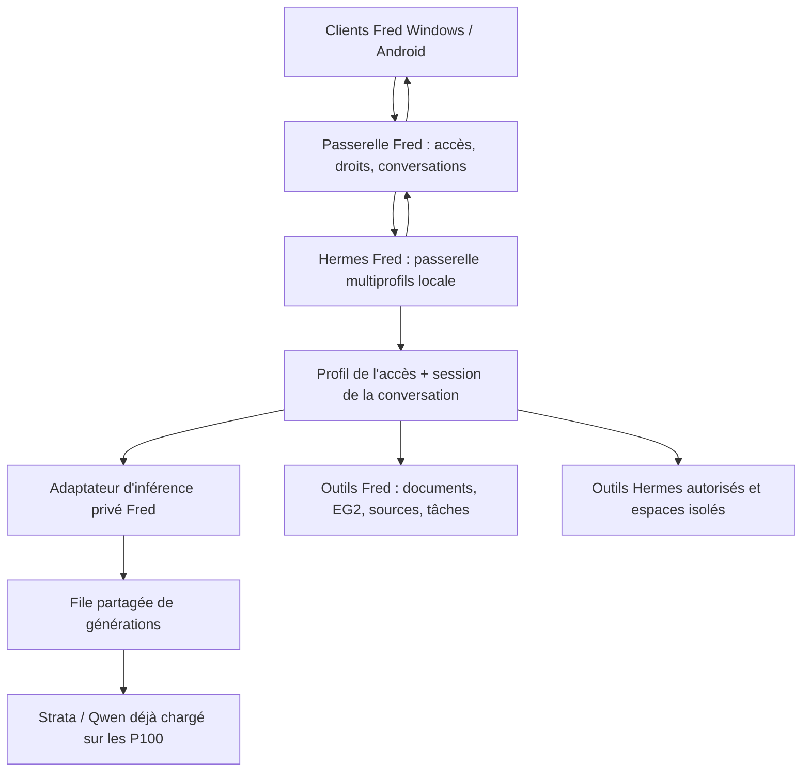

# Intégration de Hermes dans les conversations Fred

Date : 11 octobre 2026. Statut : **intégration implantée, validée et en service**. Windows 3.5.22 et Android 1.0.6/code 7 sont publiés. Le fonctionnement livré est décrit dans [HERMES-FRED.md](lanceur/HERMES-FRED.md), avec projets natifs associés et outils système désactivés en l’absence d’un environnement d’exécution isolé.

## Résultat demandé

Chaque conversation des clients Windows et Android doit être traitée par Hermes sur le serveur. Hermes utilise le Qwen déjà chargé et choisit les outils nécessaires. À la création d’un client dans la console Fred, son profil Hermes est créé automatiquement, sans opération supplémentaire pour le destinataire.

Une conversation simple passe également par Hermes ; celui-ci peut répondre sans appeler d’outil. Le mode agent devient le parcours normal de tous les clients compatibles après la migration. Le développement commence sur des profils de test, puis un accès pilote, avant la généralisation.

Le présent document conserve le plan initial. Le [rapport de validation](preuves/hermes-fred/VALIDATION.md) rassemble les essais effectifs avec Hermes natif et le modèle local, ainsi que les contrôles de livraison.

## 1. Existant vérifié

| Élément | Constat | Conséquence |
| --- | --- | --- |
| Installation Hermes | `C:\Users\karen\AppData\Local\hermes\bin\hermes.exe` ; sources dans `hermes-agent` au même emplacement | Réutiliser l’installation disponible ; ne pas réinstaller Hermes pour chaque client |
| Version des sources examinées | Commit `1cb26bf248e150f715ce8a487fdef2a2bef6b541`, décrit comme `v0.21.4+canary.20261003T070620Z-229-g1cb26bf248` | Enregistrer cette référence ; vérifier les capacités du processus effectivement lancé avant intégration et après mise à jour |
| Usage actuel de Hermes | Application Desktop et backend local présents ; le registre observé ne liste que `default` | Préserver cet espace personnel et ses conversations ; créer un espace de données dédié à Fred |
| Capacités dans les sources installées | Profils, passerelle multiprofils, API par `/p/<profil>/`, sessions, runs, événements, arrêt, approbations et création idempotente de runs | Utiliser ces contrats natifs derrière une adaptation Fred |
| Création d’accès Fred | `AccessStore.issue()` est utilisé par la fabrication Windows et la création de profils Android | Brancher le provisionnement sur le cycle commun, avec état persistant et reprise après panne |
| Identité Fred | Les documents, historiques et droits sont attachés à l’identifiant d’accès. Le champ administratif `owner` est un libellé | Ne pas fusionner les espaces de deux clients parce qu’ils portent le même nom de propriétaire |
| Conversations clientes | `chat.html` envoie messages, projet/document et identifiant de demande ; `workspaceFields()` n’envoie pas encore l’identifiant de conversation | Ajouter un identifiant stable de conversation au contrat Windows/Android |
| Traitement actuel | `remote.py` transmet le chat directement à Strata ; son générateur de tâches fait de même | Remplacer les deux parcours par Hermes pour les traitements conversationnels et les tâches rédactionnelles liées |
| Appels d’outils | La validation Fred accepte déjà `tools`, `tool_choice` et les messages `tool` ; `strata_mcp` est forcé à `False` | Base de compatibilité disponible, mais boucle complète Hermes/Qwen à tester ; ne pas activer les outils hôte Strata |
| File actuelle | `scheduler.py` sérialise les générations et limite les demandes d’un accès | Séparer la durée d’un run agent de la réservation du modèle |
| Mémoire documentaire | Workspace, FTS5, EG2 CPU, sources contrôlées et données par accès | Les conserver et les présenter à Hermes comme outils Fred |
| Livraison | Windows et Android utilisent la passerelle Fred et leurs mécanismes de mise à jour existants | Garder les transports, signatures et profils ; publier des clients compatibles avec les sessions Hermes |

Sources locales examinées : `lanceur/app.py`, `remote.py`, `wireguard_access.py`, `scheduler.py`, `workspace.py`, `knowledge.py`, `client_storage.py`, `backups.py`, `restoration.py`, `client-qwen/chat.html`, `workspace.html`, `client.py`, les transports Android et les sources/docs Hermes installées.

Les documents officiels confirment les [profils indépendants](https://hermes-agent.nousresearch.com/docs/user-guide/profiles/), la [passerelle multiprofils](https://hermes-agent.nousresearch.com/docs/user-guide/multi-profile-gateways) et les [API de sessions et de runs](https://hermes-agent.nousresearch.com/docs/user-guide/features/api-server/). Les détails du plan seront validés sur la version installée, car ces interfaces évoluent.

## 2. Architecture retenue

Fred reste responsable de l’authentification, des droits, de la synchronisation cliente et de la distribution des mises à jour. Hermes gère les sessions de l’agent, ses étapes de raisonnement et ses outils. Strata fournit l’inférence.

### Installation et exploitation

- Réutiliser les binaires/runtime Hermes installés, avec un lancement dont les arguments sont explicites.
- Définir pour ce processus un `HERMES_HOME` dédié, proposé : `D:\Serveur IA\lanceur\hermes-fred`. L’installation examinée sait résoudre une racine personnalisée ; le lancement réel, les helpers et les outils seront validés au lot 0.
- Ne pas cloner le profil personnel `default`, ses secrets, ses souvenirs ou ses abonnements. Créer une configuration Fred minimale et explicite ; sélectionner les compétences utiles.
- Une passerelle multiprofils Fred, liée à `127.0.0.1`, sur un port disponible réservé. Son profil par défaut est technique ; aucune conversation cliente ne lui est attribuée.
- Les clés Hermes restent sur le serveur. Les clients continuent d’utiliser leurs accès Fred via HTTPS ou WireGuard. Aucun accès public direct à l’API Hermes.
- Un superviseur Fred gère ce processus et ses seuls enfants identifiés, vérifie disponibilité/capacités et redémarre avec temporisation. Une panne Hermes ne décharge pas le modèle.
- Premier déploiement sous la session Windows existante. Le démarrage avant ouverture de session serait un travail distinct, avec traitement des secrets DPAPI.
- Version validée enregistrée, sans mise à niveau automatique en production. Une modification de l’installation partagée déclenche une vérification de compatibilité avant réactivation des conversations.

### Identité et séparation

La règle de première livraison est **un accès client Fred = un profil Hermes**, nommé `fred-<identifiant-acces>` ; cet identifiant est stable et généré côté serveur. Le nom affiché peut changer sans déplacer le profil.

Le même accès importé dans plusieurs appareils retrouve le même profil. Deux accès différents restent séparés, y compris si le libellé « propriétaire » est identique. Un véritable compte personnel regroupant plusieurs accès demanderait une table d’identité et une migration explicite ; cette fusion ne fait pas partie de la première livraison.

Chaque conversation possède sa propre session Hermes. La mémoire générale du profil contient les préférences utiles du compte ; les contenus de projets restent soumis aux droits et au périmètre documentaire Fred. Un profil n’autorise pas à rechercher automatiquement dans tous les projets.

## 3. Création automatique du profil

Ajouter un service commun de provisionnement utilisé par les créations Windows, Android et le remplacement d’un appareil. Ne pas ajouter trois implémentations indépendantes aux boutons de la console.

Séquence cible :

1. Valider le nom, la plateforme, la disponibilité du générateur et les limites existantes.
2. Réserver l’identifiant Fred et enregistrer un état `provisioning`, refusé par l’authentification cliente tant que l’ensemble n’est pas prêt.
3. Créer le profil Hermes vierge, une clé API propre au profil, sa configuration Qwen locale et son espace d’outils autorisés. Les commandes utilisent des arguments structurés, jamais le nom fourni comme commande shell.
4. Enregistrer le lien accès/profil, la version de configuration et un journal des étapes ; réessayer une étape ne crée ni deuxième profil ni nouvelle clé.
5. Générer le pair et le livrable personnel Windows ou Android avec les mécanismes existants. Préserver les signatures et le stockage protégé des profils.
6. Vérifier que la passerelle sert le profil et que ses API de sessions/runs répondent avec sa propre clé. Le contrôle ne doit pas lancer une réponse au modèle.
7. Activer l’accès et rendre le téléchargement disponible uniquement quand toutes les étapes ont réussi.

Une erreur laisse une fiche récupérable « Création incomplète » avec reprise depuis la console. Un accès incomplet ne reçoit ni conversation ni pair actif exploitable. Les compensations ciblent uniquement les ressources créées par cette opération ; ne pas supprimer un profil antérieur réutilisable. Les verrous des accès/WireGuard ne doivent pas rester pris pendant le lancement d’un sous-processus ou une attente réseau.

Renommer conserve l’identité et les sessions. Suspendre, expirer ou révoquer interdit immédiatement les nouvelles demandes, arrête les runs concernés et ferme leurs outils. L’archivage conserve les données et désactive les éventuels travaux programmés. Le remplacement suit la règle Fred actuelle : nouvel accès/profil distinct, ancien accès archivé, sans réutilisation implicite de ses secrets ou données.

Les accès existants autorisés sont provisionnés par migration idempotente, avec aperçu et rapport. Les accès révoqués/archivés ne sont pas réactivés. Un échec sur un accès n’empêche pas la préparation des autres.

## 4. Une conversation Fred devient une session Hermes

### Contrat et stockage

Créer des tables versionnées dans un stockage d’intégration SQLite privé :

- `bindings` : accès Fred, profil Hermes, état, version de configuration, référence protégée du secret et dernière erreur bornée.
- `conversations` : accès, UUID Fred, session Hermes, génération de restauration, branche/version de contexte et état de migration.
- `runs` : identifiant de demande Fred, conversation, run Hermes, état, séquence reçue, résultat final et référence des sources.
- `provisioning` : opération, étapes acquises, ressources créées et statut de reprise.

Les contraintes d’unicité empêchent plusieurs profils pour un accès ou plusieurs runs pour le même envoi. Toutes les recherches de sessions, runs, fichiers et approbations sont faites sous l’identité authentifiée Fred ; aucune identité ou clé fournie dans le corps client ne la remplace.

Ajouter `conversation_id`, un identifiant de tour/envoi et la révision de conversation au contrat client. Conserver `X-Qwen-Request` pour l’annulation et la corrélation. Les identifiants Hermes restent des détails serveur ; le client ne choisit ni le profil, ni la destination réseau, ni le fournisseur du modèle.

### Parcours d’un tour

1. Fred authentifie l’accès, vérifie provisionnement, conversation, révision, projet/document et disponibilité de Hermes/Qwen.
2. Lors de la première continuation d’une conversation existante, importer une seule fois l’historique visible validé dans une session Hermes. Utiliser les API officielles de sessions/runs et le champ initial `conversation_history`, après essai de la combinaison exacte au lot 0. Ne jamais modifier directement une base SQLite Hermes en cours d’utilisation.
3. Pour les tours suivants, envoyer le nouveau message et les pièces jointes normalisées ; Hermes recharge son historique complet, comprenant les appels d’outils. Ne pas réinjecter à chaque tour une copie cliente qui supprimerait cet historique interne.
4. Créer un run via `/p/<profil>/v1/runs` avec une clé d’idempotence dérivée de l’envoi validé ; persister le `run_id` et suivre ses événements.
5. Fred convertit les événements en flux compatible avec les clients : progression, attente du modèle, texte/réflexion selon les réglages, sources, décision demandée et état final. Ne jamais confondre un commentaire intermédiaire avec la réponse finale.
6. Enregistrer le résultat final une seule fois côté Fred avant de le livrer. Projeter les messages visibles vers l’historique synchronisé, puis vers les copies locales chiffrées.

Le transcript d’exécution, les résultats d’outils et les compressions appartiennent à Hermes. Les messages visibles, titres, classement, projets, révisions et sources restent dans Fred. Le stockage et la synchronisation doivent reconnaître les tours serveur : une sauvegarde locale ancienne ne peut pas écraser une réponse finalisée ou dupliquer un message. Réconcilier avant envoi et à la reconnexion.

Une nouvelle conversation crée une nouvelle session. Renommer/archiver conserve sa session. Supprimer applique une politique explicite à la session, ses fichiers et la mémoire issue de cette conversation ; le mécanisme d’annulation de suppression Fred doit rester possible. Importer donne une nouvelle identité et ne déclenche pas les actions mentionnées dans l’historique. Une réponse relancée, une modification de l’historique ou un changement de périmètre nécessitant un autre contexte crée une branche contrôlée plutôt qu’une mutation silencieuse du passé.

Les projets et documents sont présentés comme contexte autorisé pour le tour ou comme résultats d’outils, avec origine identifiable. Leur contenu est traité comme donnée, y compris lorsqu’il contient des instructions. Garder le socle système stable dans une session et éviter de réinjecter tout le contexte documentaire comme nouvelles instructions système à chaque tour.

### Reconnexion, arrêt et approbations

- Déconnexion réseau pendant un tour interactif : arrêter par défaut le run et ses travaux enfants ; une tâche explicitement lancée en arrière-plan conserve son contrat persistant. Une perte réseau ambiguë se résout d’abord par consultation de l’état, sans rejouer la création.
- Reconnexion : lire les états/résultats persistés Fred et l’état Hermes. Les buffers d’événements et la conservation des runs Hermes sont bornés ; ne pas en faire l’unique archive de la réponse.
- « Arrêter » appelle le stop du run et annule ses générations en file, outils et enfants. Afficher « Arrêt en cours » jusqu’à confirmation ; ne pas prétendre qu’un travail est terminé pendant qu’il continue.
- Une suspension/révocation est recontrôlée avant chaque appel au modèle, outil, décision et livraison privée ; empêcher les travaux différés de contourner cette décision.
- Une approbation est liée à accès + run + action + expiration. Présenter l’effet concret, puis envoyer une décision ponctuelle. Refus et expiration empêchent l’action ; aucune autorisation globale accordée depuis un texte du modèle.
- Après arrêt/redémarrage du serveur, un run interrompu n’est pas rejoué automatiquement, surtout s’il a déjà produit un effet externe.

## 5. Qwen partagé et file d’attente

Créer un adaptateur d’inférence local privé, distinct de la route publique de chat. Hermes utilise cet adaptateur comme fournisseur OpenAI compatible ; celui-ci appelle uniquement le moteur Strata détecté par Fred, avec la clé amont existante.

**Séparer deux niveaux** : admission et suivi des runs agents, puis file des appels au modèle. La passerelle ne doit pas réserver la file GPU pendant qu’elle attend Hermes : cela empêcherait Hermes d’obtenir son propre tour d’inférence. Elle ne doit pas non plus pointer Hermes vers sa propre route de chat, ce qui créerait une boucle Fred → Hermes → Fred → Hermes.

- Jeton de fournisseur privé par profil, lié à l’accès/run effectif et distinct de la clé API cliente. Authentification obligatoire même sur loopback ; aucune confiance dans un simple en-tête d’identité.
- Une réservation GPU par appel Qwen ; libération entre les appels, notamment pendant navigateur, recherche documentaire, attente de confirmation et calcul CPU.
- Conserver les règles d’équité, les priorités interactives/tâches, la révocation et les limites de file. Adapter le refus actuel « une demande par owner » pour qu’un run et ses appels successifs ne se bloquent pas eux-mêmes.
- Commencer avec un run interactif par accès, une génération à la fois sur le moteur actuel, une file d’appels bornée et une faible limite globale de runs. Mesurer avant d’augmenter ; la multiplication des profils n’ajoute pas de capacité GPU.
- Limiter durée, tours d’outils, tentatives et tokens par run. L’adaptateur privé respecte les plafonds convenus ; ne pas y reprendre le `max_tokens=-1` forcé par la route actuelle.
- Acheminer compression et appels auxiliaires vers le même fournisseur local, avec comptabilisation. Désactiver routage automatique vers d’autres modèles/fournisseurs et replis cloud non configurés pour Fred.
- Les overrides client `provider`, destinations, clés, outils et réglages privilégiés sont ignorés ou refusés ; niveaux de réflexion et paramètres autorisés sont traduits par Fred.
- Conserver les outils hôte Strata désactivés : Hermes est l’unique orchestrateur des outils conversationnels.
- `/v1/context` reste un comptage sans génération. Afficher la capacité/contexte réellement utilisé par Hermes, avec estimation clairement indiquée tant que le prompt complet n’est pas comptable.

Le plafond `agent.max_turns` installé est élevé par défaut ; prévoir une valeur Fred bornée adaptée au pilote. Désactiver initialement la délégation autonome, les boucles et cron génériques. Les activer seulement lorsque budget global, annulation, droits et livraison des résultats enfants ont été validés.

## 6. Outils et mémoire

### Première livraison

Fournir un connecteur MCP ou plugin externe Fred, maintenu dans ce dépôt, plutôt qu’une modification permanente des sources Hermes. Choisir le transport après essai : il doit porter un contexte de run vérifiable et un périmètre projet/document imposé côté serveur, même avec plusieurs conversations d’un profil.

| Capacité | Mise en œuvre prévue | Contrôle |
| --- | --- | --- |
| Recherche documentaire/mémoire | Réutiliser Knowledge, EG2 et FTS5 | Accès et périmètre projet vérifiés à chaque recherche |
| Consultation et citation | `source_get` et références Fred existantes | Passage/version contrôlés ; sources structurées accessibles au client |
| Recherche web et pages | Backend déjà disponible ou backend Hermes configuré explicitement | Limites, URL publiques et refus des destinations privées/administratives |
| Calcul et fichiers produits | Outils Hermes dans un environnement propre au compte | Volumes, durée, processus, réseau et répertoires bornés ; téléchargement par identifiant opaque |
| Documents/projets/tâches | Opérations Workspace existantes, puis écritures autorisées | Droits existants ; décision ponctuelle lorsque l’effet le demande |
| Mémoire de préférences/compétences | Profil Hermes dédié | Aucun secret mémorisé ; édition/suppression visibles depuis Fred |

La recherche EG2 reste la source des connaissances documentaires. Hermes complète avec des préférences et procédures utiles. Éviter de copier tous les documents/historiques dans sa mémoire globale, de partager une mémoire personnelle entre profils ou d’ajouter un fournisseur mémoire externe sans configuration explicite.

Le terminal et le navigateur ne sont activés pour les clients qu’après validation de l’isolation réelle. Sur ce poste, `wsl.exe` est présent ; Docker n’a pas été trouvé sur le PATH lors de l’inventaire. Cela ne prouve ni une distribution WSL prête ni un environnement isolé disponible. Le lot 0 détermine le backend supporté ; s’il n’est pas prêt, livrer d’abord les outils de recherche et Workspace, puis activer calcul/navigation après son installation et sa validation.

Les profils Hermes séparent l’état applicatif, mais des outils exécutés sous le même compte Windows peuvent accéder aux fichiers du serveur. Imposer une isolation système pour l’exécution arbitraire ; un simple `terminal.cwd` ne suffit pas. Le répertoire personnel Hermes et la console serveur ne sont jamais montés dans l’espace d’un client.

Les fichiers générés sont publiés via Fred avec contrôle d’accès, taille et durée de conservation. Les PDF/DOCX et autres fichiers entrants continuent d’être extraits/indexés via Fred : l’API Hermes examinée ne prend pas en charge les téléversements de documents génériques. Les images gardent leurs vérifications de capacité Qwen.

## 7. Clients et console

Conserver l’application et les parcours existants. Ajouter les informations utiles : « Recherche dans vos documents », « Recherche web », « Calcul en cours », attente du modèle et éventuelle action à confirmer. Ne pas publier les secrets, chemins internes, commandes brutes ou arguments complets des outils dans le flux de progression.

Windows et Android doivent gérer identités de conversation/tour, états d’arrêt, reprise d’un résultat, approbations, sources et fichiers produits. Les appels d’outils sont exécutés côté Hermes ; le client n’exécute pas une seconde fois un appel reçu.

La conversation vocale Windows passe par le même envoi de chat. La synthèse vocale lit la réponse finale, pas les commentaires et résultats d’outils. La dictée/TTS restent leurs services existants. Le correcteur et les tâches qui génèrent des réponses passent également par l’adaptateur Hermes, avec sessions et outils adaptés à leur fonction. Inventorier les entrées API locales Windows afin qu’aucune route de génération conversationnelle ne conserve un accès direct involontaire à Qwen.

Dans « Clients & accès », ajouter état du profil, préparation/reprise, disponibilité et diagnostic borné. Le tableau de bord distingue runs actifs, outils, générations Qwen et attente de décision. Les notifications existantes reçoivent les résultats des tâches persistantes. Le redémarrage d’un service ne doit pas produire une avalanche d’alertes identiques.

Les clients actuels n’envoient pas l’identité stable requise. Publier des versions signées compatibles, détecter leur capacité de protocole et ne basculer un accès qu’après cette vérification. Après généralisation, un ancien client reçoit une demande de mise à jour explicite ; aucune réponse directe Qwen silencieuse ne remplace le parcours Hermes.

## 8. Sauvegarde, migration et retour

- Étendre les archives Fred au registre d’intégration, profils dédiés, sessions/outils utiles, préférences/compétences, fichiers retenus et secrets chiffrés. Ne pas inclure le profil Hermes personnel, les runtimes installés ou les caches volumineux.
- Utiliser des instantanés SQLite cohérents et coordonner les mutations de mémoire/fichiers ; ne pas copier naïvement des bases ouvertes sans leurs transactions. Tester une restauration dans une racine isolée.
- Garder les chemins et références restaurables sur une autre machine. Renouveler les secrets de service lorsque nécessaire ; préserver les signatures clientes et les identités/documents Fred.
- Une restauration invalide les runs/approbations de l’ancien état et applique la génération de synchronisation Fred ; elle ne réactive pas un accès révoqué et ne rejoue pas une action passée.
- Sauvegarde et état de référence avant chaque migration. Import des historiques à la première continuation, sans génération en masse ni exécution d’actions pendant la migration.
- Drapeau d’exploitation par accès pendant le pilote, puis mode Hermes généralisé. Un retour à l’ancien moteur est une action administrative explicite : conserver les profils, transcripts et résultats Hermes, signaler le changement, et maintenir les historiques visibles compatibles.
- Une panne Hermes en mode généralisé produit une erreur explicite et récupérable ; aucun basculement automatique vers Qwen direct ou un fournisseur cloud.

## 9. Lots, livrables et validations

| Lot | Travail | Condition de sortie |
| --- | --- | --- |
| H0 — compatibilité réelle | Racine Hermes Fred de test, API/capacités, profil A/B, modèle local, import/reprise de session, outil minimal, isolement disponible | Réponse Qwen avec outil puis continuation correcte ; aucune mémoire/clé A utilisée par B ; données personnelles Hermes intactes ; décisions de transport et sandbox consignées |
| H1 — service et provisionnement | Supervision, registre versionné, secrets, création Windows/Android commune, reprise, suspension/révocation | Création d’accès fournit exactement un profil ; erreurs/restart ne laissent aucun accès exploitable incomplet ; aucun client réel modifié pendant les essais |
| H2 — conversations et modèle | Sessions/runs persistants, adaptateur privé, files distinctes, SSE compatible, arrêt et idempotence | Deux clients conversent via Hermes ; un outil libère la file GPU ; doublon réseau n’exécute qu’un run ; continuation garde le résultat des outils |
| H3 — outils Fred et décisions | EG2/documents/sources, mémoire, outils configurés, actions et téléchargements ; sandbox avant exécution arbitraire | Sources fidèles ; refus d’accès croisé ; action refusée/expirée sans effet ; arrêt/révocation bloque les enfants et outils |
| H4 — interface et continuité | Clients Windows/Android, correcteur, tâches, voix Windows, copies locales, versions/capacités | Essais Windows et Android téléphone/tablette ; archivage/import/suppression/conflits/historique et conversation vocale préservés |
| H5 — récupération et exploitation | Sauvegarde/restauration, diagnostic, incidents, limites, charge, version Hermes | Restauration isolée complète ; modèle non déchargé par redémarrage Hermes ; aucune reprise d’action après incident ; mesures qualité/latence disponibles |
| H6 — livraison | Accès pilote, observation, migration des autres accès autorisés, EXE/APK signés et publication | Tous les clients compatibles utilisent Hermes ; profils créés automatiquement ; rapport final et procédure de retour vérifiés |

Ordre : **H0 → H1 → H2 → H3 → H4 → H5 → H6**. H0 est un véritable essai d’intégration, pas une installation supplémentaire dans l’espace personnel. Le pilote ne dispense pas de la généralisation demandée une fois les critères atteints.

### Essais obligatoires

1. Création Windows/Android, noms identiques, panne à chaque étape, redémarrage et reprise sans duplication.
2. Profil A → B → A : mémoire, sessions, fichiers, secrets, droits, événements et approbations isolés. Même conversation UUID sous deux accès sans collision.
3. Conversation ancienne reprise, tours successifs avec outils, nouvelle session, import, branche, compression, changement de projet et conservation des sources.
4. Envoi répété, réponse finale reçue après coupure, fermeture client, SSE vide/long outil, débit interrompu, erreur Qwen et redémarrage Hermes.
5. Annulation, suspension, expiration et révocation pendant attente GPU, outil, confirmation, sous-travail et livraison ; accès des autres clients maintenu.
6. Documents contenant des instructions hostiles, tentative d’accès à un autre projet, URL privée, chemin traversant, fichier trop gros, outil non autorisé et override fournisseur/modèle.
7. Sauvegarde/restauration des profils et mapping, bases ouvertes, secret indisponible, disque plein, anciennes archives et registre de révocation récent.
8. Charge avec plusieurs profils et tâches : attente, temps avant premier texte, temps total, nombre d’appels/outils, tokens et consommation CPU/RAM/GPU. Distinguer génération et temps passé dans les outils.
9. Jeu de questions de référence : conversation simple, document avec citation, recherche web, calcul vérifiable, tâche rédactionnelle et réponse hors projet. Comparer au fonctionnement Fred actuel sans promettre un gain de vitesse.
10. Production pilote : preuve que chaque réponse passe effectivement par le profil/run Hermes attendu et que les nouveaux clients sont provisionnés automatiquement ; traces sans contenu privé ni secrets.

## 10. Fichiers à créer ou adapter

Les noms nouveaux ci-dessous sont proposés ; leurs responsabilités doivent rester séparées, sans dupliquer les services existants.

| Zone | Changements |
| --- | --- |
| `lanceur/hermes_service.py` | Découverte/version, lancement isolé, supervision, capacités et client HTTP local |
| `lanceur/hermes_accounts.py` | Provisionnement, lien accès/profil, configuration maîtrisée, secrets et reprise |
| `lanceur/hermes_conversations.py` | Sessions, runs, idempotence, projection vers historique Fred et arrêt |
| `lanceur/hermes_inference.py` | Fournisseur privé OpenAI compatible, owner/run vérifiés et file GPU |
| `lanceur/hermes_tools.py`, `hermes_projects.py` | Connecteur Workspace/EG2, périmètre du run et projets natifs |
| `lanceur/remote.py`, `wireguard_access.py`, `app.py` | Création commune, bascule du chat/générateur, API cliente bornée et console |
| `lanceur/scheduler.py`, `workspace.py`, `client_storage.py` | Séparation des files, contexte/outils, réconciliation de l’historique |
| `lanceur/backups.py`, `restoration.py`, `operations.py` | Données Hermes gérées, cohérence, récupération et cycle de service |
| `client-qwen/chat.html`, `workspace.html`, `client.py`, `voice.js` | Identité de conversation/tour, progression/confirmation, compatibilité et voix |
| `client-android/mobile-ui/`, transports Java, générateur d’assets | Même contrat de conversation et actions, publication APK conservant les données |
| `lanceur/web/` | États Hermes et reprise de création dans la gestion des clients |
| Tests et `preuves/hermes-fred/` | Validation isolée, intégration native et navigateur, références de versions, preuves de livraison |

Les sources Hermes installées restent une dépendance : favoriser leur API et un connecteur externe. Si H0 révèle un défaut bloquant, le documenter avec reproduction avant de décider d’un correctif versionné ; ne pas construire le plan sur un patch local non suivi.

## 11. Critère final d’achèvement

L’intégration est achevée quand un client créé dans la console obtient automatiquement un profil Hermes prêt, que Windows et Android associent chaque conversation à sa session, que toutes les générations conversationnelles passent par Hermes utilisant Qwen local, et que outils, données, annulation, sauvegarde et restauration restent contrôlés par les droits Fred. La livraison inclut les clients signés, les preuves et une procédure de récupération.

Les essais natifs H0 à H6 ont été effectués sur des profils synthétiques et une racine séparée. La livraison conserve le modèle chargé, les comptes existants et leurs clés. Les outils système libres restent désactivés ; leur ouverture demande un environnement d’exécution isolé par compte.
