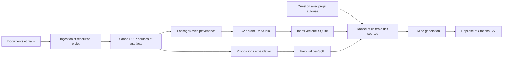

# Architecture globale — EG2

Agent est le projet unique, servi sur 127.0.0.1:8001 : FastAPI, React/Jinja,
Brain et ERP avec leurs bases canoniques. XPilot externe reste sur 8000.

La mémoire est une projection reconstructible. Les classifications et validations
appartiennent aux bases canoniques ; aucune similarité ne les change. Les contrôles
d’accès et de projet précèdent le rappel, puis les sources sont revérifiées dans le
canon. Les sources ambiguës et les artefacts remplacés sont exclus.

`KnowledgeMemoryPort` expose indexation, rappel, purge, reconstruction et santé.
Le moteur de production est `EG2MemoryAdapter`. L’adaptateur SQL est réservé aux
tests isolés ; les réglages de production offrent uniquement EG2.

Indexation : calcul de vecteurs EG2, sans LLM. Réponse : LLM configuré dans Agent,
avec références numérotées produites par le serveur. L’index persiste dans
`storage/eg2/index.db`. Les files de reprise et l’enrichissement métier des mails
restent distincts ; ce dernier utilise toujours le LLM pour proposer des faits.

Voir [moteur](20_EG2_ENGINE.md), [exploitation](../README_BACKEND.md) et
[modèle de domaine](02_DOMAIN_MODEL.md).
