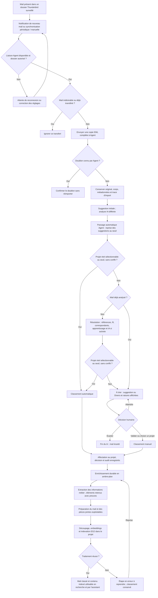

# Tri des mails — classement automatique au seuil configuré

## Reprise des suggestions déjà analysées — 4 novembre 2026

Le passage automatique reprend désormais les propositions de classement
existantes avant le scan et l'analyse des nouveaux mails. Le tri non forcé
ignore volontairement les mails déjà analysés : ce filtre pouvait laisser
des suggestions au-dessus du seuil en attente, notamment après un changement
de seuil ou une reprise ancienne. `auto_classify_pending()` applique le seuil
enregistré (75 % par défaut), sans relancer le LLM, via le classement canonique
et son audit ; extraction et indexation restent différées.

La reprise utilise le verrou de tri et est différée si une analyse durable
est active. Les sources classées/écartées, les propositions concurrentes,
les égalités et les candidats non sélectionnables restent protégés. Elle se
fait à chaque passage automatique lorsque celui-ci est activé, selon son
intervalle configuré ; elle ne dépend pas de l'ouverture de l'écran Mails.
`GET /v1/ingest/auto-status` expose les compteurs et erreurs de reprise dans
`last_result.auto_classification`. Tests de non-régression :
`tests/test_mail_threshold.py` (anciens mails déjà analysés, baisse du seuil,
idempotence, décisions humaines, conflits et scores insuffisants).

Vérification de cette correction : 49 tests ciblés réussis, puis 10 tests
du seuil rejoués après finalisation ; Ruff conforme. La suite Python globale
a été interrompue après plusieurs échecs : elle n'est pas annoncée conforme.
Après sauvegarde `backups/before-mail-reconciliation-20261104-130214.db`
et redémarrage d'Agent 8001, le premier passage a classé une suggestion à
0,89 au seuil 0,75, sans erreur ; compteurs pending et queued à zéro,
santé Brain/ERP OK. Aucun commit ni push pour cette correction.

## Parcours Thunderbird jusqu'à la recherche — 4 novembre 2026



Le seuil vaut 75 % par défaut. Un score élevé ne suffit pas si les projets
restent contradictoires ou non sélectionnables. L'import Thunderbird est
différé : le mail peut apparaître temporairement en attente avant le passage
Agent. Celui-ci analyse au plus 20 nouveaux mails par passage. La liaison
transfère au plus 100 mails par passage ; la suite attend un passage suivant.
Les deux cycles utilisent l'intervalle configuré (5 minutes par défaut).
Les pièces jointes non exploitables gardent un état explicite ; leur présence
ne garantit pas que leur contenu ait été indexé. Une panne d'extraction peut
également interrompre l'enrichissement avant son étape d'indexation.

## État de référence — 11 octobre 2026

Le classement automatique utilise le seuil configurable
`mail.auto_classification_threshold`, 0,75 par défaut. Seul un candidat unique
éligible au seuil est classé automatiquement ; les égalités, références
contradictoires et décisions humaines restent protégées. Les anciennes règles
de validation systématique ou de seuil à 100 % ci-dessous décrivent les étapes
datées et sont remplacées par cette politique.

Les sources classées sont projetées dans l’index EG2. Un mail écarté ou déplacé
est exclu du rappel par vérification canonique même avant la purge effective
de ses anciens passages. Les reprises durables et les originaux sont conservés.
Voir [moteur EG2](20_EG2_ENGINE.md) et [contexte courant](../PROJECT_CONTEXT.md).

## Historique de conception et de qualification


**Tri automatique des mails actif sur Agent 8001 — 7 octobre 2026.** À la demande de l’utilisateur, les suggestions de projet dont la confiance vaut exactement 1.0 sont classées automatiquement, avec décision et audit explicites, indexation/extraction durables. Les autres suggestions restent à valider et leur projet est présélectionné dans le menu ; un choix manuel reste conservé lors des rafraîchissements. Les scores inférieurs à 1.0 ne sont pas arrondis à 100 %. Les sources déjà classées ou écartées et les suggestions contradictoires restent inchangées. Reprise des suggestions existantes : `python -m scripts.auto_classify_mail --apply`, avec sauvegarde SQLite préalable. Cette règle remplace l’ancienne validation humaine systématique du classement ; les informations métier extraites restent à valider.

Validation : 1698 tests Python réussis / 1 ignoré, 458 React, Ruff, TypeScript et build conformes. Recette navigateur sur données fictives puis contrôle de la version active sans erreur console. Après sauvegarde, 207 suggestions existantes à 100 % classées ; 109 sources déjà traitées, toutes les décisions antérieures et le contenu des mails conservés. Aucun commit/push. Preuve : `.ui-preview/mail-auto100/delivery.json`.

## État historique — 2 octobre 2026, Agent 0.3.0

Tous les classements nécessitent une décision humaine ; la file est paginée et les mails classés sont consultables/reclassables. Confirmation répétée neutre ; ancien canon dérivé invalidé, anciennes projections à purger, historique conservé. Scan et tri avancent au-delà des doublons et entrées déjà triées.

Références actuelles : [contexte](../PROJECT_CONTEXT.md), [exploitation](../README_BACKEND.md), [corrections et preuves](19_AUDIT_REMEDIATION.md). Les sections de conception ci-dessous doivent être lues avec cet état.

## Correction des références explicites — 5 octobre 2026

Les références projet dans l’objet ou le corps alimentent la suggestion dès
l’import, avec le projet reconnu et une confiance d’au moins 90 %. Les préfixes
de commande avec tiret n’empêchent plus la détection. Un alias alphanumérique
déclaré est traité comme une référence explicite ; les indices IA ne prennent
pas la priorité sur cette référence. La décision reste humaine.

`python -m scripts.refresh_mail_references` produit un audit des reprises possibles ;
`--apply` sauvegarde la base puis remplace les seules suggestions en attente
incorrectes pour lesquelles un unique projet est explicitement référencé.
Aucun mail validé/écarté n’est modifié, aucune ligne n’est supprimée, les anciennes
propositions sont conservées comme `superseded` avec un événement d’audit.
Tests : `tests/test_resolution.py` et `tests/test_mail_reference_refresh.py`.

Reprise locale vérifiée le 5 octobre : 219 suggestions corrigées, dont 99 vers
`AIRB25LTH0806-A`, après sauvegarde SQLite. Huit mails citant plusieurs projets
ont été laissés en revue. Comparaison avec la sauvegarde : les 71 sources déjà
résolues/écartées et les 590 propositions acceptées/rejetées sont inchangées.
La suggestion d’un mail réel `Demande de prix AIRB25LTH0806-A` est vérifiée
par l’API à 0.9 après redémarrage sur 8001. Suite : 112 tests réussis,
1 ignoré ; Ruff conforme. Une seconde reprise ne propose aucune modification.

## Principe

### Classement multicritère évolutif — 5 octobre 2026

Le profil de chaque projet apprend des mails déjà classés par l’humain et des
connaissances validées. L’adresse exacte de l’expéditeur, sa fréquence et sa
répartition entre projets sont croisées avec les destinataires spécifiques,
contacts déclarés, domaine, fil MIME, objet, vocabulaire et noms des pièces
jointes. Les contacts partagés sont affaiblis et nécessitent d’autres indices.
Les reclassements et exclusions sont pris en compte au prochain import/lot.
Les suggestions non validées ne sont jamais des exemples d’apprentissage.

« Pourquoi ce projet ? » expose les éléments utilisés et les alternatives.
Une référence d’objet prime sur le texte cité ; les références contradictoires
et les candidats contextuels trop proches restent en revue. Le seuil 0.75 et
une marge contextuelle de 0.12 protègent le choix. Le profil évolue localement,
sans réentraîner le LLM. Voir `05_PROJECT_RESOLUTION.md` pour les poids.

`GET /v1/triage/learning` décrit les profils (pont ERP sous `/api/v1/brain`).
La reprise sauvegardée peut intégrer ces critères via
`python -m scripts.refresh_mail_references --learned --apply`, sans LLM et sans
modification des décisions humaines. Les anciennes propositions restent conservées.

Reprise multicritère vérifiée le 5 octobre : 302 suggestions remises à jour,
dont 72 nouvelles orientations et 230 enrichissements. Les 20 sources du lot
automatique en cours ont été exclues de la maintenance ; la seconde passe hors
lot actif est neutre. Sauvegarde `backups/before-mail-learning-20261005-135229-902462.db`.
Les 71 sources résolues/écartées et 626 propositions acceptées/rejetées sont
inchangées. L’API expose 9 profils et 60 mails validés distincts ; une proposition
sans code explicite est vérifiée à 0.89 avec expéditeur, destinataires et vocabulaire.
La recherche paginée `/v1/mail/page` fournit les mêmes indices et candidats que
la file historique `/v1/triage/queue`, pour les explications de la nouvelle UI.

### Source des mails — 5 octobre 2026

Réglages → Mails sélectionne **Thunderbird** ou **Dossier de fichiers EML**.
La liaison locale transfère directement les messages des dossiers cochés,
sans exports `.eml` manuels. Le scanner EML automatique est suspendu dans ce
mode ; le tri et la validation humaine restent communs aux deux sources.
Les mails importés et leur classement sont conservés lors d’un changement.
Le choix des comptes/dossiers, les automatismes et la progression sont décrits
dans [la liaison Thunderbird](21_THUNDERBIRD_BRIDGE.md).

### Interface Mails — 1er octobre 2026

La boîte utilise trois panneaux indépendants : navigation et cartes projets,
liste de messages avec avatars/aperçus/badges IA, puis espace de lecture.
L’espace de lecture présente le texte intégral, l’expéditeur, les destinataires,
la date, la suggestion et son motif, les actions de validation/reclassement et
les vignettes des pièces jointes. L’historique cité peut être déplié ; l’original
reste téléchargeable. Les pièces jointes sont récupérables dans cet original.

Les dossiers classés par projet et DIVERS sont filtrés côté serveur avant
pagination. Recherche sans accents et ordre chronologique portent sur la page
affichée. La sélection multiple et le dépôt sur les cartes projets fonctionnent
pour les propositions et pour les mails déjà classés. Les styles sont isolés,
compatibles avec le thème Graphite et les couleurs personnalisées ; les panneaux
se replient sur les petites fenêtres. Implémentation :
`web/src/components/MailWorkspace.tsx` et `web/src/mail-workspace.css`.

### Synchronisation des projets et retrait des mails classés — 2 octobre 2026

Les changements du portefeuille sont transmis à la page Mails conservée dans
la navigation. Le catalogue est réactualisé au retour à Mails, au retour dans
la fenêtre et toutes les dix secondes lorsque cette rubrique est visible.
Le lecteur ouvert conserve son contenu. Les cartes et le sélecteur utilisent
les projets ERP ainsi que les projets de connaissance sans correspondance ERP,
dont DIVERS. Un projet ERP sans lien reste immédiatement sélectionnable.

Le premier dépôt ou l’action Affecter vers ce projet appelle
`POST /api/v1/projects/{id}/brain/ensure` : lien existant conservé, correspondance
unique par code réutilisée, sinon projet Brain créé puis lien enregistré.
Un code ambigu exige un lien explicite ; un projet ERP sans code reçoit un code
de connaissance stable fondé sur son UUID. Aucun classement n’est effectué sur
la seule création d’un projet.

Chaque réussite serveur retire aussitôt les lignes de la source de la file et
ajuste les compteurs, avant le rafraîchissement final. Les anciennes réponses ne
réintroduisent plus les mails validés. En lot, les échecs restent visibles et
sélectionnés avec un bilan ; les envois concurrents sont verrouillés. Une dernière
page vidée revient à une page valide. Le mail, ses artefacts et son original sont
conservés dans les échanges classés du projet. Le même choix de cible fonctionne
pour le reclassement d’un mail existant.

Tests : `web/src/components/MailApp.test.tsx`, `MailWorkspace.test.tsx`,
`web/src/lib/mailProjects.test.ts`, `tests/test_mail_project_targets.py`.

### Destination Écarter

**Écarter** est une décision humaine, pas un projet. Elle est disponible dans
la liste de destination et comme vignette de dépôt multisélection, pour les
mails en attente et ceux déjà classés. L’API `POST /v1/sources/{id}/discard`
sauvegarde d’abord la base et la copie brute Agent, puis supprime les artefacts,
propositions, décisions et connaissances exclusivement issues du mail. Elle
retire ses liens de provenance et expurge les audits associés. Une connaissance
également étayée par d’autres sources demeure conservée.

La Source minimale `discarded` conserve son empreinte SHA-256 pour empêcher
la réimportation, sans objet, expéditeur, destinataires, texte ni rattachement.
Elle est considérée traitée mais ne produit aucune connaissance. Les analyses
normales et forcées l’excluent ; une analyse déjà en cours revérifie le statut
avant d’enregistrer sa proposition. Aucune validation ne peut la réactiver.
Lecture/original : 410 ; tentative de reclassement : 409.

Les projections concernées deviennent obsolètes et leur purge de l’index EG2
est durable et réessayable. Le chatbot vérifie le statut canonique avant de
retenir un passage ; les sauvegardes et le `.eml` du dossier d’origine restent
conservés. Implémentation : `app/services/mail_discard.py` ; tests :
`tests/test_mail_discard.py`.

Chaque mail conservé doit finir relié à un projet, et **chaque classement est validé
par l'humain**. Le tri ne rattache jamais seul : il propose, tu disposes.
Un mail explicitement écarté termine au statut `discarded`, sans projet ni
connaissance dérivée. Les imports Thunderbird sont décrits dans
[la liaison locale](21_THUNDERBIRD_BRIDGE.md) ; l’analyse IA y est différée.

1. **Lecture** : l'IA lit le mail (expéditeur, objet, corps, résumé).
2. **Classement** : résolution déterministe (code `[P26-…]`, alias, expéditeur
   connu) + indices IA (`ai_hint`, score 0.75). Seuil : 0.75.
3. **Proposition** : une `project_attach` par mail vers le meilleur projet —
   ou vers **DIVERS** si aucun candidat fiable.
4. **Validation** : accepter (= suggestion IA) ou réassigner vers un autre
   projet. Le rattachement indexe l'evidence et extrait les items à valider.

## Projet DIVERS

`DIVERS` (« Divers — mails non classés ») est un vrai projet, créé
automatiquement s'il manque. C'est une file de ré-examen explicite, pas une
affectation arbitraire : ses mails restent re-classables à tout moment
(réassigner depuis l'app Mails). Pour éviter les faux positifs (le mot
« divers » est courant), DIVERS est **exclu** des candidats déterministes
et des indices IA, à l'ingestion comme au tri.

## Architecture

```
Infomaniak-IA/*.eml ──scan──▶ Source (pending) ──tri──▶ Proposal project_attach
                                                          │ accept / assign
                                                          ▼
                                              Source resolved ─▶ evidence
                                                              ─▶ item proposals
```

- `app/services/triage.py` : `ensure_divers_project`, `triage_pending`
  (idempotent : ignore les mails déjà proposés par le tri, remplace la
  proposition générique d'ingestion), `resolve_source` (rattachement +
  evidence + extraction, partagé avec `POST /v1/resolution/{id}/confirm`
  qui extrait désormais aussi les items).
- `app/routers/triage.py` (`/v1/triage`) : `POST /run?limit=&offset=&force=`
   (`force=false` : mails en attente sans proposition de tri IA pending ;
   `force=true` : ré-analyse les mails en attente, pas ceux déjà résolus ou écartés),
  `GET /queue` (plus ancien d'abord), `GET /stats`,
  `POST /{id}/accept`, `POST /{id}/assign`.
- `backend/app/routers/brain.py` : mêmes routes sous `/api/v1/brain/triage/*`.
- `MailApp` (`web/src/App.tsx`) : fenêtre **Mails** (icône enveloppe,
  épinglée au Dock) — compteurs, **« Analyser les nouveaux »** (nouveaux
  uniquement, par lots de 5 avec progression + bouton Interrompre),
  **« Tout ré-analyser »** (avec confirmation : solde et remplace les
  classements en cours), file avec confiance, Valider / Réassigner,
  recherche, et état du scan auto.
- **Scan automatique** (`app/services/auto_scan.py`, réglage
  `mail.scan_interval_minutes`, défaut 5) : boucle en thread démon lancée au
  démarrage — premier passage immédiat, puis scan du dossier + tri des
  nouveaux toutes les N minutes. Chaque passage ouvre ses propres sessions ;
  un échec est journalisé dans l'état sans arrêter la boucle.
  `GET /v1/ingest/auto-status` expose l'état (activé, intervalle, dernier
  passage, dernier résultat, erreurs, compteur).
- **Tri par lots** : le navigateur coupe toute requête à 6 min
  (`web/src/lib/http.ts`, délai relevable par appel), donc « Lancer le tri »
  enchaîne des lots de 5 avec progression et bouton
  **Interrompre** ; chaque lot validé reste acquis, on reprend où on s'est
  arrêté. Délai pont/appel porté à 600 s pour le tri.
- **Vignettes projets + glisser-déposer** : dans la navigation latérale, une vignette par
  projet ouvert (code, titre, état du lien Brain) + une vignette **DIVERS**.
  Multisélection par cases à cocher (case « tout » dans l'en-tête, glisser une
  ligne non cochée = elle seule). Déposer sur une vignette classe le lot vers
  son projet Brain — un projet au même code mais jamais relié est relié
  automatiquement au moment du dépôt. Déposer sur un projet non relié sans
  correspondance affiche la marche à suivre (onglet Connaissance).

## Garde-fous

- Traçabilité : `is_analyzed()` reconnaît une proposition `project_attach`
  de raison `triage IA%`, quel que soit son statut, ou une Source écartée.
  La sélection du mode normal exclut les sources résolues/écartées et les
  propositions de tri IA encore pending ; une source restée en attente sans
  proposition IA pending peut être analysée de nouveau. En ré-analyse
  complète, les anciennes sont soldées (`superseded`, pas de décision : elles
  n'ont jamais été validées).
- Idempotence : relancer le tri ne duplique rien (propositions `triage IA`
  existantes ignorées).
- Un mail en échec n'arrête pas le lot (`errors` dans le bilan).
- Valider clôt les autres rattachements en cours de la source.
- `confirm` historique conserve son contrat, enrichi de l'extraction.
- Tests : `tests/test_triage.py`, `tests/test_mail_discard.py` et
  `tests/test_thunderbird.py` utilisent les bases/stockages temporaires définis
  par `tests/conftest.py`, jamais la base de production.

## Recherche et pagination — 0.4.0

`app/routers/mail_search.py` fournit `GET /v1/mail/page` pour les scopes pending
et resolved. Auteur, sujet, code projet et texte intégral des artefacts sont
filtrés en SQL avant pagination ; `agent_fold` normalise casse et accents et
les caractères `%`/`_` sont recherchés littéralement. Tri reçu croissant ou
décroissant avec UUID comme second critère ; total filtré et has_next. Les
listes React conservent ces résultats même si le mot est hors de l’aperçu.
Le scan périodique reçoit son signal d’arrêt à la fermeture du serveur.
Les liens Brain du portefeuille évitent un appel supplémentaire par projet.

## Compteur d’analyse — 2 octobre 2026

Les totaux et le traitement partagent `pending_triage_query` : pending_sources
pour tous les mails email en attente, new_sources pour ceux sans suggestion IA
pending. `web/src/lib/mailTriage.ts` fige ce total au démarrage et compte scanned
après chaque lot de cinq, jusqu’à ce total (sans plafond de 300).

En ré-analyse complète, l’offset avance du nombre de mails examinés. En analyse
des nouveaux, les succès quittent la sélection : l’offset avance seulement du
nombre d’échecs restés éligibles. Cela évite de sauter les nouveaux mails.
L’ordre reçu + UUID est stable. Une modification concurrente de la file peut
rendre le passage incomplet : aucune progression artificielle à 100 %.

`MailWorkspace` affiche un compteur et un progress accessible (`aria-valuetext`),
avant la liste des mails. Il reste visible après fin, interruption ou erreur ;
les échecs sont distingués des propositions réussies. Mise à jour entre les lots,
pas pendant un appel IA du lot courant. Tests : `mailTriage.test.ts`,
`MailWorkspace.test.tsx` et `test_progress_totals_match_eligible_mail_sources`.

Validation locale : 103 tests Python passés (1 ignoré), 23 tests React passés,
Ruff et compilation TypeScript/Vite réussis. Contrôle visuel sur 30 mails fictifs :
25/30 pendant le traitement, puis 30/30 conservé à la fin. Aucun mail réel n’a été
ré-analysé pour vérifier cet écran. Le serveur 8001 a été relancé pour charger
le nouveau total ; données et port XPilot 8000 conservés.

## Classement durable dans le nouvel espace de travail

Le frontend lance désormais POST `/api/v1/workspace/triage-jobs` et observe
le compteur serveur `processed/total` via GET `/{id}` ou `/latest`. Les identifiants
éligibles sont figés au lancement, par lots de cinq. La fermeture de l’onglet
ne coupe pas l’analyse ; la reprise après redémarrage écarte les propositions
déjà acquises avec leur audit atomique. L’annulation attend le lot en cours.
`force` vise seulement les mails encore à classer. Les classements humains
validés restent conservés. Voir [la refonte](24_UI_UX_REDESIGN.md).

## Classement immédiat et création depuis le lecteur — 2 octobre 2026

Le sélecteur « Projet de classement » propose « Créer un projet… ». Le formulaire
du lecteur demande un nom et un code facultatif ; le nouveau projet est ajouté
aux destinations et aux dossiers puis sélectionné. La création ne classe pas
le mail : l’utilisateur choisit Affecter ou le dépose sur le dossier.

Le délai observé provenait du traitement mémoire synchrone : un classement réel
avait attendu près de 54 secondes après l’enregistrement canonique. Les routes
de triage et de reclassement ERP valident désormais l’affectation et son travail
persistant avant toute inférence ou indexation lente. Le mail quitte « À classer »
et les compteurs changent dès la réponse ; le prochain mail reste utilisable
même si le rafraîchissement complet attend encore. Un mail reclassé quitte aussi
le dossier d’origine, y compris face à une réponse de liste périmée.

`mail_enrichment_jobs` conserve source, projet, révision, étape, projections et
erreur. Le worker extrait hors transaction, vérifie à nouveau le classement,
enregistre les propositions puis traite les projections de cette source.
Un reclassement augmente la révision ; une exclusion empêche toute recréation
des propositions ou preuves obsolètes. Les résultats mémoire sont revérifiés
après l’appel externe. Les échecs restent visibles et reprenables dans Traitements.
Le moteur CDC et la confirmation historique sans option différée restent inchangés.

Validation : 153 tests Python, 83 tests frontend, Ruff et build réussis.
Sur bases fictives, création INLINE0809 depuis le sélecteur puis vrai dépôt :
compteur 1 → 0, réponse en moins d’une seconde avec travail mémoire encore queued,
source résolue et texte conservé. Aucun mail réel n’a servi de fixture.

## Probabilité d’écartement — 7 octobre 2026

Le score indicatif compare objet, expéditeur et vocabulaire du corps rédigé avec les décisions humaines précédentes. Les citations et signatures sont retirées ; un expéditeur commun seul ne suffit pas. Les messages conservés similaires réduisent le score. Formule : similarité maximale × (poids écartés + 0,5) / (poids écartés + poids conservés + 1), plafonnée à 99 %. Ce score heuristique n’est pas une probabilité statistiquement calibrée. Sans exemple suffisamment similaire, `probability` vaut null : aucun pourcentage inventé.

Les empreintes SHA-256 des champs de comparaison sont stockées dans les audits `mail.discard_learning.v2`, liés par correlation_id aux seules traces actuellement écartées. Aucun objet, expéditeur ou corps en clair n’est conservé dans ces empreintes ; celles-ci ne constituent pas une garantie d’anonymisation. La purge existante, les sauvegardes et l’exclusion de la connaissance projet restent en place. La reprise des sauvegardes est explicite via `scripts.learn_discarded_mail --apply`, idempotente et vérifie id + SHA-256 ; les archives restent inchangées. Les historiques sans sauvegarde disponible ne participent pas au score.

L’interface affiche le pourcentage dans les vignettes et détaille les exemples écartés/conservés dans la lecture du mail. Aucune suppression automatique, aucun remplacement de la suggestion de projet, aucune modification d’une décision humaine existante.

## Interface centrée sur un mail — 7 octobre 2026

Disposition Projets latéraux : un seul message est ouvert automatiquement, avec navigation entre messages et pages. Après un classement réussi, le message retiré de la file cède la place au suivant ; une erreur garde le message visible. Le bouton unique utilise la destination choisie, y compris écartement ou reclassement. La création de projet dans le menu, les dossiers, la recherche, Thunderbird et le dépôt du mail sur une vignette restent disponibles. Cliquer une vignette sélectionne une destination sans classer.

Les vignettes proposées utilisent les scores du mail courant, mis à jour au passage au message suivant. Les vrais audits source.processed.v1, dédupliqués par source et pondérés exp(-jours/30), départagent les correspondances égales et servent de repli sans candidat évalué. Le classement des options du menu utilise la confiance décroissante, avec le meilleur candidat existant présélectionné et conservation du choix manuel lors d’un rafraîchissement. Un candidat absent du catalogue n’est pas sélectionnable. Aucun pourcentage n’est inventé pour les scores inconnus. Le détail du score et les indices restent accessibles dans « Pourquoi cette proposition ? » ; preuves et candidats restent dans les contrats backend.

### Lecture des mails — 11 octobre 2026

La barre Mails réunit recherche, navigation et analyse. Le lecteur affiche l’objet,
une ligne expéditeur/date puis le corps, sans bloc de classement entre les deux.
« Détails du mail », fermé par défaut, contient les coordonnées complètes,
la préparation d’une réponse et le téléchargement de l’original. Le petit panneau
de droite réunit destination, validation et vignettes. Jusqu’à quatre projets
restent visibles selon les scores du mail courant ; sans score, les destinations
récentes n’affichent pas de pourcentage inventé. Les autres se déplient dans
« Tous les projets ». Sous 540 px de largeur disponible, le lecteur vient avant
les projets. Le mail se glisse depuis son en-tête ou son corps ; cliquer une
vignette sélectionne la destination, « Classer et suivant » valide. Un échec
garde le mail ouvert et affiche l’erreur.

Les coordonnées du mail distinguent De, À et Copie depuis le fichier EML original, avec repli explicite sur les destinataires enregistrés si cet original manque. Le détail expose sender, recipients et attachments (index, filename, mime, previewable). `GET /v1/sources/{id}/attachments/{index}` lit sans extraction sur disque : PDF, images raster et texte brut s’ouvrent dans un onglet ; les autres formats sont téléchargés. `?download=true` force le téléchargement. Les mails écartés répondent 410, les fichiers manquants et index invalides 404. Aucun fichier ni donnée de mail n’est modifié. Tests : tests/test_mail_preview.py.

La vignette DIVERS reste séparée des propositions de projets. « Classer dans Divers », accessible dans Options du mail, affecte directement le mail courant via la même validation que le sélecteur, puis avance après réussite. Un échec garde le mail affiché ; l’action est désactivée pendant une opération ou si DIVERS manque au catalogue.

Le menu « Projet de classement » reste visible en haut du panneau projets,
au-dessus de la destination courante et de « Classer et suivant ». Il propose les
projets ERP/Brain, DIVERS et « Créer un projet… » lorsque la création est disponible.
La sélection prépare la destination ; le bouton confirme le classement.
« Pourquoi cette proposition ? » et « Options du mail » se déplient. L’écartement conserve
son libellé explicite et ses effets sur le contenu. Le suivi d’analyse reste
compact, avec compteur, erreurs et interruption visibles ; Détails/Réduire
conserve son état lors des mises à jour, et Options se referme après le lancement.

Qualification précédente de la lecture (11 octobre 2026) : **519 tests React réussis dans 62 fichiers**,
TypeScript, compilation Vite et Ruff conformes. Contrôle réel sur Agent 8001 à
670, 1915 et 320 pixels, détails du mail, réponse et original accessibles,
sans débordement ni erreur console. Aucun classement ni lancement d’analyse en
production pendant ces contrôles ; backend inchangé. Voir les
[mesures et preuves de l’interface](24_UI_UX_REDESIGN.md#correction-mails-après-utilisation).

Qualification du sélecteur — 12 octobre 2026 : **31 tests MailWorkspace/MailApp
réussis**, TypeScript, compilation Vite et Ruff conformes. Le menu visible est
vérifié sur Agent 8001 en thème sombre ; capture :
`.ui-preview/mail-project-selector/result.jpg`. La suite Python globale a été
interrompue après des échecs vers 33 % et n’est pas validée pour cette modification.

## Seuil de classement automatique des mails

Réglages → Mails : seuil modifiable entre 1 et 100 %, 75 % par défaut. Le champ API `mail.auto_classification_threshold` utilise une fraction (0.75 = 75 %) et passe par PUT /v1/settings/mail ou PUT /api/v1/brain/mail-settings. Dès la prochaine analyse/import, une suggestion de projet réel avec confiance supérieure ou égale au seuil est classée automatiquement ; les suggestions inférieures restent à valider. Les choix humains, les mails écartés, Divers et les propositions contradictoires sont préservés. L’audit enregistre le score et le seuil utilisés ; les anciennes traces à 100 % restent intactes. Le classement conserve l’enrichissement différé. Les modifications partielles d’autres paramètres conservent le seuil enregistré. Le script `python -m scripts.auto_classify_mail` consulte les suggestions existantes ; `--apply` les classe selon ce même seuil après sauvegarde SQLite. Changer le réglage seul ne relance pas l’analyse des mails déjà analysés. Tests : test_mail_threshold.py, test_mail_auto100.py (seuil 100 % explicite), MailSettingsForm.test.tsx.
# Équipe projet issue des correspondants eXcent — 7 octobre 2026

Les mails résolus sur un projet actif lié à l’ERP ajoutent leurs correspondants personnels `@excent.fr` à l’équipe comme `collaborateur_projet`. Seuls From/To/Cc sont considérés, pas le corps ni les échanges cités. Les personnes et affectations déjà présentes (y compris archivées) restent intactes. L’historique d’équipe trace le mail d’origine et l’acteur système `mail-team`.

Les équipes actives contribuent à la résolution par l’indice expliqué `project_team` : 0,35 pour une présence non partagée, 0,12 si les mêmes correspondants interviennent sur plusieurs projets. Le poids passe à zéro lorsque les indices expéditeur/destinataire/contact appris comptent déjà ces correspondants. Les références explicites restent prioritaires, les correspondants partagés seuls ne justifient pas de classement. Les routes mail/page et triage/queue conservent leur format evidence/candidates.

Reprise idempotente : `python -m scripts.sync_mail_teams --apply`, sauvegarde SQLite ERP préalable, sans réécrire les classements ni supprimer de données. Un projet Brain sans lien ERP unique n’est pas assimilé par ressemblance de code.

## Fiabilité des reprises mails — 7 octobre 2026

Une absence de réponse IA exploitable dans la file durable est maintenant un échec à l’étape `extraction`, repris explicitement ; elle ne devient plus une extraction heuristique annoncée comme terminée. Les autres résolutions de classement conservent leur repli heuristique existant.

### Candidat IA à 75 % masqué par Divers — 7 octobre 2026

Un expéditeur partagé ne neutralise plus un indice IA de contenu : le seuil et les contrôles d’égalité / références explicites restent applicables. `auto_classification_target` reprend également les candidats conservés dans une ancienne proposition Divers à 35 %. Le classement met à jour la destination et le score de cette proposition avant sa validation canonique ; il préserve les sources déjà classées ou écartées et les propositions concurrentes. Le script de reprise applique la même sélection dans son aperçu et après sauvegarde. Recette réelle : 14 mails classés, zéro erreur ; un mail avec deux projets à 75 % reste en attente.
