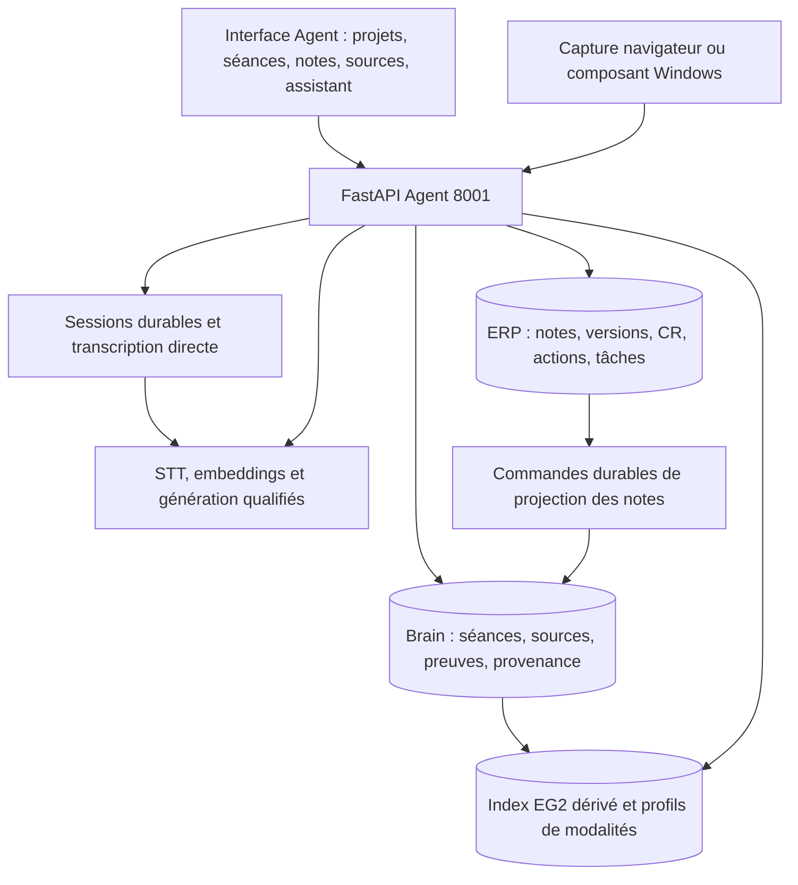
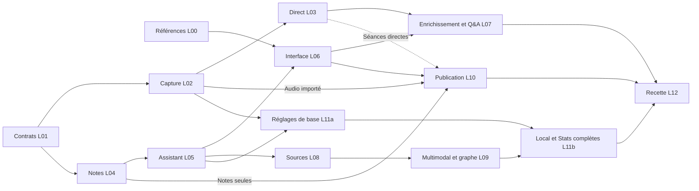

# Plan complet de fusion fonctionnelle Foresight dans Agent

## Livraison clôturée L00–L12 — 22 octobre 2026

**13/13 lots, 25/25 fonctions et 16/16 recettes applicables sont clos dans la
portée acceptée par l’utilisateur.** Ce bilan courant remplace les états
intermédiaires conservés ci-dessous comme historique.

Le parcours enregistrement → transcription → correction/validation humaine →
préparation et validation du compte rendu est qualifié. Le direct reste
**provisoire** : les défauts sous bruit et paroles simultanées sont documentés.
P95 CPU chaud mesuré sur les phrases fictives : **7,74 s** ; la cible initiale
de 5 s n’est pas atteinte. La validation ne constitue aucune garantie de
transcription automatique sans erreur. L’adaptation visuelle Agent est acceptée,
sans copie exacte à ±2 pixels ; Google Drive et la saturation physique du disque
sont exclus à la demande de l’utilisateur. T16 n’est pas déclaré réussi.

Régression : **2 934 tests backend et 54 sous-tests réussis**, un test ignoré
(dossier Infomaniak-IA absent), zéro échec ; **995 tests frontend réussis**.
Ruff conforme. Les 487 sources Python et les sources frontend sont inchangées ;
seuls trois scripts npm UX ont été ajoutés séparément, sans changer dépendances,
commandes de test/build ni interface servie. Agent 8001 et ses deux bases sont
opérationnels ; assets servis identiques au build, Gemma local déchargé et aucun
processus de capture/transcription de recette observé au contrôle final.

La sauvegarde complète a été extraite et vérifiée (144 692 fichiers), puis sa
copie restaurée démarrée en mode isolé. Elle précède les derniers changements ;
un complément distinct sauvegarde les sources/assets/documents récents.
Les preuves de conservation, reprise et retour à l’ancien parcours restent
disponibles. Les modifications locales ne sont ni commitées ni poussées.

Mode d’emploi : [Démarrer une réunion et préparer son CR](56_MEETING_START_GUIDE.md).
Bilan : `logs/foresight-runtime/L12-FINAL-ACCEPTED-DELIVERY-ROOT-20261022.json` ;
audit `acceptance-r97.json`. Aucun nouvel enregistrement ni modèle lancé pour
cette clôture documentaire.

## Direct provisoire accepté avec relecture — 22 octobre 2026

L’utilisateur accepte explicitement la livraison avec transcription directe
provisoire, relecture humaine obligatoire et limites documentées. Le critère
initial de zéro erreur automatique ne conditionne plus cette portée acceptée.
Les erreurs bruit/chevauchement restent conservées ; aucun score n’est corrigé
ni modèle présenté comme sans erreur. La publication exige déjà la révision
actuelle de transcription relue et validée ; le brut direct ne la remplace pas.

Mesure actuelle dans le vrai Studio : **15phrases fictives,26Opus traités**,
paragraphe visible vérifié par géométrie et hit-test. Medium CPU/int8/4threads :
**P50 chaud6,82s ; P95 chaud7,74s** après fin de parole annotée. Le chargement
froid a pris22,44s. La cible CPU initiale5s n’est pas atteinte et n’est pas
revendiquée ; aucune latence de microphone humain n’est déduite. Le GPU reste
une option en essai, sans changement du choix CPU en production.

**L03/F06 sont clos dans cette portée acceptée :12/13lots,25/25fonctions,
16/16recettes applicables.** Les exclusions Drive/disque plein et l’adaptation
visuelle Agent restent explicites. L12 attend uniquement son bilan global final.
Aucun microphone, GPU, LLM ou réseau externe utilisé pour cette mesure ; Job et
résident CPU fermés. [Guide de démarrage](56_MEETING_START_GUIDE.md).
Preuve : `logs/foresight-runtime/L03-PROVISIONAL-ACCEPTANCE-ROOT-20261022.json` ; audit r96.

## Exports et reprise F24 qualifiés — 22 octobre 2026

Le seul blocage encore inscrit pour F24 était le disque plein physique, exclu
explicitement par l’utilisateur. Les preuves PDF et leurs rendus ont été
revérifiés par empreinte ; les six sources d’export/publication correspondantes
sont inchangées. Les contrôles actuels de récupération de sessions et de droits
d’export passent : **60tests**, sur bases fictives privées.

La restauration historique conserve les saisies postérieures à la sauvegarde ;
le checkpoint complet a144692fichiers extraits/vérifiés et un démarrage sur
copie en mode test réussi. Ce checkpoint précède les derniers réglages GPU :
aucune sauvegarde future ou restauration complète de production n’est inventée.
Les248empreintes frontend restent celles de la suite995tests réussie.

**F24 est clos :11/13lots,24/25fonctions,16/16recettes applicables**.
Restent F06/L03 pour la qualité et la latence du direct, puis le bilan L12.
La saturation physique n’est pas présentée comme un essai réussi ; ses garde-fous
et les preuves de crash déjà acquises sont conservés. Aucun modèle, microphone,
changement de données métier ou nouveau déploiement.
Preuve : `logs/foresight-runtime/F24-EXPORT-RECOVERY-CLOSURE-ROOT-20261022.json` ; audit r95.

## Dernier bilan et comparaison Qwen3-ASR CPU — 22 octobre 2026

**11/13lots,23/25fonctions,16/16recettes applicables** : L11 est désormais
qualifié par la chaîne physique hors ligne et son complément de retour réseau.
Le disque plein reste exclu à la demande de l’utilisateur. Restent L03 et le
bilan L12 ; les bilans antérieurs constituent l’historique.

Qwen3-ASR0.6B INT8, autre famille que Whisper et Canary, a traité les deux
Opus synthétiques difficiles inchangés sur CPU/4threads. L’archive publiée
par sherpa-onnx est vérifiée contre son SHA256 amont ; environ879Mo compressés
et987Mo extraits restent privés. Le runtime sherpa-onnx1.12.35 déjà installé
n’est pas modifié. Le premier lancement a refusé le mot-clé hotwords avant
construction du modèle ; le pilote privé construit ensuite la même configuration
native sans ce champ, sans mot attendu, référence ou contexte lexical fourni.

Le terme technique reste incorrect dans le premier extrait ; dans le second,
l’instruction négative de consignation subsiste mais le refus du client manque
encore. Une différence de conjugaison ne vaut pas perte automatique de négation.
Le candidat n’est pas adopté et n’est pas étendu au corpus complet inchangé.
Chargement8,06s ; calcul2,15/1,15s : aucune latence d’affichage déduite.
Jobs fermés, aucun microphone ouvert ni donnée de production modifiée.
Preuve : `logs/foresight-runtime/QWEN3-ASR-CPU-DIAGNOSTIC-ROOT-20261022.json` ; audit r94.
Sources : [modèle Qwen](https://huggingface.co/Qwen/Qwen3-ASR-0.6B),
[export et moteur](https://k2-fsa.github.io/sherpa/onnx/qwen3-asr/pretrained.html).

## Chaîne complète hors ligne qualifiée — 22 octobre 2026

Sous coupure manuelle réelle de Fortinet/Wi-Fi/LAN, Agent a conservé une
capture native Realtek Opus des phrases fictives, puis transcrit la piste
système sur CPU. EG2 local a indexé et retrouvé les sources privées, avec
annulation/reprise/réouverture ; Gemma local a produit les deux valeurs et
la citation attendues.32inventaires réseau encadrent les phases réelles de
capture et de moteurs. Ils sont échantillonnés, sans prétention à zéro appel
système natif. Les empreintes et reçus concordent ; les quatre Jobs sont fermés.

Le premier contrôle de retour est conservé comme échec : inventaire readiness
ancien, diagnostic URLError, puis RuntimeError dont le détail n’était pas
enregistré. Un complément sans nouvelle coupure, capture ou chargement local
confirme ensuite une connexion réelle au serveur, sa réponse au diagnostic
fixe et Gemma local installé mais déchargé. Aucun son ou texte capturé envoyé
au serveur réseau ; seule la piste système fictive a alimenté Gemma local.

**L11 et F21 sont clos :11/13lots,23/25fonctions,16/16recettes applicables** ;
le disque plein reste exclu. L03 reste ouvert (erreurs métier et latence du
direct), puis L12 attend son bilan global. La suite backend courante est
encore en cours ; aucun verdict global vert anticipé.
Preuve : `logs/foresight-runtime/INTEGRATED-OFFLINE-ACTUAL-ROOT-20261022.json` ; audit r93.

## Préparation de la recette hors ligne intégrée — 22 octobre 2026

État actuel : **10/13 lots, 22/25 fonctions, 16/16 recettes applicables**.
La recette matérielle est close (Realtek humain4/4, Jabra système6/6,
changement et conservation vérifiés) ; le disque plein est exclu à la demande
de l’utilisateur, sans être déclaré réussi. Les bilans antérieurs sont historiques.

La recette L11 restante réunit capture Realtek, lecture fictive, STT CPU,
recherche EG2 et génération Gemma locales sous coupure manuelle, puis retour
au serveur réseau et vérification du déchargement local. Sa préparation passe
**30tests de contrôle**, le vrai point d’entrée des moteurs, le contrôleur audio
en mode refus, les Jobs Windows imbriqués et la conversion d’anciens Opus.
Aucun micro ouvert, modèle chargé ou réseau coupé pendant cette préparation.
Un nouvel accord combiné est requis : l’accord matériel terminé ne couvrait
ni cette nouvelle coupure ni la génération Gemma. Aucun ancien accord réutilisé.

La suite backend globale de l’arbre actuel est lancée dans un Job isolé ; elle
n’est pas encore déclarée terminée. Ruff passe. Aucun changement de production.
L03 reste ouvert pour la qualité métier et la latence du direct ; L11/L12
restent ouverts jusqu’aux preuves d’exécution correspondantes.
Protocole : `.ui-preview/pilots/offline-integrated-20261022/PROTOCOL.md`.
Preuve : `logs/foresight-runtime/INTEGRATED-OFFLINE-PREPARATION-ROOT-20261022.json` ; audit r92.

## Critère de disque plein retiré — décision du 22 octobre 2026

À la demande explicite de l’utilisateur, la saturation réelle d’un volume
n’est plus un critère de clôture et ne donnera lieu à aucun nouvel essai.
T16 est exclu du décompte des recettes bloquantes ; il n’est pas déclaré réussi.
Les preuves déjà acquises de crash, fragments partiels, SQLite FULL et reprise,
ainsi que la gestion des erreurs de stockage dans Agent, sont conservées.

État actuel : **10/13 lots, 22/25 fonctions, 16/16 recettes applicables**,
avec **un critère exclu**. Restent la qualité et la latence du direct (L03),
la chaîne capture et moteurs sous coupure physique (L11), puis le bilan L12.
Les mentions de T16 ouvert dans les comptes rendus antérieurs sont historiques.
Décision : `logs/foresight-runtime/FULL-DISK-CRITERION-EXCLUDED-ROOT-20261022.json` ; audit r91.

## Décision de poursuite — 15 octobre 2026

L'utilisateur demande de limiter les plafonds arbitraires et d'avancer. Les
cibles initiales P95 demeurent des résultats à mesurer : leur indisponibilité
ne doit pas arrêter la capture ni bloquer les essais fonctionnels indépendants.
Les recettes ne coupent plus un fichier fictif pour 2,5 s de retard, 600 s de
backlog, 3 Gio de RAM ou 1 Gio de stockage. Les validations humaines et
contrôles de conservation, droits, identité et annulation restent applicables.
Une performance ou une fonction non vérifiée est indiquée comme telle ; aucun
lot n'est clôturé sur un démarrage ou une simulation.

**Plan créé le 11 octobre 2026 — état actualisé le 21 octobre 2026 :
implémenté, qualification partielle. Neuf lots sur treize et quinze recettes
sur dix-sept sont clos dans leurs portées documentées. L02/L03/L11/L12 restent ouverts.**

Ce document répond à la demande de réunir dans Agent l’interface et les fonctions de Google AI Edge Foresight. Il définit la cible, les travaux, leurs dépendances, les migrations et la recette. Les spécifications initiales ci-dessous définissent toujours la cible ;
les [preuves de livraison](38_FORESIGHT_DELIVERY.md) et la
[matrice d’acceptation](40_FORESIGHT_ACCEPTANCE.md) décrivent l’état réellement vérifié.

## 1. Résultat attendu et périmètre

Le chargé d’affaire ouvre une réunion, prend quelques notes, consulte les réponses documentées pendant la conversation, puis publie un compte rendu sourcé et transforme les actions retenues en tâches. Tout reste accessible depuis la réunion et le projet, sans ressaisie.

La fusion est **fonctionnelle et visuelle dans le projet Agent existant** : interface React, backend FastAPI sur 8001, bases Brain et ERP, index EG2 dérivé. L’application Mac Foresight n’est pas absorbée comme un second projet. Les briques Google utilisables sur Windows peuvent être intégrées comme fournisseurs après qualification.

Le périmètre comprend : séances globales et par projet, notes personnelles et enrichies, capture micro et système, transcription directe, interlocuteurs, synthèse, chat ciblé, cartes proactives, sources locales/Drive/web, labels, recherche textuelle et multimodale, exploration des relations, statistiques réelles, configuration des moteurs et chaîne hors ligne.

Les détails de calendrier importés constituent du contexte de séance. La demande ne réactive pas le développement d’un calendrier général, ni les extensions antérieurement reportées : signature, BOM, charge/ressources, collaboration, qualité, REX, clôture ou extension CDC/BE. Le dialogue vocal avec réponse parlée n’est pas ajouté au périmètre Foresight sans fonction attestée correspondante.

### Invariants obligatoires

1. Un seul dépôt et serveur utilisateur Agent 8001 ; XPilot 8000 préservé, aucun serveur Agent 8002.
2. CDC, CDC & BE, Revues, Atelier, Sage, Mails, Documents, Planning et informations existantes conservés.
3. Même note, séance, document et tâche dans les vues globales et projet ; identités ERP/Brain reliées explicitement.
4. Texte humain conservé ; enrichissement IA, transcription provisoire et décision publiée distingués.
5. Toute réponse métier citée renvoie à une version et à un passage consultables.
6. Un index ou un moteur indisponible n’empêche pas de lire les données canoniques ni de sauvegarder une note.
7. Aucune suppression automatique de modules, de versions ou de lignes historiques ; migration additive et sauvegardée.
8. Les nouvelles fonctions restent désactivées jusqu’à leur qualification. Une installation ou un témoin réseau ne vaut pas recette fonctionnelle.

## 2. Base de départ et niveaux de preuve

Les éléments ci-dessous proviennent de l’étude effectuée le 11 octobre, avant rédaction du plan. Ce plan n’a pas relancé les moteurs ni les tests applicatifs.

| Domaine | Point de départ vérifié | Écart à traiter |
|---|---|---|
| Application | React/FastAPI, Brain + ERP, interface et santé accessibles sur 8001 | Assemblage de nouveaux parcours dans ce socle |
| Navigation | Réunions globales, vues projet, assistant, recherche et réglages | Écran de séance et bibliothèque fédérée |
| Audio | Import, micro, lecture, segments et relecture présents | Capture progressive, système et STT direct absents |
| Runtime STT | Statut précédent `ready:false`, « Installer le runtime audio » | Installation et vraie transcription à qualifier dans L02 |
| Publication audio | Révisions, citations par segment, CR/actions ERP et provenance Brain | Réutiliser ce circuit pour la séance unifiée |
| Notes | Versions ERP, pièces, brouillons et gestion des conflits | Projection de versions vers Brain/EG2 et lien avec séance |
| Mémoire | Index EG2 persistant existant dans `storage/eg2/index.db` | Scopes sélectionnés, notes et modalités supplémentaires |
| IA | Fournisseurs distants prioritaires, secours local de génération séparé | Arbitrage du direct et secours/local pour tous les moteurs |

Le nombre de passages, les statuts des modèles et les latences sont des mesures variables ; la référence de départ de chaque lot devra être enregistrée à nouveau. [Contexte courant](../PROJECT_CONTEXT.md), [audio](23_MEETING_AUDIO.md), [mémoire](20_EG2_ENGINE.md).

## 3. Fidélité Foresight : contrat de référence

L00 constitue une référence numérotée pour chaque écran : version de Foresight, dimensions, contenu fictif, état, capture et interactions. Les images officielles montrent au moins deux dispositions de séance et des variantes Feed/Meetings. Elles ne prouvent pas une disposition simultanée à trois colonnes.

Les dispositions fidèles sont donc : notes personnelles/enrichies côte à côte, puis notes et assistant à onglets selon la référence retenue. Une présentation à trois zones serait une adaptation Agent explicitement nommée. Les rubriques métier d’Agent restent disponibles autour de cet espace.

| Référence | Contenu à figer |
|---|---|
| UI-01 | Liste/feed de réunions, recherche, filtres et menus |
| UI-02 | Création, import, démarrage et arrêt d’une séance |
| UI-03 | Notes courtes + enrichissement, mise en forme et copie |
| UI-04 | Chat, Summary, Transcript, Live Q&A et citations |
| UI-05 | Sources, labels, formats, tri et liste/grille |
| UI-06 | Graph view et interactions réelles |
| UI-07 | Stats et définitions des compteurs |
| UI-08 | Premier lancement, audio, modèles, téléchargement et réglages |
| UI-09 | Vide, chargement, traitement, indisponibilité, conflit et erreur |

Les fonctions non montrées doivent être relevées dans une installation de référence ou marquées « spécification Agent, équivalence proposée ». L’absence d’une capture ne bloque pas les contrats de données ou les essais audio indépendants ; elle bloque la déclaration de fidélité exacte de l’écran concerné.

Sources de référence : [page Google](https://developers.google.com/edge/foresight), [notes enrichies](https://developers.google.com/static/edge/foresight/assets/enhanced-notetaking.gif), [panneau assistant](https://developers.google.com/static/edge/foresight/assets/foresight-retrieval-live-and-chat.gif), [Sources](https://developers.google.com/static/edge/foresight/assets/knowledge-sources.png). La définition détaillée des écrans reste un livrable L00.

## 4. Couverture fonctionnelle et lots responsables

| ID | Fonction cible | Réemploi / travail principal | Lots |
|---|---|---|---|
| F01 | Liste des séances globale et par projet | Vue Réunions et identités actuelles | L01, L06 |
| F02 | Nouvelle séance : note seule, import, capture | Session durable liée aux objets existants | L01, L02, L06 |
| F03 | Démarrage immédiat sans projet choisi | Capture en attente, attribution avant publication | L01, L02, L06 |
| F04 | Capture micro | MediaRecorder à fiabiliser | L02 |
| F05 | Capture audio système et voix distantes | Qualification navigateur, puis composant Windows si nécessaire | L02, L03 |
| F06 | Transcription en direct | Segments provisoires/finalisés et consolidation | L03 |
| F07 | Voix, noms et corrections | Relecture actuelle, identités de voix provisoires | L03, L06 |
| F08 | Lecture et citations au bon instant | Lecteur et segments actuels | L01, L03, L06 |
| F09 | Notes riches et Markdown | Notes/versionnement/éditeur existants | L04, L06 |
| F10 | Enrichissement automatique des notes | Proposition versionnée, acceptation explicite | L05, L07 |
| F11 | Synthèse et compte rendu | Circuit audio actuel conservé | L06, L10 |
| F12 | Ask global et chat ciblé | Même assistant, scope contrôlé par le serveur | L04, L05, L06 |
| F13 | Live Q&A et cartes proactives | Détection, déduplication et réponse sourcée | L03, L05, L07 |
| F14 | Catalogue, formats, labels, tri, liste/grille | Vue fédérée, aucun second référentiel | L08 |
| F15 | Imports dossiers, fichiers, Drive et URL | Ingestion commune, versions et provenance | L08 |
| F16 | Recherche exacte, mots et sens | Recherche unifiée/EG2 existants | L04, L05, L08 |
| F17 | Recherche images, schémas et audio | Profils/encodage multimodaux qualifiés | L09 |
| F18 | Exploration par graphe | Liens connus, UI de référence à préciser | L00, L09 |
| F19 | Statistiques et diagnostics | Mesures réelles, formules documentées | L11 |
| F20 | Réglages et premier lancement | Configuration IA/mémoire/audio commune | L02, L11 |
| F21 | Traitement local et hors ligne | Capture, STT, embeddings et génération sur le PC | L02, L09, L11 |
| F22 | Contexte de calendrier importé | Données de séance choisies, sans scheduler général | L08 |
| F23 | Informations et actions du projet | Publication, puis conversion explicite en tâche | L10 |
| F24 | Export, récupération et reprise | CR/PDF existants, sessions et commandes idempotentes | L01, L02, L10, L12 |
| F25 | Fidélité visuelle et usage au clavier | Comparaison référencée et recette d’accessibilité | L00, L06, L12 |

Chaque ID reçoit un état distinct : spécifié, développé, testé sur copie, activé, qualifié en usage réel. « Développé » ne signifie pas « opérationnel ».

## 5. Parcours et organisation de l’application

### Avant la réunion

Depuis un projet, la création préremplit le projet. Depuis Réunions, l’utilisateur choisit un projet ou démarre une capture en attente d’attribution. Il peut préparer une note seule, importer un audio ou enregistrer. Les sources et le périmètre de l’assistant sont visibles. La liaison ERP/Brain est contrôlée avant tout classement, indexation projet ou publication.

La capture non attribuée est une zone de travail durable, avec statut « À rattacher ». Elle ne crée pas un faux projet et n’entre pas dans un index de projet. Elle peut être sauvegardée et écoutée ; sa publication reste bloquée jusqu’au rattachement explicite. L’assistant n’y choisit aucun projet automatiquement.

Dans cette zone, les notes humaines sont des brouillons durables de séance, pas encore des ProjectNote ERP : ce modèle impose un projet. Au rattachement, une commande rejouable transfère chaque brouillon vers une seule note ERP et conserve le snapshot initial comme provenance. Une fois le transfert acquitté, seule la note ERP porte l’édition courante ; le basculement d’autorité empêche deux éditeurs concurrents d’écrire dans deux copies.

L’arrêt d’une capture sans projet peut finaliser son audio et sa transcription dans la zone de séance. Le MeetingRecording existant n’est créé ou relié qu’après attribution ERP/Brain vérifiée ; la finalisation n’invente ni source de projet ni identifiant ERP.

### Pendant la réunion

Le bandeau global permet de revenir à la séance, de voir les pistes réellement actives et d’arrêter. La capture survit à la navigation dans Agent. Les notes personnelles restent éditables pendant l’enrichissement. La transcription provisoire est identifiée. Une carte affiche question, réponse, sources et état de fraîcheur.

Changer le périmètre du chat ouvre un contexte de discussion distinct ou réinitialise explicitement son historique : une conversation d’un projet ne doit pas être réutilisée silencieusement dans un autre. Les scopes proposés sont séance, sources choisies, projet et tous les projets autorisés.

### Après la réunion

L’arrêt consolide l’audio puis la transcription. L’utilisateur corrige les noms et les segments, valide le texte, génère/revoit la synthèse et publie via le circuit existant. Les actions du CR peuvent ensuite être converties explicitement en tâches. Les notes et documents restent accessibles depuis Documents ; le compte rendu depuis les réunions globales et le projet.

Les CR audio hérités et les revues structurées RLP restent des objets distincts. Le plan ne suppose pas que publier un CR audio crée automatiquement une revue RLP.

Pour une séance de notes seules, la synthèse utilise les versions de notes et documents sélectionnés. Sa publication réemploie le compte rendu manuel et ses actions avec un contrat de provenance et de rejeu à ajouter. Les citations désignent des blocs de notes/documents ; aucun MeetingRecording, locuteur ou timecode fictif n’est créé. La revue requise est celle des notes et de la synthèse, sans validation de transcription inexistante.

### Navigation et adaptation

Conserver le shell et les URLs existantes. Ajouter la bibliothèque Sources à la navigation commune, reliée aux vues Documents/Informations et à Recherche. Ask reste le même assistant en présentation globale ou contextuelle. Réunions & revues conserve l’accès aux revues métier. Les autres modules restent joignables avec leurs parcours actuels.

La fidélité desktop se mesure aux dimensions de référence. À 670 et 320 pixels, Agent adapte les panneaux en onglets et conserve lecture, saisie et arrêt du micro sans débordement ; cette adaptation web ne sera pas présentée comme une fonction Mac observée.

## 6. Architecture et responsabilités des données

La capture, la projection des notes et le traitement IA sont des services/workers du même projet. Un processus isolé peut protéger le serveur d’un calcul audio ; il est supervisé et arrêté avec Agent. Un composant de capture Windows, si requis, livre l’audio au backend local et ne fournit pas une seconde application métier ni un serveur 8002.

### Contrats de données proposés, à figer dans L01

| Objet | Autorité | Contrat |
|---|---|---|
| CaptureSession, nouveau | Brain, zone de capture | UUID, projet nullable en attente, références ERP/Brain explicites, pistes, état, révision et timestamps |
| AudioChunk/manifest, nouveaux | Session + stockage brut | Piste, séquence, codec/en-tête, taille, SHA-256, durée, acquittement et ordre |
| LiveTranscriptSegment, nouveau | Session | ID stable, piste/voix, début/fin, texte, provisoire/finalisé, révision |
| SessionNoteDraft, nouveau et temporaire | Session non attribuée | Brouillon humain sauvegardé et versionné ; transfert idempotent unique vers ERP à l’attribution |
| MeetingRecording, existant | Brain | Résultat audio consolidé après attribution ; liaison unique session → recording, source/projet et publication actuels |
| ProjectNote / NoteVersion, existants | ERP | Notes humaines et versions immuables ; lien de séance sans copie parallèle |
| NoteProjectionOutbox, nouveau | ERP | Événement enregistré dans la même transaction que la version à projeter |
| Binding/receipt de note, nouveau | Brain | Lien note/version/source/artefact et événement déjà reçu |
| EnhancedNote / LiveAnswer, nouveaux | Session/proposition | Entrées/version, passages utilisés, sortie, moteur, statut, acceptation et obsolescence |
| CR et actions, existants | ERP | Publication idempotente actuelle ; une action devient tâche par commande explicite |
| Vecteurs et relations dérivées | Index / vues dérivées | Reconstruisibles, filtrés par source/profil/projet et version courante |

Les noms sont des propositions de contrat, pas des tables déjà créées. Les états de capture, traitement et validation sont séparés : une capture terminée peut avoir une transcription en échec, et une transcription prête peut être non relue.

### Citations et fraîcheur

Une citation contient le type, l’identité, la version, un localisateur, l’extrait et le statut de la source. Localisateurs : réunion/segment/timecode, PDF/page/passage, note/version/bloc, tableur/feuille/plage, image/région si réellement produite. Une page de pagination UI n’est pas une référence documentaire.

La sauvegarde d’une modification invalide les sorties dépendantes immédiatement, avant la fin de la réindexation. Chaque résultat vérifie à nouveau la version avant affichage courant et publication. Les citations restent consultables dans leur ancienne version, avec indication d’obsolescence.

### Projection Notes ERP → Brain → EG2

1. Enregistrer NoteVersion et une commande outbox dans une transaction ERP.
2. Un worker lit la commande, contrôle le projet et la version ; aucune requête IA ne bloque la sauvegarde de la note.
3. En Brain, écrire/retrouver le reçu unique, la source logique, l’artefact versionné, la provenance et la MemoryProjection dans une transaction.
4. Acquitter l’outbox ERP seulement après ce commit ; un rejeu retrouve le même reçu.
5. La file de projections existante indexe la preuve ; erreurs et reprises sont visibles.

Cette voie produit de l’**evidence**. Elle ne déclenche pas le pipeline mail, une extraction automatique de propositions ou la création de vérités à chaque sauvegarde de note. Les informations publiées suivent le circuit de décision existant.

`Source.sha256` est globalement unique : deux notes identiques dans deux projets ne doivent pas être fusionnées. L01 doit figer une identité logique distincte et une capsule de source incluant ses identifiants de provenance, avec empreinte de contenu séparée. Un simple hash du texte ne suffit pas. Les anciennes sources ne sont pas requalifiées pour résoudre ce cas.

## 7. API, commandes et flux proposés

Les routes ci-dessous décrivent le contrat à préparer. Elles ne sont pas actives du fait de ce document. Les IDs de projet des routes `/api/v1/projects` restent ERP ; les scopes de mémoire sont résolus vers Brain côté serveur.

| Contrat | Situation / responsabilité |
|---|---|
| `/api/v1/workspace/meetings` | Existant : liste globale ; étendre filtre/statut et liaison séance sans retirer les CR historiques |
| `/api/v1/projects/{pid}/recordings` et routes audio | Existants : import, original, relecture, synthèse, publication ; préserver la compatibilité |
| `/api/v1/meeting-sessions` | Nouveau : créer/lister capture ou note de séance, projet optionnel pour staging |
| `…/meeting-sessions/{sid}` | Nouveau : état, révision, associations et reprise ; lecture sans nouvelle capture |
| `…/{sid}/chunks` | Nouveau : fragments numérotés, checksum, accusé et reçu idempotent par piste/séquence |
| `…/{sid}/pause`, `/resume`, `/finalize` | Nouveaux : commandes rejouables et fermeture unique ; finalisation en staging si projet absent, recording après attribution |
| `…/{sid}/assign-project` | Nouveau : attribution ERP/Brain, contrôle des droits et état ; pas de classement implicite |
| `…/{sid}/events?after=…` | Nouveau : événements SSE ordonnés, curseur de reprise, snapshot si curseur expiré |
| `…/{sid}/notes`, `/enhancements`, `/live-answers` | Nouveaux bindings/commands ; réemploi des services Notes et IA, pas de second stockage de notes humaines |
| `/v1/projects/chat` et `/v1/projects/chat/stream` | Existants : ajouter scope/source/version/séance optionnels avec compatibilité des anciens clients |
| `…/meeting-sessions/{sid}/publish` | Nouveau dispatch de publication : circuit audio existant ou CR manuel de notes avec provenance/rejeu ; aucun audio fictif |
| `/v1/search` | Existant : ajouter sélection de sources/labels/modalités sans modifier les filtres canoniques |
| Catalogue `/api/v1/workspace/sources` | Nouveau contrat fédéré, à aligner sur les routes sources/imports existantes dans L08 |
| Réglages / état / files | Étendre les routes actuelles pour readiness, capacités capture et placement des moteurs |

Chaque mutation porte une clé de commande et, si nécessaire, une révision attendue. Le rejeu d’une commande retourne son résultat précédent ; la réutilisation d’une clé avec un autre contenu est rejetée. Les contrôles local_guard/origine/token et de périmètre projet s’appliquent aussi aux nouveaux flux.

Enregistrer explicitement les nouvelles routes, bibliothèques et SSE dans la politique d’accès projet. Les imports refusent les chemins de sortie du stockage et les fichiers actifs exécutables ; Office/HTML sont extraits comme contenu. Les URL respectent un périmètre réseau défini et ne déclenchent pas d’exploration du réseau interne. Les instructions présentes dans un document restent du contenu documentaire et n’autorisent ni action ni élargissement du contexte.

Événements proposés : fragment reçu, capture interrompue, segment provisoire, segment finalisé/corrigé, note sauvegardée, enrichissement disponible, réponse disponible/obsolète, phase de consolidation, résultat de publication. Les événements de contenu privés restent dans les flux locaux autorisés, pas dans des journaux généraux.

Après reconnexion, la vue recharge la révision canonique puis reprend les événements. Une déconnexion SSE ne relance pas le microphone et ne duplique pas une tâche IA. La capture active dans plusieurs onglets doit être arbitrée : une session propriétaire, état explicite pour les autres, transfert contrôlé.

## 8. Découpage de réalisation

### L00 — Référence Foresight et spécification de fidélité

**Livrables :** dossier UI-01…09, mesures des surfaces/polices/icônes, interactions, grille des divergences Agent, corpus fictif identique pour comparaisons. Compléter Graph, Stats, Settings et les états manquants. Définir l’accessibilité et les adaptations web.

**Sortie :** chaque fonction F01…25 est liée à une référence ou à une spécification Agent clairement nommée. Aucun comportement inconnu n’est déclaré copié exactement.

### L01 — Identités, sessions, contrats et migrations additives

**Livrables :** modèles de session/fragments/bindings, états séparés, règles de version et citation, API/événements, liaison finale avec MeetingRecording, stratégie des sessions non attribuées, clés de rejeu. Tests des collisions de notes/projets et des transitions.

**Dépendance :** base architecture ; L00 utile, sans attendre les détails visuels.

**Sortie :** une même séance est visible par ses accès global/projet ; rattachement et finalisation rejoués ne créent pas de doublons ; aucun Source canonique projet avant attribution.

### L02 — Runtime et capture audio durable Windows

**Livrables :** qualification du STT batch existant, session créée avant capture, fragments acquittés et manifeste, service de capture au shell, indicateur/pause/arrêt global, reprise des fragments locaux non acquittés si le navigateur le permet. Mesurer micro + sortie système dans les navigateurs et applications retenus.

Le découpage MediaRecorder ne garantit pas des fichiers décodables séparément : tester codec, en-têtes et reconstitution. Conserver les pistes micro/système et produire un mix dérivé si nécessaire. Un échec ou une absence de piste est visible, pas remplacé par du silence présenté comme succès.

**Dépendance :** L01. **Décision technique :** chemin navigateur quand qualifié ; composant Windows supervisé avec loopback si nécessaire pour les applications installées. Le choix est fondé sur les essais, pas sur un nom d’API.

**Sortie :** micro et voix distante audibles ; navigation/changement de projet ne perdent pas la capture ; aucun fragment acquitté perdu après arrêt/reprise. Fermeture du navigateur arrête potentiellement la capture, sans effacer la partie déjà sauvegardée.

### L03 — Transcription en direct et consolidation finale

**Livrables :** découpage/VAD avec recouvrement, traitement continu, horloge de séance, segments identifiés et révisables, diarisation provisoire, consolidation batch de fin et intégration à la relecture existante. Conserver les pistes et traces permettant de comprendre les corrections.

**Dépendance :** L01, L02. **Sortie :** texte direct utile sur corpus français industriel ; corrections sans doublons, horodatages cohérents, noms jamais inventés comme identités humaines ; interruption/reprise et finalisation déterministes.

### L04 — Notes de séance, projection et migration du fonds existant

**Livrables :** association de la même ProjectNote à la séance et à Documents, éditeur existant, outbox ERP, reçus Brain et projection evidence, localisateurs de blocs, progression de reprise des notes historiques. Définir traitement des notes restaurées, pièces remplacées et notes sans liaison Brain.

**Dépendance :** L01. **Sortie :** texte/version/pièces historiques inchangés ; notes identiques entre projets séparées ; une modification invalide le rappel ancien avant réindexation ; panne Brain/EG2 n’empêche pas la sauvegarde ERP.

### L05 — Assistant commun, scopes et gestion des moteurs

**Livrables :** scopes séance/sources/projet/global contrôlés serveur, historique partitionné, contexte provisoire séparé du corpus canonique, résolution des citations et budget de contexte. File d’arbitrage par moteur, priorité aux actions demandées, regroupement des travaux automatiques et annulation des sorties périmées.

**Dépendance :** L01, L04 ; tampon direct branché après L03. **Sortie :** aucune fuite entre projets/scopes, sources périmées exclues, cas sans réponse explicite, réponse arrivée après une modification non marquée à jour.

### L06 — Interface de séance fidèle et navigation commune

**Livrables :** liste de séances et création, écran de séance dans le shell actuel, deux dispositions référencées, barre audio, notes/enrichissements, onglets Chat/Synthèse/Transcription/Questions, lecture timecode, copies et liens sources, maintien des vues/brouillons. Bibliothèque et Stats restent accessibles sans doubler les panneaux métier. L’éditeur riche conserve les notes existantes ; tout mode Markdown précise sa conversion et ses limites, sans perte silencieuse de tableaux, images ou mise en forme.

**Dépendance :** L00, L01, L04, L05 ; contrat de capture L02. L03 peut être raccordé après première recette avec audio importé.

**Sortie :** toutes les actions existantes restent accessibles ; captures comparables à UI-01…09 et écarts documentés ; clavier, focus, redimensionnement et petite fenêtre utilisables.

### L07 — Notes enrichies et Live Q&A

**Livrables :** déclenchement après stabilisation du texte, suggestions structurées par point de note, provenance, acceptation/rejet, cartes de questions dédupliquées et épinglables. Respecter réserves/négations/numéros/unités ; ne pas réécrire automatiquement la note humaine ni publier une décision.

**Dépendance :** L03, L04, L05, L06. **Sortie :** saisie pendant génération sans perte ; sorties obsolètes signalées ; cartes sans répétitions gênantes et sources consultables ; traitements automatiques désactivables en gardant chat et transcription.

### L08 — Sources unifiées, labels, imports et contexte de calendrier

**Livrables :** catalogue fédéré des sources/documents/notes/transcriptions, filtre projet/type/label/état, liste/grille, tri/pagination, état d’import/extraction/indexation. Imports sélectionnés de fichiers et dossiers, Drive, URL et métadonnées de calendrier/export choisi. Séparer données téléchargées, contenu extrait et contenu indexé.

Les dossiers ne sont pas surveillés intégralement sans choix explicite. Synchronisation par identifiant de fournisseur, version/empreinte et reçu ; changement/retrait distant n’efface pas le canon historique. Les connexions appartiennent à Agent, avec configuration dédiée ; elles ne reprennent pas automatiquement les connexions de Codex.

**Dépendance :** L01, L04, L05 ; référence Sources L00. **Sortie :** réimport sans duplication logique, source changée versionnée, labels sans effet sur les droits, fichiers absents/illisibles visibles ; imports distants précédemment conservés consultables sans connexion.

### L09 — Recherche multimodale et exploration des relations

**Livrables :** extraction avec localisateurs pour PDF/Office/tableurs, OCR de scans si nécessaire, images et schémas, fenêtres audio et encodeurs correspondants. Extension de l’index persistant EG2 avec profils identifiés par modèle/build/prétraitement/dimension/modalité ; mêmes contrôles projet/version. Graphe fondé sur liens documentaires et provenance connus.

Les vecteurs de profils incompatibles ne sont pas mélangés. Un changement de moteur ou de dimension exige une reconstruction parallèle contrôlée et une bascule, sans rendre inutilisable l’index texte actif. Une représentation audio n’est pas une transcription. Une relation sémantique supposée doit être distinguée d’un lien constaté.

**Dépendance :** L08, L05 et contrat de citation L01 ; Graph UI L00. **Sortie :** recherche de plans/images/tableaux avec références valides sur corpus fixé ; pertinence mesurée ; sources/versions hors périmètre exclues ; graphe navigable et traçable, sans nouvelle autorité métier.

### L10 — Publication métier, tâches et exports

**Livrables :** raccordement de la séance finale au service audio existant, relecture, citations vérifiées, publication du CR/actions/informations avec ses clés idempotentes, conversion explicite en Task, ouverture depuis projet/global, réemploi PDF et exports existants. Ajouter le parcours notes seules au CR manuel existant avec citations note/version/bloc et commandes rejouables, sans recording ni audio fictif. Une rectification après publication conserve le CR figé et passe par un amendement lié si ce parcours est retenu.

**Dépendance :** L01, L04, L05, L06 ; L02 pour audio importé/consolidé, L03 seulement pour séances issues du direct ; suggestions L07 raccordables ensuite. La publication de notes seules et d’audio importé n’attend pas la livraison du STT direct. **Sortie :** rejeu après interruption entre ERP et Brain produit un seul CR, une seule action de chaque type et sa provenance ; pas de validation humaine créée par le direct ou l’indexation.

### L11 — Réglages, statistiques et mode entièrement local

**Livrables L11a, disponibles tôt avec L02/L05 :** premier lancement guidé et réouvrable, readiness distincte capture/STT/embeddings/génération, modèle installé/chargé/réponse réelle, placement PC/réseau, ressources et erreurs, mesures de base. L’interface conserve les étapes de préparation déjà réussies en cas d’échec.

**Livrables L11b, complétés après L09 :** statistiques documentées, chaîne locale et modes de secours sur toutes les modalités annoncées. Mesures : durée/pistes, retard STT, réponses utiles, latences, taille/indexation et tokens réellement disponibles.

Un compteur de tokens économisés ou d’économie financière n’est pas inventé : formule et référence requises, sinon mesure indisponible. Le mode local qualifie chaque moteur, avec poids locaux et absence de téléchargement à l’exécution. Le secours EG2 conserve un profil compatible ou utilise un index local préconstruit compatible ; une bascule de modèle ne peut pas réutiliser arbitrairement les anciens vecteurs.

**Dépendances :** L11a après les contrats L01 et en parallèle des capacités L02/L05 ; L11b après L02, L05, L09. **Sortie finale :** capture, STT, recherche et génération fonctionnent réseau local/Internet coupés ; mode réseau correctement indiqué ; aucune prétention hors ligne sur la seule présence du secours LLM.

### L12 — Recette globale, activation progressive et réversibilité

**Livrables :** qualification sur copie puis poste cible, bilan de conservation, preuves visuelles/audio, couverture F01…25, documentation d’exploitation, réglages de capacité et mécanismes d’arrêt/reprise. Pilote sur projet fictif, puis activation des seules capacités qualifiées.

**Dépendance :** tous les lots applicables à la capacité livrée. **Sortie :** critères de la section 12 atteints, aucun risque critique ouvert, retour à l’ancien parcours possible avec nouvelles données conservées.

## 9. Dépendances et jalons de livraison

| Jalon | Contenu utilisable | Porte de sortie |
|---|---|---|
| J0 — Contrat | Références disponibles, scopes/données/API et corpus fixés | Pas d’inconnue bloquant les identités/citations |
| J1 — Réunion fiable | Capture durable, import, relecture et notes communes | Audio récupérable et aucune perte de saisie |
| J2 — Espace unifié | Interface, chat ciblé, sources et publication | Scénario de bout en bout sur projet fictif |
| J3 — Assistance directe | STT direct, enrichissement et cartes | Qualité et latences cibles atteintes |
| J4 — Parité élargie | Connecteurs, multimodal, relations, Stats et local | Chaque capacité évaluée, hors ligne réel |
| J5 — Livraison complète | Régressions, fidélité et exploitation | Couverture F01…25 et bilan de conservation |

L00 peut avancer avec les contrats et essais de faisabilité. Après L01, capture/runtime et Notes peuvent avancer en parallèle. Les connecteurs et modalités peuvent être qualifiés isolément, sans remplacer le moteur texte de production. Les migrations d’un même référentiel et la publication sont intégrées séquentiellement.

Les jalons sont un ordre de réalisation, pas un engagement de dates. La charge et le calendrier se chiffrent après J0 et les essais L02/L03 : matériel, audio système, corpus documentaire et références Mac conditionnent fortement l’effort.

## 10. Capture, charge et moteurs : décisions techniques

### Capture système

Qualifier le navigateur pour réunions web, puis la capture des applications installées. [Chrome](https://developer.chrome.com/docs/web-platform/screen-sharing-controls) documente la sélection de surface et les options audio ; cela ne garantit pas une piste sur tous les postes. [WASAPI loopback](https://learn.microsoft.com/en-us/windows/win32/coreaudio/loopback-recording) constitue une piste Windows pour récupérer une sortie audio. Le périmètre exact capturé, les périphériques, le casque/Bluetooth, l’écho et les changements de périphérique doivent être vérifiés.

Le composant natif fonctionne dans la session interactive de l’utilisateur propriétaire de la capture, pas comme une capture globale en session Windows 0. Le loopback fournit par défaut le mix de sortie : périphérique et périmètre capturés sont indiqués en permanence. Deux pistes séparées ne suffisent pas à identifier tous les participants présents dans une même sortie distante.

### Capacité et limites audio

L’import actuel limite chaque fichier à 50 Mio et 120 minutes. Une séance de deux heures ne tient pas nécessairement dans ce volume. La capture progressive possède ses propres limites de fragment, durée, volume cumulé et espace disponible ; elle ne contourne pas arbitrairement la limite d’import.

Depuis le 21 octobre 2026, les nouvelles captures natives sont stockées en **Ogg/Opus mono à 32 kbit/s par piste**, soit environ 29 Mo par heure pour deux pistes avant mix et copies de récupération. Le navigateur demande également un débit compressé de 32 kbit/s ; les imports MP3 sont conservés. À titre de comparaison, les anciennes pistes PCM à 16 kHz/16 bits représentaient environ 440 Mio pour deux heures. Codec, marges disque/RAM et une seule capture active par poste sont qualifiés dans L02/L03. Un fragment n’est acquitté durablement qu’après stockage et manifeste récupérables. Le disque saturé provoque un arrêt propre, préserve les parties reçues et signale les manques, sans purge automatique.

### Moteurs et placement

Conserver les fournisseurs actuels pour établir une référence. Comparer ensuite les moteurs locaux sur le même corpus. [LiteRT-LM Python](https://developers.google.com/edge/litert-lm/python) documente Windows ; son adoption est une option technique à qualifier, pas un prérequis imposant de remplacer les fonctions opérationnelles.

Afficher séparément STT, embeddings et génération. Le mode PC peut fonctionner sans réseau après acquisition des poids et des sources ; l’import Drive/URL/calendrier nécessite sa connexion au moment de l’acquisition. Les modèles locaux restent téléchargés, chargés et testés séparément.

Le profil EG2 actuel inclut l’endpoint : basculer vers un endpoint local change donc de profil même avec un nom de modèle identique. Sa compatibilité doit être attestée sur modèle/révision/prétraitement/dimension/normalisation/préfixes, ou un index local compatible construit séparément. Aucun rapprochement silencieux de vecteurs de profils différents.

### Charge et priorité

La capture/persistance ne dépend jamais d’une file LLM. Sur chaque moteur : question explicitement demandée, synthèse demandée, cartes automatiques, enrichissement regroupé, puis indexation/analyses de fond. Le STT continu dispose d’un budget indépendant ; la concurrence est ajustée au matériel, éventuellement à une requête par moteur.

Les appels engagés non annulables sont marqués obsolètes à leur retour si les entrées ont changé. Limiter le nombre de cartes et de travaux en attente ; montrer retard et pause automatique des fonctions secondaires plutôt que laisser croître une file sans borne. La disponibilité des moteurs externes aux processus Agent n’est pas supposée observée.

## 11. Migration, reprise et retour arrière

### Avant activation

1. Enregistrer état Git, versions, tables, liens et empreintes des fichiers ; les modifications déjà présentes dans le dépôt restent identifiées séparément.
2. Sauvegarder Brain, ERP, stockage et configuration de façon cohérente, en tenant compte de SQLite/WAL et des workers ; restaurer et contrôler une copie.
3. Exécuter les migrations additives sur copie neuve. Aucun retrait de colonne/table ni réécriture des notes/CR historiques.
4. Tester les anciens clients et parcours avec le nouveau schéma ; leurs routes restent fonctionnelles.
5. Reprendre les notes par lots avec curseur et état durable, seulement pour les projets liés ; conserver les IDs, versions, pièces et décisions.
6. Construire les nouveaux profils d’index en parallèle, comparer résultats puis basculer seulement la capacité qualifiée.

### Invariants de la reprise historique

La projection de notes peut ajouter sources/artefacts/reçus dérivés ; elle ne change pas titre, texte, versions, auteur ou validations historiques. Deux notes identiques demeurent distinctes. Les projets non reliés restent dans une file à traiter explicitement. Aucun CR audio publié n’est retranscrit ou republié automatiquement.

Les notes modifiées pendant la reprise sont traitées par version : le filtre canonique exclut une ancienne projection, même si son calcul finit plus tard. Comptages, empreintes et différences sont enregistrés pour expliquer toutes les écritures nouvelles.

### Retour arrière après activation

Désactiver séparément direct, enrichissement, cartes, connecteurs ou nouveau moteur ; arrêter leurs travaux aux points sûrs. Revenir aux anciens parcours et assets compatibles. Conserver sessions, fragments, notes, événements non acquittés et tables additives pour reprise ultérieure.

**Ne pas restaurer une ancienne sauvegarde sur la production après de nouvelles saisies.** Utiliser les fonctions désactivables et la compatibilité additive ; si une récupération de données est nécessaire, travailler sur copie et réconcilier les nouvelles écritures avant toute opération destructive autorisée. Aucun rollback de schéma supprimant les données ajoutées n’est prévu.

## 12. Qualification et critères mesurables

### Corpus et scénarios de référence

Constituer un corpus anonymisé/fictif avec au moins douze extraits audio couvrant présentiel calme, bruit, interlocuteurs distants et chevauchement des voix ; ajouter une séance longue de 60–120 minutes. Inclure codes projet, noms, nombres, unités, réserves, négations et dates relatives.

Préparer des documents texte/PDF, scan, schéma, image, tableur et versions contradictoires ; notes identiques dans deux projets ; sources manquantes ; questions avec et sans réponse. Les passages attendus et erreurs métier critiques sont annotés avant les essais.

### Cibles initiales à confirmer dans L02/L03

Ces valeurs servent à dimensionner les essais ; elles ne sont pas des performances déjà obtenues ni une garantie sur ce poste.

| Mesure | Cible proposée |
|---|---|
| Conservation | Zéro perte de fragment acquitté et de note sauvegardée |
| Capture progressive | Fragments de 2–5 secondes ; signal visible si le retard dépasse la borne fixée |
| STT direct | P95 du premier segment visible ≤ 5 s après fin de parole sur configuration retenue |
| Assistance | P95 d’une carte utile ≤ 10 s après segment stabilisé ; sinon afficher délai et désactiver le proactif si nécessaire |
| Recherche texte/EG2 | P95 ≤ 2 s sur corpus pilote chaud, hors génération ; mesurer le froid séparément |
| Fidélité | Positions/tailles principales à ±2 px aux dimensions de référence, contenu fictif identique ; animations comparées séparément |
| Pertinence | Recall@5 ≥ 90 % sur questions documentaires annotées, à confirmer après corpus |
| Citations | 100 % des références affichées ouvrent une source et une version présentes |
| Erreurs métier critiques — portée acceptée le22/10/2026 | Direct provisoire avec relecture et validation humaines obligatoires avant publication ; erreurs connues conservées. L’objectif initial de zéro erreur automatique ne constitue plus un critère de livraison dans cette portée. |
| Idempotence | Zéro doublon après rejeu de fragments, commandes, projection et publication |

Une valeur atteinte sur corpus pilote ne prouve pas toute réponse future. Si une cible n’est pas atteinte, conserver le mode manuel/batch et qualifier la fonction séparément ; ne pas annoncer sa parité directe.

### Recettes bloquantes

| ID | Vérification | Résultat attendu |
|---|---|---|
| T01 | Capture, navigation, autre projet et retour | Une capture, même séance, aucun fragment sauvegardé perdu |
| T02 | Actualisation, fermeture, crash et redémarrage | Partie acquittée récupérable ; interruption explicitement affichée |
| T03 | Micro + audio système / casque / changement de périphérique | Pistes réelles et interlocuteurs audibles ; perte de permission signalée |
| T04 | Deux onglets et doubles clics | Pas de deuxième micro ni session/publication dupliquée |
| T05 | Correction note/segment pendant IA | Texte humain conservé, résultat ancien obsolète |
| T06 | Panne Brain/EG2 lors de sauvegarde Notes | Version ERP conservée ; reprise outbox sans doublon |
| T07 | Notes identiques et scopes croisés | Identités séparées et aucune fuite de projet |
| T08 | Citation note/PDF/audio/tableur/image | Bonne version et bon localisateur ; pas de pagination UI utilisée |
| T09 | Interruption entre commits de publication | Rejeu : un CR, actions et provenance uniques |
| T10 | Import répété/changé puis source distante indisponible | Réimport versionné ; copie conservée lisible |
| T11 | Coupure Internet + LAN | Local qualifié pour STT/recherche/génération, ou indisponibilité honnête par moteur |
| T12 | Charge IA et longue réunion | Capture intacte, files bornées, retard visible, priorité au geste utilisateur |
| T13 | Référence visuelle, clavier, contraste, 670/320 px | Écarts suivis, contrôles accessibles et arrêt toujours joignable |
| T14 | Retour ancien parcours après nouvelles données | Nouvelles écritures conservées et récupération disponible |
| T15 | Modules métier et décisions historiques | Aucune régression ni modification inexpliquée du canon |
| T16 — exclu de la clôture le 22/10/2026 | Saturation réelle d’un volume : critère retiré à la demande de l’utilisateur | Aucun nouvel essai exigé ; non déclaré réussi. Preuves de crash/fragments partiels/reprise et gestion des erreurs conservées. |
| T17 | Notes seules et capture sans projet puis attribution rejouée | Brouillon conservé, une note ERP, audio finalisé lié après attribution ; aucun projet/audio/timecode fictif |

### Tests du dépôt et preuves

Pour chaque lot : tests ciblés de contrats, transitions, pannes et régression concernés. Aux jalons d’intégration : `python -m pytest tests/ -q`, `ruff check app backend/app tests`, `npm test -- --reporter=dot` et `npm run build` depuis `web`. Vérification réelle de `/health`, `/app/`, des services qualifiés et des parcours, sur copies/fictifs avant production.

`test_ai_status_and_unreachable` reste isolé du serveur LLM réel. L’échec mail préexistant doit être revalidé dans la baseline et distingué des nouveaux échecs ; une suite avec un échec n’est pas décrite comme entièrement verte. Les mocks ne remplacent pas la recette audio et hors ligne.

Chaque bilan conserve commit/état de fichiers, configuration sans secrets, corpus/empreintes, résultats, latences P50/P95, mémoire/CPU/GPU si accessibles, captures et journal des différences de données. Aucun comptage historique n’est présenté comme mesure fraîche.

## 13. Risques et décisions conditionnelles

| Risque / inconnue | Réponse prévue | Lot / porte |
|---|---|---|
| Références Mac incomplètes | Compléter ou annoncer équivalence Agent pour les écrans concernés | L00 / fidélité |
| Audio système absent dans navigateur | Essai réel puis solution Windows dédiée si requis | L02 / J1 |
| Direct trop lent ou mauvais sur français industriel | Mesurer moteurs/ressources, garder batch, limiter proactif | L03 / J3 |
| Double identité note/source ou cross-project | Bindings et reçus, test de hash global et filtres canoniques | L01/L04 |
| Indexation d’une version périmée | Contrôle avant et après calcul, invalidation immédiate | L04/L09 |
| Surqualification d’un brouillon | Scope provisoire visible, evidence distincte des décisions | L05/L10 |
| Saturation mémoire/disque/files | Quotas dimensionnés, alerte, capture préservée et pause du secondaire | L02/L05 |
| API/modèle multimodal incompatible avec l’index | Profil exact, reconstruction parallèle, pas de mélange de vecteurs | L09/L11 |
| Plan industriel mal interprété | Corpus annoté et citations ; pas de promesse CAO/3D | L09 |
| Connecteur obsolète ou synchronisation destructive | Imports versionnés et canon conservé | L08 |
| Déploiement incompatible / rollback dangereux | Schéma additif, capacités désactivables, aucune restauration ancienne directe | L12 |

Décisions proposées : conserver les deux bases ; staging de capture sans faux projet ; notes ERP comme autorité ; index EG2 existant ; relecture avant publication ; création de tâches explicite ; connecteurs acquis dans Agent ; aucune nouvelle fonction vocale ou ERP hors périmètre. Les choix de moteurs, chemins de capture, ressources et détails non observés sont tranchés par les essais du lot responsable.

## 14. Suivi et documentation de livraison

Chaque lot dispose d’une fiche : état, dépendances, fichiers touchés, capacités Fxx couvertes, contrats, migrations, tests, preuves, limites, réglage d’activation et méthode de retour. Les jalons n’avancent pas sur la seule présence de code.

| Famille | Points d’entrée existants à réutiliser |
|---|---|
| UI/navigation | `web/src/components/WorkspaceShell.tsx`, `WorkspaceViews.tsx`, `MeetingAudioPanel.tsx`, `App.tsx`, `lib/workspaceNavigation.ts` |
| Notes | `ProjectNotesPanel.tsx`, `NoteRichEditor.tsx`, `backend/app/services/project_notes.py`, `project_note_models.py` |
| Audio/publication | `backend/app/routers/meeting_audio.py`, `app/services/meeting_audio.py`, `app/models.py`, `scripts/transcribe_meeting.py` |
| Recherche/chat | `app/services/eg2_memory.py`, `embedding_channel.py`, `unified_search.py`, `app/routers/core.py`, `app/schemas.py` |
| Files/provenance | `app/services/projections.py`, liaisons ERP/Brain et workers actuels |
| Charge et reprise | `app/services/llm_activity.py`, `app/main.py`, `scripts/agent_runtime.py` |
| Documents/actions | Services Notes/artefacts, routes réunions et Planning existantes |

Toute réalisation met à jour README.md, README_BACKEND.md, manifest.json et les documents concernés : 02 modèle, 04 ingestion, 07 API, 08 gouvernance, 09 tests, 20 EG2, 22 exploitation, 23 audio, 24 UI, 25 direct, 31 Planning, 33 revues, 34 Notes/Documents et 36 canal embedding selon le lot. Ce document reste le suivi de couverture et des décisions.

L’analyse initiale est conservée sous `.ui-preview/foresight-analysis-20261011/analyse.md`. Le présent plan est la référence durable du dépôt. La réalisation L00–L12 est autorisée après sauvegarde et restauration vérifiées ; son état et ses preuves sont tenus dans [38_FORESIGHT_DELIVERY.md](38_FORESIGHT_DELIVERY.md). Aucun lot n'est clôturé sur la seule présence de code. Aucun commit/push demandé à ce stade.

## 15. Périmètre confirmé par l'utilisateur le 11 octobre

L'utilisateur exclut Google Drive de la livraison : aucune connexion, import
ou activation Drive n'est demandé. Le code et les données existants sont
conservés ; le connecteur Foresight reste désactivé. La partie Drive de T10
est donc hors périmètre et ne bloque plus L12. Les imports locaux, URL et
leurs versions restent au périmètre initial.

L'utilisateur valide ensuite l'adaptation visuelle présentée du Studio à
Agent : éditeur riche XPilot conservé, panneaux distincts et séparation égale
des notes personnelles et enrichies ; dimensions principales des Sources
reprises de la référence publique. F25/T13 est clos dans cette portée
acceptée. Cette décision remplace la cible de parité publique à ±2 pixels
pour cette livraison ; aucune copie exacte ni parité Mac privée n'est
revendiquée. Les contrôles de clavier et de tailles responsives restent
applicables.

La décision directe et l'image présentée sont référencées dans
`logs/foresight-runtime/user-scope-decision-20261011-drive-visual.json`.
Elle ne dispense d'aucune recette de capture intégrée, de qualité du direct,
de charge, de conservation ou d'activation progressive.

### L06 — Studio commun, responsive et lecture au bon repère — 16 octobre 2026

Le projet conserve ses revues et anciens comptes rendus, avec une entrée vers le même
Studio que Réunions. Le projet reste filtré dans `/app/meetings?project=…`, y compris
après rechargement. Les changements passent par la garde de navigation existante.

Les panneaux sont égaux lorsqu’ils tiennent côte à côte, sinon empilés et défilables.
L’intervalle fractionnaire entre670et671pixels est couvert. Les fenêtres1280,800,
671,670et320pixels sont contrôlées dans le navigateur ; le viewport initial est rétabli.

Le lecteur des fragments est dans Transcription, avec son historique, et non caché
dans Préparation. Le seek attend les métadonnées et garde le dernier repère demandé.
L’API audio prend en charge une plage d’octets avec206/Content-Range et signale416
hors fichier. Droits et empreinte des originaux sont vérifiés avant réponse partielle.
Sur un WAV de silence fictif, le navigateur décode10s et démarre réellement à2s.

59contrôles de navigation/projet et95contrôles du Studio passent. Les15nouveaux cas
HTTP passent ; les25contrats de séance restent couverts par17réussites acquises et
8cas rejoués après correction de leurs chemins temporaires Windows, sans nouveau
total global. TypeScript, Vite et Ruff passent. Les échecs initiaux sont conservés.

Les parcours réels sur copies privées vérifient création, brouillons riches et Markdown,
conversion explicite, correction de transcription sans changer le timecode et accès
à la même note depuis le projet. Les fonctions métier héritées sont conservées.
L06 est clos selon ses critères d’interface ; le plan permet l’audio importé avant L03.
Aucun nouvel essai matériel, ASR, GPU ou LLM : L02/L03/L09/L11/L12 restent ouverts.
Sauvegardes et conservation SQL vérifiées avant activation8001. Détail : domaine47.

### OCR des PDF conservés — 16 octobre 2026

Sources → Détails du PDF → « Reconnaître le texte du scan » ajoute le texte des
pages scannées avec son numéro de page et un état de relecture explicite. Le bouton
est aussi visible en grille. Indicateur de travail en cours, pages déjà traitées
réutilisées après interruption, aucune nouvelle limite de RAM/page/durée totale.
L’original, les anciennes extractions et les versions sont conservés ; le nouveau
texte est mis en attente d’indexation dans le mécanisme EG2 habituel. Les limites
documentaires existantes restent applicables. Aucun module CDC hérité n’est réécrit.

L’OCR Windows français/anglais fonctionne sur CPU, sans modèle génératif ni GPU.
Essai réel via HTTP sur un PDF fictif mixte : 4,14 s, valeurs 1250 W et 230 V et
réserve « ne pas valider » reconnues ; anciens artefacts et téléchargement original
inchangés. 71 tests backend et 44 tests frontend/transport ciblés passent, ainsi que
TypeScript, Vite et Ruff. Les suites globales ne sont pas rejouées.
Backend 8001 et fichiers compilés activés après sauvegardes et comparaison SQL.
Huit lots restent clos ; L02/L03/L09/L11/L12 restent ouverts. Détail :
`docs/48_FORESIGHT_SCAN_OCR.md`. Aucun microphone, téléchargement ou LLM lancé.

### L09 qualifié sur ses corpus fixés — 16 octobre 2026

Recherche réelle du produit courant :11/11questions documentaires retrouvent la
source/version et page ou cellule exactes au rang1, avec4/4exclusions. PDF visuels,
scan OCR et tableurs sont couverts ; les preuves acquises de4images PNG et2requêtes
audio sont réutilisées après contrôle du code et du profil. L’index est rouvert,
l’encodeur CPU s’arrête naturellement et les anciens vecteurs restent conservés.
P95 chaud observé sur11questions :0,302s ; essai38,635s, sans génération ni mesure DOM.
Le graphe courant couvre976sources et3555liens connus sur5pages, sans doublon.
27contrôles ciblés index/profils/PDF/graphe/Word/disponibilité passent, Ruff aussi.

Le reçu de qualification attendu par le runtime est maintenant présent : moteur
installé et qualifié, résident arrêté. Aucun modèle n’est relancé pour corriger
cet état. Le mode réseau et les données métier restent inchangés. Pas de nouvelle
capture, transcription, GPU ou LLM génératif. Aucune réindexation globale lancée.
L09 est clos selon ses exigences de corpus fixé et de provenance ; ce n’est pas
une garantie de lecture native CAO, de tous les formats Office ou de toute donnée
industrielle future. Neuf lots sont clos ; L02/L03/L11/L12 restent ouverts.
Correspondance des exigences et preuves : `docs/49_FORESIGHT_L09_QUALIFICATION.md`.

### Diagnostic de préparation des moteurs — 16 octobre 2026

Réglages → Autres réglages → Réunions et transcription distingue installation,
chargement et réponse réelle, capture/STT/recherche/génération et placement réel.
L’inventaire ne lance pas de génération ; le test de réponse est un clic séparé,
avec le seul texte fictif « Réponds uniquement OK », sans repli implicite vers un
autre modèle. Les résultats datés restent associés à l’identité du moteur et
conservés après un échec. Aucun nouveau seuil de RAM n’est ajouté.

19contrôles backend et37frontend distincts sont couverts ; TypeScript, Vite et
Ruff passent. La recette réelle UI constate un serveur réseau non répondant et
signale l’échec explicitement, sans prétendre à une génération réseau réussie.
La capture et la recherche locale restent reconnues. Le direct est installé mais
sa preuve runtime doit encore être traitée ; la transcription des fichiers reste
disponible. Les sauvegardes, la conservation SQL et les assets servis sont vérifiés.
Neuf lots restent clos ; L02/L03/L11/L12 restent ouverts, dont la recette hors ligne
complète actuelle. Détail : `docs/50_FORESIGHT_READINESS.md`.

### Direct CPU : medium disponible en essai — 16 octobre 2026

Le reçu runtime manquant est rétabli après un véritable parcours de3WAV fictifs
jusqu’aux segments SQL, aux événements et aux acquittements rejoués sans doublon.
Small produit une erreur2250W au lieu de1250W ; medium retrouve les6valeurs
annotées. Le medium complet déjà installé devient le défaut CPU du direct,
avec les réglages explicites conservés, sans téléchargement ni activation GPU.
Le décodeur ne change pas ; la sélection seule est différente du pilote vérifié.

Le résultat est plus précis sur ce corpus mais plus lent : environ6,8–7,2s par
fragment chaud,27,4s pour l’essai ; la cible de latence du direct reste non atteinte.
Disponible en essai ne signifie ni qualité industrielle ni latence qualifiée.
81contrôles ciblés et Ruff passent. Sauvegardes et conservation SQL vérifiées,
backend8001 activé, API : medium prêt en essai et non chargé au repos. Aucun
microphone, GPU, LLM ou réglage de génération utilisé dans ces essais CPU.
L02/L03/L11/L12 restent ouverts ;9lots restent clos. Domaine51 pour les limites,
preuves et modalités de retour : `docs/51_FORESIGHT_DIRECT_CPU.md`.

### Consolidation T12/T15 — 16 octobre 2026

T15 est clos : le passage backend courant termine avec 2680 réussites, 1 ignoré
(dossier Infomaniak-IA absent), 54 sous-tests réussis et quatre avertissements.
Les 457 sources Python restent identiques. Les avertissements sont conservés :
dépréciation TestClient, deux décodages de sortie de helpers Windows et un
SAWarning de fixture. Les assertions de jonction sont effectivement réussies.
Les sauvegardes/restaurations privées et la classification des deux journaux
dérivés expliquent les écarts ; données et validations métier sont conservées.
Le frontend conserve son global 960/94 fichiers antérieur au correctif T05,
complété par les contrôles ciblés et TypeScript/Vite déjà acquis, sans addition.

T12 est clos dans la configuration observée, par preuves complémentaires des
quatre résultats du plan : heure réelle small CPU/int8/4 threads + LLM réseau
(1440 fragments acquittés et traités), priorité réellement concurrente du
planificateur, puis file SQL actuelle et affichage réel du retard. Sur 28 WAV
fictifs acquittés, 24 restent admis et 4 sont conservés hors direct ; la vue
affiche les deux pistes et l'ancienneté réelle. Le dernier contrôle n'exécute
aucun modèle. Ce verdict ne qualifie ni une heure medium CPU, ni un P95 DOM,
ni 15 réponses utiles pendant l'heure, ni la capture matérielle restante.
L03 et L12 restent ouverts. Aucun nouveau cycle d'une heure ni global backend
n'est nécessaire tant que leurs chemins restent inchangés.

Pièces : `logs/foresight-runtime/T12-T15-current-consolidation-ROOT-20261016.json`
et `.ui-preview/pilots/l12-acceptance-audit-20261016/acceptance-r23.json`.

### Préparation T16 simplifiée — 16 octobre 2026

Le harnais reprend la suite backend déjà réussie (457 empreintes), sans refaire
le global. Il appelle désormais la vraie boucle de capture avec des adaptateurs
inertes : l'échec du journal doit arrêter/fermer le flux, libérer le parent et
conserver tampon/séquence sans faux acquittement. Deux nouveaux tests passent ;
la première invocation interrompue par les droits du répertoire temporaire reste
conservée, avec ses 26 anciens cas réussis. Le retest comporte un avertissement
de cache pytest, sans modification de droits. La relecture indépendante du delta
reste limitée aux sources et ne vaut pas autorisation d'exécution.

Aucun modèle, microphone ou volume lancé. T16 demeure ouvert pour la saturation
réelle du seul volume isolé, dont la création exige l'intervention administrateur
déjà documentée. La recette audio matérielle reste distincte. Les passages longs
et plafonds RAM déjà écartés ne sont pas réintroduits comme conditions de travail.
Pièce : `logs/foresight-runtime/T16-capture-loop-preparation-ROOT-20261016.json`.

### Audio compressé et continuité — 21 octobre 2026

Import 256 Mio, capture 512 Mio/12 h, nouvelles captures et mix final Opus ;
les anciennes captures WAV restent disponibles. Le recouvrement en mémoire
est vérifié. Le corpus CPU réel confirme deux erreurs en conditions dégradées
et un défaut de fin de fragment également présent dans l'ancien parcours WAV.
Ces résultats font progresser L02/L03 sans les clôturer. Ils ne remplacent pas
les recettes physiques T01/T02/T03/T04/T16 ou les conditions hors ligne restantes.
Voir `docs/51_FORESIGHT_DIRECT_CPU.md` et le rapport L03-OPUS-CPU du 21 octobre.

### T01 clôturé sur capture microphone Opus réelle — 21 octobre 2026

La navigation vers la liste, le filtre du second projet, le retour à la même
séance et l’actualisation ont conservé la capture Windows. Après pause/reprise
et arrêt normal, les 17 fragments microphone (82,901 s, 341873 octets) et leurs
reçus SQL sont intacts, sans doublon. Le trou mesuré de 9,947 s correspond au
parcours pause/reprise observé et reste explicitement présent dans le bilan.
T01 est clos dans ce contrat ; T02/T03/T04/T16 restent ouverts. Les quatre
refus de double capture sont prouvés par appels API réels, pas par des doubles
clics dans le second onglet. Le loopback n’a fourni aucun fragment. Aucun
audio écouté/transcrit, aucun modèle ; tous les processus de recette sont clos.
Inventaire cumulatif : 13 recettes/17 closes, sans requalification fraîche
des verdicts historiques. Audit :
`.ui-preview/pilots/l12-acceptance-audit-20261016/acceptance-r42.json`.

### Bilan consolidé du 21 octobre 2026 — diagnostics audio non retenus

État vérifié dans l’audit r52 : **17/25 fonctions, 9/13 lots et 15/17 recettes qualifiés**. L02, L03, L11 et L12 restent ouverts ; T03 et T16 restent ouverts. Le global backend précédent est terminé : 2793 tests réussis, un ignoré et 54 sous-tests. Les derniers correctifs ont leurs contrôles ciblés ; aucun nouveau global complet du dernier arbre n’est revendiqué. Le frontend courant compte 983 tests réussis sur 95 fichiers.

Le débruitage neuronal GTCRN et la séparation Conv-TasNet ont été évalués sur des fichiers vocaux fictifs existants. Ils restent exclus du produit : erreurs persistantes de consignation/négation, et régression d’une réserve « reste à vérifier » en affirmation. Le corpus initial et les sorties défaillantes sont conservés. Medium reste le profil de transcription ; aucun nouvel enregistrement n’est lancé par cette consolidation.

Détail et provenance : `docs/51_FORESIGHT_DIRECT_CPU.md`. Preuve : `logs/foresight-runtime/L03-NEURAL-AUDIO-DIAGNOSTICS-ROOT-20261021.json`.

### Réveil de l’assistant après transcription enregistrée — 21 octobre 2026

L’assistant automatique est désormais réveillé après la sauvegarde d’un segment ou d’une correction. Il n’attend plus uniquement son contrôle périodique de huit secondes pour découvrir ces changements. Les notifications reçues pendant une génération sont regroupées pour le passage suivant, sans créer un second worker. Les réglages d’activation, la file IA, la déduplication et la validation humaine restent applicables.

98 tests ciblés et Ruff passent. Activation sur 8001 après sauvegardes SQLite intègres et conservation des lignes préexistantes de 19 tables ; aucune capture ni génération lancée par la recette. Ce résultat supprime une attente de détection évitable ; il ne mesure pas le P95 de la carte utile. F13 et L12 restent ouverts. Aucun nouveau global backend complet du dernier arbre n’est revendiqué.

Preuve : `logs/foresight-runtime/PROACTIVE-COMMIT-WAKEUP-ROOT-20261021.json`. Audit courant : `.ui-preview/pilots/l12-acceptance-audit-20261016/acceptance-r53.json`.

### Mesure réelle des cartes réseau — 21 octobre 2026

Le vrai worker proactif et le bundle courant ont traité un corpus préparé de quinze questions fictives. Les textes finalisés sont injectés explicitement : aucune capture ni STT n’est revendiquée. Onze réponses correctes et sourcées ont été effectivement affichées. La douzième demande échoue avec HTTP 400 ; les trois suivantes restent non exécutées. Aucun échec supprimé ou relancé automatiquement.

Sur les onze cartes réussies seulement, médiane 1.560 s et P95 14.629 s, par rang supérieur ; trois dépassent dix secondes. Ces statistiques partielles ne qualifient pas le corpus complet. La mesure va du commit à la réception du reçu DOM après deux frames et vérification de visibilité ; elle inclut le retour HTTP du reçu. Elle ne commence pas à la fin de parole et ne mesure pas une chaîne STT complète.

L’inventaire réseau ultérieur répond HTTP 200 avec zéro instance chargée du modèle configuré et zéro LLM chargé. Cela ne prouve pas la cause exacte du refus antérieur, dont le corps n’a pas été conservé. Aucun modèle distant n’a été chargé ni réglage modifié par la recette. Les deux Jobs privés sont fermés avec code 0, sans capture ni résident STT. F13 et L12 restent ouverts ; les compteurs restent 17/25 fonctions, 9/13 lots et 15/17 recettes.

Preuve : `logs/foresight-runtime/F13-NETWORK-VISIBLE-ROOT-20261021.json`. Audit courant : `.ui-preview/pilots/l12-acceptance-audit-20261016/acceptance-r54.json`.

### Réponse automatique vide sans rejeu silencieux — 21 octobre 2026

Les questions proactives utilisent maintenant `retry_empty=False` : une réponse fournisseur vide reste un échec visible, sans seconde requête cachée à budget doublé. Le comportement des questions explicitement posées reste inchangé. 79 tests ciblés et Ruff passent ; le correctif est actif sur 8001 après sauvegardes SQLite intègres et conservation des lignes préexistantes de 19 tables.

Les quinze questions fictives disposent désormais chacune d’une réponse utile réellement affichée : 17 tentatives durables au total, deux échecs historiques conservés et deux reprises explicites par révision de segment. Les onze premiers résultats n’ont pas été régénérés. Sur le dernier passage, trois questions ont produit trois requêtes fournisseur, chacune limitée au budget demandé de 1200 tokens. Les délais restent au-dessus de la cible sur certains cas ; aucun P95 complet du dernier code n’est revendiqué en mélangeant ces passages. Ce sont des textes finalisés injectés, sans capture/STT. Les deux refus HTTP 400 initiaux ne sont pas déclarés expliqués par le défaut de rejeu.

Les copies de recette sont fermées ; aucun microphone ni modèle local, aucune sollicitation GPU du PC de recette. F13 et L12 restent ouverts. Preuve : `logs/foresight-runtime/PROACTIVE-EMPTY-REPLY-ROOT-20261021.json`. Audit courant : `.ui-preview/pilots/l12-acceptance-audit-20261016/acceptance-r55.json`.

### Capture matérielle et transcription CPU locale — 21 octobre 2026

Une seule séance explicitement autorisée, même nonce et même échéance depuis la première ouverture, a exercé les deux pistes Jabra, le retrait/rebranchement puis la sélection explicite des Realtek. Après retrait, le Studio affiche « Interrompue » avec « Périphérique audio interrompu : system ». Les fragments acquittés sont conservés, mais le drain gracieux reste non confirmé : ce résultat n’est pas transformé en arrêt réussi. La validation automatique a refusé le premier changement vers Realtek ; le serveur et son Job ont ensuite été fermés normalement, avec zéro processus restant et handles fermés, avant la continuation dans une nouvelle fixture.

La capture Jabra normale conserve 54,114 s et 302 893 octets en Opus. La transcription medium CPU locale retrouve les cinq repères fictifs dans le son système, mais un seul dans le microphone. La lecture Realtek confirmée conserve 26,990 s et 108 870 octets ; aucun des cinq repères n’est retrouvé. Un signal micro non nul est mesuré : sa présence ne prouve pas l’intelligibilité et la cause de la mauvaise reconnaissance n’est pas établie. Une capture Realtek intermédiaire, arrêtée avant réception de la confirmation, reste séparée du passage confirmé. Aucun fragment système Realtek n’est qualifié par ces passages silencieux.

Trois fixtures et leurs Jobs STT sont fermés ; tous les contrôles de conservation passent. Les transcriptions brutes restent exclusivement locales, sans lecture par Codex, écoute ni envoi audio/texte au LLM. Aucun réglage ou contenu métier de production n’est modifié. Les 16 tests de garde et trois refus de continuation hors fenêtre passent ; aucune nouvelle suite backend globale n’est revendiquée. L02, T03 et L12 restent ouverts. Les compteurs de clôture restent 9/13 lots, 17/25 fonctions et 15/17 recettes. Preuve : `logs/foresight-runtime/FINAL-HARDWARE-LOCAL-STT-ROOT-20261021.json`.

### Qualité du décodage direct et comparaison Windows — 21 octobre 2026

Le fichier physique Realtek conservé est exploitable : le décodage beam5 retrouve les cinq repères fictifs, y compris via le vrai résident/IPC CPU. La préparation de ses six fragments avec le contexte du direct retrouve quatre repères avec beam1 et cinq avec beam5. Sur les fragments Jabra, les deux profils restent à trois sur cinq : aucune correction générale des microphones n’est revendiquée. Ces indicateurs ne valident ni toutes les phrases ni la précision industrielle.

Le direct utilise désormais beam5, comme la transcription complète. Le profil CPU et le profil CUDA live passent au contrat2 ; les anciennes mesures liées à beam1 ne sont pas réutilisées. Le VAD reste actif. Le profil courant est réellement vérifié sur CPU, sans nouvel enregistrement ni envoi audio/texte. Ce réglage augmente le calcul : sur les fragments Realtek de ce diagnostic, le maximum observé est de5,734s ; aucun objectif de latence n’est déclaré atteint. Aucun essai GPU réel n’a eu lieu.

100 tests ciblés et Ruff passent. Activation sur8001 après sauvegardes intègres Brain/ERP et conservation des lignes préexistantes de19tables. Le rapport de disponibilité du résident est renouvelé avec sa portée précise ; qualité industrielle et latence restent non qualifiées. Aucun nouveau global backend complet n’est revendiqué.

Le moteur français Windows déjà installé (`System.Speech`/SAPI8.0) est comparé sur le même fichier en dictée générique, sans phrases fournies au moteur, sans microphone ni téléchargement : un repère retrouvé sur cinq, en0,978s. Ce cas ne justifie pas son remplacement de Whisper et ne constitue pas un classement général. La nouvelle API Windows AI Speech est une autre option locale, encore expérimentale selon Microsoft ; elle n’est ni installée ni testée ici. Le poste couvre son prérequis Windows11 24H2, ce qui ne prouve pas toute la compatibilité.

L02/L03/L11/L12 restent ouverts ; compteurs inchangés (9/13lots,17/25fonctions,15/17recettes). Preuve : `logs/foresight-runtime/LIVE-DECODING-QUALITY-WINDOWS-COMPARISON-ROOT-20261021.json`.

### Contrôle ciblé des deux cas industriels difficiles — 21 octobre 2026

Le modèle turbo déjà installé est comparé avec le nouveau réglage beam5 sur les deux Opus fictifs bruité et chevauché, sans nouveau téléchargement, microphone ou LLM. Il remplace encore « consignation » par « confirmation » dans le bruit et ne conserve que la seconde consigne dans le chevauchement. Il n’est pas adopté. Medium beam5 reste actif ; ce passage n’est pas une nouvelle qualification complète des quinze fichiers du profil medium. Le Job CPU est fermé, sans modèle restant. Preuve : `logs/foresight-runtime/L03-TURBO-QUALITY-ROOT-20261021.json`. Aucun lot supplémentaire clos ; L02/L03/L11/L12 restent ouverts.

### Preuves de l’assistant et panneau étroit — 21 octobre 2026

La question courante, lorsqu’elle est elle-même un segment interrogatif identique, est exclue des preuves de sa réponse ; sa transcription SQL reste conservée. Une affirmation identique à une recherche courte reste une preuve. Le prompt place désormais les extraits avant la question pour permettre la réutilisation du préfixe, sans réduire le budget1200tokens. Les quatre requêtes réseau fictives comparatives réussissent en0,76–1,60s ; cette mesure HTTP ne démontre pas le P95 visible du produit ni une causalité isolée du cache.

À814×668, le panneau Assistant sélectionné pouvait mesurer1,6px de haut quand les colonnes passaient sur deux lignes. Les lignes de grille gardent désormais250px minimum et restent accessibles par le défilement de la colonne. La vue réelle confirme250px de hauteur après correction.58tests backend ciblés,121tests frontend sur deux fichiers et TypeScript/Vite passent. Les assets précédents sont reconstitués à l’identique et conservés pour les onglets ouverts. Activation sur8001 après sauvegardes SQLite intègres et conservation des lignes préexistantes de19tables.

Les racines de calibration F13 sont conservées et fermées : deux contiennent une réponse réseau sans mesure visible qualifiée ; la troisième n’a lancé aucune question. Le navigateur/probe s’est bloqué sur une boucle d’observation de l’attribut disabled ; le setter conditionnel est corrigé hors ligne, sans nouvelle qualification navigateur revendiquée. Aucune mesure P95 actuelle complète, aucune clôture F13/L12 sur cette base. Aucun microphone, modèle local ou donnée métier de recette. Preuve : `logs/foresight-runtime/ASSISTANT-CONTEXT-VISIBLE-PANE-ROOT-20261021.json`.

### Reprise du refus LLM et mesure visible complète — 21 octobre 2026

Le client reprend une seule fois le refus HTTP400 exact `{"error":"Model is unloaded."}`, avec le même modèle, payload, clé et budget de réponse, dans le délai initial restant. Les deux tentatives sont comptées séparément ; les jetons d'un refus restent inconnus. Aucun chargement/déchargement explicite ni repli local pour ce refus. Les erreurs génériques et réponses vides ne bénéficient pas de cette reprise ; un second refus reste visible. Le JSON strict ne déclenche pas ensuite une troisième tentative sans schéma.

117 tests ciblés passent. Activation sur8001 après sauvegardes Brain/ERP intègres, droits hérités protégés et conservation des lignes préexistantes de19tables. Le serveur est sain après redémarrage officiel ; aucune capture active. Aucun microphone, modèle local ou donnée métier de recette.

La nouvelle mesure privée F13 utilise les quinze questions fictives originales, une fois chacune, le worker ordinaire, les citations/version SQL et les paragraphes réellement visibles dans Questions en direct à814×668. Quinze réponses utiles sont affichées, quinze HTTP200, sans reprise nécessaire dans ce passage. Les quinze citations C1 renvoient au segment de faits exact et à sa révision. Le contrôle littéral scellé retrouve14/15 réponses ; la quinzième, « Aucun achat n’est autorisé », est relue comme un refus correct sans modifier le corpus. Le P95 visible au rang ceil(0,95×15) vaut14,1203s : la cible10s n'est pas atteinte. La reprise après refus n'est donc prouvée que par tests isolés ; la cause du déchargement distant reste inconnue. L'ancien passage avec cinq cartes puis HTTP400 et le lancement refusé par le garde proxy sont conservés avec leurs Jobs fermés.

L02/L03/L11/L12 et F13 restent ouverts ; compteurs inchangés :9/13lots,17/25fonctions,15/17recettes. Aucun nouveau global backend complet revendiqué. Rapport : `logs/foresight-runtime/MODEL-UNLOADED-RECOVERY-F13-ROOT-20261021.json`. Audit cumulatif : `.ui-preview/pilots/l12-acceptance-audit-20261016/acceptance-r60.json`.

### F13 qualifiée après stabilisation du serveur réseau — 21 octobre 2026

L'utilisateur signale avoir corrigé le chargement intermittent d'EmbeddingGemma2 et de Gemma4. Cette modification externe n'est pas attribuée à Agent et ses paramètres globaux ne sont pas audités. Une nouvelle mesure complète, avec le même code Agent et le même corpus fictif original, obtient15réponses utiles visibles pour15questions, quinze HTTP200 et aucune reprise. P50visible1,3479s, P95visible1,7657s (rang supérieur, du commit du segment stabilisé au paragraphe visible après deux frames). La cible10s est atteinte dans cette configuration réseau. Le passage précédent à14,1203s et ses résultats bruts restent conservés ; aucune cause générale ni fiabilité continue du serveur n'est déduite de ce seul passage.

Les quinze réponses sont relues, les citations C1 et les révisions des segments SQL sont contrôlées. Le contrôle littéral scellé reste14/15 : « Aucun achat n’est autorisé » est une formulation correcte du refus, confirmée par relecture ; le corpus n'est pas modifié.58tests actuels vérifient contexte, droits/périmètre, déduplication des questions chevauchantes, admission, états obsolètes et réveil du worker. Le Job privé est fermé, sans capture, résident STT ou modèle local restant. Aucun changement des opt-ins de production, modèle distant, clé, budget ou donnée métier.

F13 (« Live Q&A et cartes proactives » après texte stabilisé) est qualifiée sur cette portée, y compris détection, déduplication et réponse sourcée. Cette mesure n'inclut pas la reconnaissance vocale : L03 reste ouvert. Aucun lot supplémentaire clos :9/13lots ;18/25fonctions ;15/17recettes. L02/L03/L11/L12 restent ouverts. Rapport : `logs/foresight-runtime/F13-STABLE-NETWORK-VISIBLE-ROOT-20261021.json`. Audit cumulatif : `.ui-preview/pilots/l12-acceptance-audit-20261016/acceptance-r61.json`.

### Conservation de la fin du tampon après interruption — 21 octobre 2026

Le helper WASAPI ordinaire pouvait quitter sa boucle après erreur de périphérique sans vidanger les callbacks déjà reçus et le résidu du convertisseur. Son nettoyage pouvait également sauter la fermeture si is_active() échouait. Il ferme désormais chaque flux avant la terminaison du contexte PortAudio, puis conserve la file reçue et la fin du tampon via le journal durable existant. L'interruption et la sortie en erreur restent explicites ; aucun faux état stopped, acquittement ou arrêt confirmé n'est ajouté. Une fermeture incertaine bloque la prétention à une vidange ; une saturation reste signalée. L'encodage Opus de production ne change pas.

Le test de régression échoue sur la copie précédente chargée uniquement en mémoire (aucun fragment final), puis passe sur le code courant avec les deux pistes et leurs PCM exacts.33tests ciblés et15sous-tests passent ;69contrats parent/reçus/reprise passent dans un dossier court. La première série parent conserve20échecs et49succès : les chemins temporaires atteignaient287caractères et échouaient à l'ouverture du .wav.pending. Le même contenu est relancé dans une nouvelle racine courte, sans modification Windows. Ruff passe. Les dispositifs et le rééchantillonneur sont simulés ; les tests utilisent le journal WAV existant pour inspecter le PCM, sans prétendre qualifier un nouvel encodage Opus réel.

Ce correctif conserve les données déjà livrées à l'application, pas les échantillons matériels non reçus. Pa_CloseStream abandonne les buffers internes actifs selon la documentation PortAudio : https://portaudio.com/docs/v19-doxydocs/portaudio_8h.html. Aucun nouveau retrait matériel n'a eu lieu et les anciennes captures ne deviennent pas qualifiées par une modification du code. La fixture physique finale utilise le producteur ordinaire, sans substitution par l'ancien producteur privé de qualification. Le parent continue de refuser un drain non confirmé. Aucun microphone, modèle, redémarrage backend, réglage ou donnée métier modifiés ; le prochain lancement ordinaire charge le script courant. Agent reste mono-serveur sur8001.

L02/L03/L11/L12 restent ouverts ;9/13lots,18/25fonctions,15/17recettes. Aucune nouvelle suite globale complète revendiquée. Rapport : `logs/foresight-runtime/NATIVE-INTERRUPTION-TAIL-ROOT-20261021.json`. Audit : `.ui-preview/pilots/l12-acceptance-audit-20261016/acceptance-r62.json`.

### Préparation matérielle regroupée v2 — 21 octobre 2026

Le protocole `.ui-preview/pilots/hardware-consolidated-v2-20261021/PROTOCOL.md`
prépare une fenêtre commune de deux heures après première ouverture audio,
partagée par les démarrages/reprises, sans quota d'essais ni seuil RAM. Aucun
accord ancien copié ; la nouvelle autorisation reste en attente. Le Jabra n'est
pas détecté lors de l'inventaire, les Realtek le sont. Aucun microphone ouvert.

La lecture fictive peut viser explicitement le casque ou les haut-parleurs
Realtek ; le garde vérifie la correspondance avec le loopback actif. La première
séance est sans projet pour vérifier aussi F03, puis l'attribution/rejeu est
limitée aux deux projets fictifs. La transcription CPU des nouvelles captures
reste locale et réservée aux fichiers dont la fermeture/conservation est prouvée.
Aucun LLM, envoi audio/texte, téléchargement, GPU ou coupure réseau dans ce paquet.

18tests de préparation et42sous-tests passent. Le prévol réel de la copie privée
refuse start/resume sans accord, ferme son Job avec zéro processus restant et
handles fermés ; une séance sans projet est vérifiée en SQL privé. Ces preuves
ne qualifient pas le matériel. Aucun lot supplémentaire clos :9/13lots,
18/25fonctions,15/17recettes. Rapport :
`logs/foresight-runtime/HARDWARE-CONSOLIDATED-V2-PREPARATION-ROOT-20261021.json` ;
audit cumulatif `acceptance-r63.json`. Architecture mono-serveur8001 inchangée.

### Comparaison CPU4/8 du profil courant — 21 octobre 2026

Les quinze Opus fictifs scellés sont décodés avec medium beam5 sur CPU/int8,
quatre puis huit threads dans deux Jobs successifs, sans microphone ni réseau,
GPU, téléchargement ou changement de configuration. Le processeur expose12cœurs
et16processeurs logiques. Chaque profil reçoit le même échauffement clean-02 ;
les fichiers sont contrôlés par empreinte et les poids/configurations sont
identiques. Les deux Jobs sont fermés, vides et handles fermés.

Les transcriptions sont strictement identiques. P50calcul4threads7,9371s,
8threads7,0596s ; P95calcul8,2756s contre8,0483s. Ces mesures n'incluent ni
découpage/capture, file, SQL ou affichage. L'ordre fixe et la charge non exclusive
ne permettent pas un classement général. Huit threads n'est pas adopté sur ce
seul passage ; le profil courant reste quatre threads, sans requalification
artificielle de la disponibilité du résident.

La relecture retrouve33/35annotations métier : « consignation » devient encore
« confiniation » dans le bruit, et le refus de l'option automatique est omis avec
chevauchement. Le point d'interrogation ajouté à clean-12 reste à relire. Les
scores littéraux sont conservés séparément :27/35dans le premier compteur de
comparaison qui supprimait la ponctuation décimale,28/35après réemploi local du
compteur scellé, sans nouvelle inférence ni correction de transcription/corpus.
Les formes équivalentes (Alpha24, nombres/unités abrégés, € et hors taxe) sont
relues, sans prétendre à une validation humaine ou à une précision parfaite.

Aucune clôture L03/F06/L12 ;9/13lots,18/25fonctions,15/17recettes. L'accord de la
nouvelle séance matérielle reste en attente. Rapport :
`logs/foresight-runtime/CPU-THREAD-COMPARISON-ROOT-20261021.json` ; audit r64.

### Vérification globale courante — frontend terminé, backend en cours (21 octobre 2026)

La suite frontend complète courante termine avec95fichiers et983tests réussis,
sans échec, erreur ou skip ;248sources restent identiques avant/après. Le passage
jsdom utilise deux workers et dure environ180s. Aucun navigateur réel, microphone
ou modèle. La suite backend complète reste sur son processus initial, sources
Python figées ; aucun résultat terminal global n'est encore revendiqué.

Le troisième cas du premier groupe backend a échoué. Son diagnostic isolé passe,
mais la cause exacte du premier échec et son bilan complet restent à examiner :
ce résultat initial n'est ni effacé ni converti en succès. Aucune nouvelle suite
complète n'est relancée sur simple délai d'observation. L'accord matériel reste
en attente ; aucun lot supplémentaire clos (9/13lots,18/25fonctions,15/17recettes).
Rapport : `logs/foresight-runtime/CURRENT-FRONTEND-GLOBAL-ROOT-20261021.json`.
