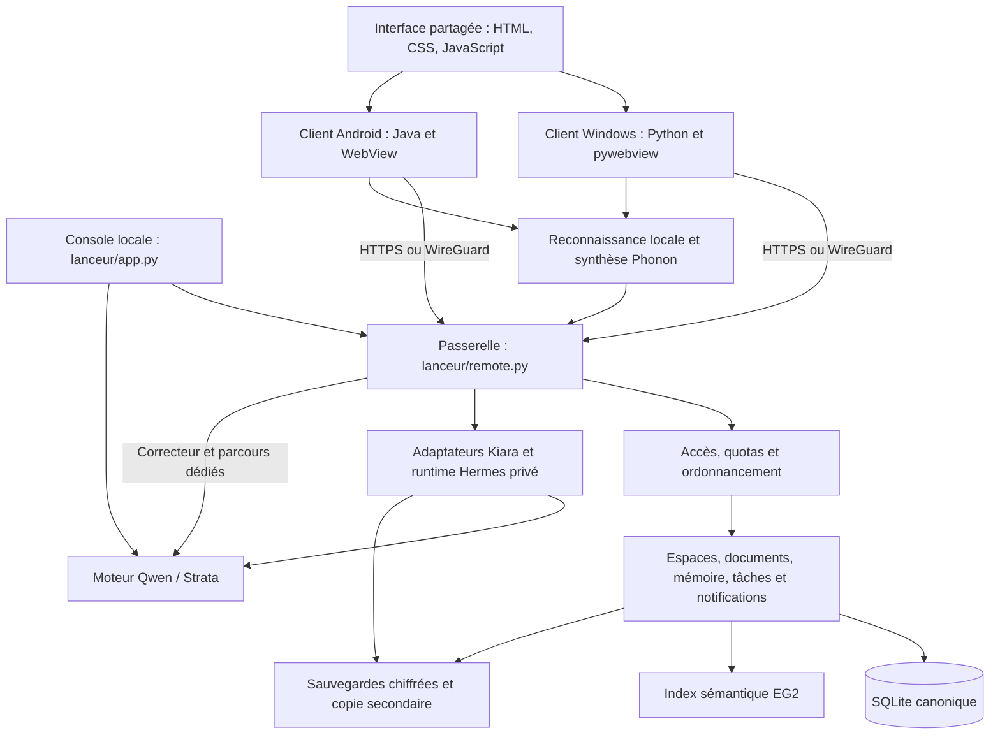

# Audit global de Kiara — 25 et 26 octobre 2026

## Suite corrective du 26 octobre 2026

Les constats ci-dessous décrivent l’état initial de l’audit. Les corrections du produit, validations et limites sont suivies dans [le rapport des correctifs](<D:/Serveur IA/maintenance/2026-10-26-correctifs-audit-global/README.md>) et [leur bilan](<D:/Serveur IA/maintenance/2026-10-26-correctifs-audit-global/AVANCEMENT.md>). Les preuves historiques restent conservées.

## Avis d’ensemble

Kiara possède un socle fonctionnel solide et déjà beaucoup de protections utiles. Son architecture convient à un serveur personnel ou à une petite équipe : un serveur central, une base canonique, des moteurs spécialisés isolés et deux clients qui partagent une grande partie de leur interface. Une réécriture générale, une migration immédiate vers des microservices ou un changement de framework ne seraient pas justifiés par les éléments observés.

Le principal problème est l’accumulation de générations successives : certaines opérations métier ont plusieurs implémentations, les compatibilités anciennes restent mêlées au fonctionnement courant, et des fichiers concentrent transport, autorisation, orchestration et stockage. Cette dette produit déjà deux défauts reproductibles. Elle rend également les prochaines évolutions plus difficiles à vérifier.

**Priorité recommandée : fiabiliser les écritures et les annulations, appliquer les correctifs de dépendances, puis consolider progressivement les frontières du code.** Le nettoyage des anciens systèmes vient après l’identification des clients et packs qui en dépendent encore.

L’audit retient **17 constats : 2 P1, 13 P2 et 2 P3**. Aucun P0 n’a été démontré. Cela ne constitue pas une garantie d’absence de vulnérabilité ou de défaut hors du périmètre testé.

| Priorité | Sens dans ce rapport | Constats |
|---|---|---|
| P0 | Incident critique immédiat démontré | Aucun identifié |
| P1 | Perte de modification ou action de récupération impossible, reproduite | F01, F02 |
| P2 | Risque de sécurité, de fiabilité ou dette structurelle à traiter | F03 à F15 |
| P3 | Clarification, réduction de maintenance et nettoyage contrôlé | F16, F17 |

Le [plan d’action](<D:/Serveur IA/audits/2026-10-25-global/PLAN-ACTION.md>) transforme ces constats en lots avec critères de validation. Les [détails des dépendances](<D:/Serveur IA/audits/2026-10-25-global/DEPENDANCES.md>) séparent présence d’un paquet vulnérable, appel à un symbole concerné et exploitabilité effectivement démontrée.

## Périmètre, méthode et limites

État de référence : commit `4ca825bf6f04e7bb906a9d4def60d69852d54fa5`, avec les modifications locales déjà présentes. Serveur et client Windows 3.5.52 ; Android 1.0.23, code 24. Les modifications préexistantes des instructions, de documents et de captures ont été conservées. Aucun correctif applicatif, déploiement ou redémarrage de production n’a été effectué dans cet audit.

Travail réalisé : inventaire Git, lecture de l’architecture et des chemins sensibles, recherche de clones et de systèmes historiques, reproduction isolée de cas limites, exécution des contrôles existants, analyse des environnements réellement installés, interrogation des avis de sécurité, inspection du binaire Go, parcours visuel des interfaces de test et lecture de l’état local de déploiement. Les sources de reconstruction et les audits antérieurs ont été utilisés pour distinguer le système courant des générations précédentes.

L’inventaire compte **4 451 fichiers suivis**, dont **206 à la racine**. Le sous-ensemble de sources applicatives retenu pour les mesures contient **186 fichiers, 25 680 lignes physiques et 989 fonctions Python**. Il exclut notamment les tests Python identifiés par leur nom, les assets Android générés, les bibliothèques vendues et les répertoires de recherche. Ce n’est donc pas une mesure de tout le dépôt ni un taux de couverture. Les scripts et filtres sont conservés dans [inventory.py](<D:/Serveur IA/audits/2026-10-25-global/inventory.py>) et [structural_checks.py](<D:/Serveur IA/audits/2026-10-25-global/structural_checks.py>).

Les interfaces ont été parcourues sur des fixtures isolées, avec des données fictives. La console de test peut afficher les métriques matérielles locales, mais aucune commande de lancement, d’arrêt ou de sauvegarde de production n’y a été déclenchée. Les seules interrogations de production étaient en lecture.

**Limites explicites :** pas de test d’intrusion depuis Internet, de charge concurrente représentative, de restauration destructive du serveur réel, de nouvel essai de récupération après perte totale du PC, de mesure audio au microphone, de validation sur téléphone Android physique, ni de revue exhaustive du code des moteurs tiers. Les captures Android valident la couche web et ses dimensions ; elles ne prouvent pas le comportement natif de WebView, des permissions, du Bluetooth ou de la mise en veille. Aucun score global artificiel ni conformité WCAG complète n’est annoncé.

## 1. Architecture actuelle



Ce schéma décrit les responsabilités, pas un déploiement où chaque rectangle serait un processus distinct.

| Ensemble | Rôle et constat |
|---|---|
| `lanceur/` | Console, contrôle du modèle, passerelle, espaces, accès, tâches, sauvegardes, adaptateurs Hermes. Cœur du produit ; frontières internes à clarifier. |
| `client-qwen/` | Client Windows, interface partagée, historique local, dictée, transport, pont WireGuard Go. Réutilisation utile, mais également importé par le serveur. |
| `client-android/` | Enveloppe Java, serveur local, intégration Android et assets dérivés du client partagé. La génération est vérifiée, mais repose sur des substitutions de texte. |
| `client-voice/` | Préparation et exécution des moteurs vocaux, avec plusieurs générations encore compatibles. |
| `maintenance/`, `audits/`, `preuves/` | Traçabilité et procédures riches. Plusieurs outils ponctuels et captures restent liés à des dates précises. |
| `recherche/`, `comparatifs/`, modèles et toolchains | Expérimentations et dépendances lourdes. À distinguer clairement du périmètre livré. |

Les conversations écrites utilisent Hermes ; le correcteur et certains parcours vocaux ont leur orchestration dédiée. La reconnaissance locale et la synthèse sont volontairement séparées du gros modèle. Cette séparation préserve les ressources du serveur et permet plusieurs niveaux de qualité selon l’appareil. Il faut unifier les règles métier communes sans imposer à chaque parcours le même moteur.

### Les données dupliquées ne sont pas toutes des doublons à supprimer

| Donnée | Autorité ou rôle | Décision |
|---|---|---|
| Espaces, documents, souvenirs, commandes, tâches | Base Workspace canonique | Conserver une autorité transactionnelle explicite. |
| Historique local Windows et métadonnées de synchronisation | Cache local protégé, édition hors ligne et synchronisation | Conserver ; tester conflits et récupération. |
| Sessions Hermes et miroirs associés | État nécessaire au moteur agent, relié au périmètre Kiara | Conserver la séparation, expliciter les règles de synchronisation et de quota. |
| Index EG2 et chunks | Données dérivées de recherche | Conserver, pouvoir reconstruire et invalider par révision. |
| Exports clients et sauvegardes | Portabilité, récupération, distribution | Conserver ; ne pas les utiliser comme autorités concurrentes. |

Le vrai doublon dangereux est une **règle métier réimplémentée différemment**, pas la présence normale d’un cache ou d’une sauvegarde.

### Points solides à conserver

- Séparation des accès, des propriétaires et des projets ; vérifications de périmètre dans les opérations sensibles.
- Bornes HTTP, contrôles d’origine et d’hôte locaux, jetons de pont et restrictions des routes.
- Transactions SQLite, contrôles de révision sur plusieurs parcours, idempotence des commandes et essais de reprise.
- Extraction documentaire séparée avec limites de durée, de mémoire et de concurrence.
- Sauvegardes chiffrées, validation des archives et copie secondaire ; mises à jour signées et procédures de récupération.
- Nombreux tests sur les conflits, la révocation, la synchronisation, les chemins web natifs Hermes et la conservation des brouillons.
- Partage effectif de l’interface Windows/Android et contrôle des assets générés.

## 2. Constats détaillés

### F01 — P1 — Deux chemins d’écriture de mémoire n’offrent pas la même protection contre les conflits

**Confirmé par reproduction isolée.** Le nouvel assistant refuse une modification fondée sur une ancienne révision. L’éditeur historique de souvenirs du projet envoie encore `memory_save` avec un identifiant et un texte, sans révision. La route correspondante vérifie le propriétaire mais écrase le contenu actuel.

Scénario reproduit : créer un souvenir ; lire son état ; le modifier depuis le nouveau parcours ; enregistrer l’ancien brouillon avec `memory_save`. Le nouveau parcours refuse correctement la révision périmée, puis l’ancienne route accepte et le texte final devient « Ancien brouillon ». La modification intermédiaire est perdue.

Sources : [éditeur partagé, ligne 70](<D:/Serveur IA/client-qwen/workspace.html:70>), [ancienne action, ligne 676](<D:/Serveur IA/lanceur/workspace.py:676>), [nouvelle commande, ligne 369](<D:/Serveur IA/lanceur/assistant_commands.py:369>). Preuve : [boundary-results.json](<D:/Serveur IA/audits/2026-10-25-global/boundary-results.json>).

**À faire :** une seule opération métier de modification de mémoire, avec contrôle de révision, appelée par les deux protocoles. Conserver les contrôles propriétaire/projet et un message de conflit qui permet de récupérer le brouillon. Examiner également les anciennes mutations de mémoire personnelle et les suppressions.

**Validation attendue :** deux clients et deux interfaces ne peuvent plus écraser silencieusement une version plus récente ; les anciens clients obtiennent un conflit compréhensible. Effort indicatif : moyen.

### F02 — P1 — À saturation, l’utilisateur peut perdre le moyen d’annuler un rappel

**Confirmé par reproduction isolée.** Les commandes d’écriture passent par le même contrôle de journal et de quota avant leur exécution. À 5 000 commandes pour un accès, `memory_forget` et `reminder_cancel` sont refusés. Le même blocage apparaît lorsqu’il ne reste pas assez de quota pour la provision calculée. Un rappel déjà enregistré continue pourtant à se déclencher.

Deux cas distincts ont été testés : journal rempli à 5 000 entrées ; quota de 1 Mio avec environ 100 octets libres. Dans les deux cas, oubli et annulation sont bloqués, le souvenir reste présent et un rappel arrive à échéance. Aucun mécanisme courant de purge/compactage du journal `assistant_commands` n’a été trouvé. Exporter les résultats ne libère pas lui-même ce journal.

Sources : [garde commune, ligne 346](<D:/Serveur IA/lanceur/assistant_commands.py:346>), [déclenchement des rappels, ligne 518](<D:/Serveur IA/lanceur/assistant_commands.py:518>), [preuve](<D:/Serveur IA/audits/2026-10-25-global/boundary-results.json>).

**À faire :** garantir une voie de récupération pour annuler et supprimer, réserver l’espace minimal nécessaire à son enregistrement, et définir une rétention bornée du journal d’idempotence. Une suppression naïve de toutes les anciennes commandes risquerait de permettre leur rejeu : conserver les garanties de non-répétition nécessaires.

**Validation attendue :** à quota plein et à journal plein, l’annulation reste durable et aucun rappel annulé ne part ; une relance de la même commande conserve son résultat idempotent. Effort : moyen.

### F03 — P2 — Des dépendances Python installées nécessitent de nouveaux correctifs

**Présence confirmée ; exploitabilité variable.** Les cinq environnements réels ont été inventoriés. Sur 220 couples paquet/version interrogés dans OSV, sept couples, correspondant à cinq noms de paquets, remontent des avis : `pypdf`, `filelock`, `opentelemetry-api`, `pip` et `setuptools`. Plusieurs avis sont des alias ; leur somme brute ne représente pas autant de vulnérabilités différentes.

`pypdf 6.19.0` est prioritaire car le code lit réellement les PDF importés. Les limites existantes — sous-processus, délai de 25 secondes, surveillance à 384 Mio et deux extractions concurrentes — réduisent le risque sans remplacer le correctif du parseur. Un avis primaire décrit une allocation excessive lors du parsing de structures imbriquées : [avis pypdf](https://github.com/py-pdf/pypdf/security/advisories/GHSA-f54x-cmq8-qg57).

Les avis sur `pip` et `setuptools` concernent notamment l’installation de paquets ; ce n’est pas une preuve d’exécution de code par une conversation. Ceux sur `filelock` dépendent des primitives et permissions utilisées. L’exposition du parseur OpenTelemetry n’a pas été démontrée de bout en bout.

Sources : [extraction PDF, ligne 168](<D:/Serveur IA/lanceur/workspace.py:168>), [environnements observés](<D:/Serveur IA/audits/2026-10-25-global/runtimes.json>), [avis OSV](<D:/Serveur IA/audits/2026-10-25-global/osv.json>).

**À faire :** mettre à jour par environnement, vérifier l’ensemble des avis applicables, régénérer les verrous après validation, reconstruire les livrables concernés et garder un retour arrière. Effort : petit à moyen par environnement. Voir l’annexe de dépendances pour les nuances.

### F04 — P2 — Le pont WireGuard est compilé avec une version Go nécessitant des correctifs

**Confirmé sur le binaire et le code.** Le binaire livré porte `go1.27.1`. Une analyse `govulncheck` au niveau des symboles remonte dix avis de la bibliothèque standard avec des chemins d’appel statiques depuis le programme. Les correctifs indiqués sont dans 1.27.2, et 1.27.3 pour le retrait de confiance de certains certificats intermédiaires. [Avis Go relatif aux certificats](https://pkg.go.dev/vuln/GO-2026-6809).

Une trace statique ne prouve pas que toutes les conditions protocolaires sont réunies. Le pont filtre les hôtes, origines, méthodes et routes ; les usages CONNECT et HTTP/2 doivent être appréciés selon sa configuration réelle. Les nombreux avis SSH associés à `x/crypto` au niveau du module ne doivent pas être présentés comme des attaques SSH contre Kiara lorsque ces paquets ne sont pas utilisés. L’outil réduit justement les résultats selon les appels de fonctions : [documentation de govulncheck](https://go.dev/doc/security/vuln/).

Preuves : [métadonnées du binaire](<D:/Serveur IA/audits/2026-10-25-global/go-binary.txt>), [résumé des appels](<D:/Serveur IA/audits/2026-10-25-global/go-summary.json>), [source du pont](<D:/Serveur IA/client-qwen/wireguard-bridge/main.go:147>).

**À faire :** reconstruire avec une version Go corrigée, revalider les transports et les canaux de contrôle, puis distribuer le binaire signé via la procédure existante. Changer uniquement `go.mod` ne remplace pas le binaire déjà embarqué. Effort : petit à moyen.

### F05 — P2 — Le contrôle des verrous d’environnement échoue sur un mélange construction/exécution

**Confirmé.** Le contrôle officiel s’arrête sur cinq paquets supplémentaires dans l’environnement Strata : `altgraph`, `pefile`, `pyinstaller`, `pyinstaller-hooks-contrib`, `pywin32-ctypes`. Les versions verrouillées elles-mêmes correspondent et les cinq empreintes de verrou sont valides. L’audit indépendant a poursuivi la vérification des autres environnements : pas d’écart de version verrouillée ni de paquet supplémentaire dans les quatre autres.

Quatre `pip check` passent ; celui d’Hermes est indisponible car ce runtime privé ne contient pas `pip`. Cela ne prouve pas une dépendance cassée.

Sources : [sortie du contrôle officiel](<D:/Serveur IA/audits/2026-10-25-global/static-3.txt>), [vérification complète](<D:/Serveur IA/audits/2026-10-25-global/runtimes.json>), [outil de verrouillage](<D:/Serveur IA/maintenance/verrous_runtime.py>).

**À faire :** séparer les dépendances de construction de celles d’exécution, ou définir explicitement deux profils verrouillés. Faire agréger les résultats des cinq environnements avant de retourner un échec. Ne pas mettre à jour le verrou à l’aveugle pour masquer une dérive. Effort : petit à moyen.

### F06 — P2 — Quelques fichiers concentrent trop de responsabilités

**Constat structurel mesuré.** `remote.py` compte 1 179 lignes, `workspace.py` 1 099, `client.py` 979 et `conversation.js` 830. La fonction `serve_gateway` couvre 758 lignes avec des fonctions internes ; son `do_POST` en couvre 548. Les métriques incluent les fonctions imbriquées et ne sont pas des mesures exactes de complexité cyclomatique.

Le problème n’est pas un seuil de lignes : ces blocs combinent routage, autorisation, validation, quotas, sélection du modèle, streaming et erreurs. Ajouter un parcours augmente le nombre d’interactions à vérifier dans un même endroit. F01 illustre déjà le coût de règles dispersées.

Sources : [passerelle, ligne 422](<D:/Serveur IA/lanceur/remote.py:422>), [actions Workspace, ligne 576](<D:/Serveur IA/lanceur/workspace.py:576>), [serveur client, ligne 342](<D:/Serveur IA/client-qwen/client.py:342>), [mesures](<D:/Serveur IA/audits/2026-10-25-global/inventory.json>).

**À faire :** extraire d’abord des opérations métier complètes et des adaptateurs de routes minces : mémoire, rappels, documents, conversations, voix. Conserver un pipeline commun d’authentification, limites et erreurs. Éviter de simplement découper le fichier en fragments qui partagent toujours les mêmes variables internes. Effort : grand, progressif par domaine.

**Validation attendue :** mêmes protocoles externes, mêmes contrôles de sécurité, tests existants conservés ; une règle métier modifiée à un seul endroit.

### F07 — P2 — Les dépendances entre serveur et client sont implicites et parfois inversées

**Confirmé par lecture.** `lanceur/http_boundary.py` importe le module HTTP placé dans `client-qwen` via `sys.path`. Workspace ajoute aussi ce répertoire au chemin d’import. `lanceur/voice_max.py` charge dynamiquement le contrôleur vocal du client. `core.py` est importé par 30 modules locaux du sous-ensemble mesuré.

Cette réutilisation évite certaines copies, mais le serveur dépend de la disposition des sources d’un client. Les noms génériques, modifications du chemin d’import et chargements par fichier rendent l’installation, les tests et l’analyse des dépendances moins explicites.

Sources : [http_boundary.py](<D:/Serveur IA/lanceur/http_boundary.py:1>), [workspace.py](<D:/Serveur IA/lanceur/workspace.py:26>), [voice_max.py](<D:/Serveur IA/lanceur/voice_max.py:1>).

**À faire :** créer un petit paquet partagé explicite pour les contrats de transport, primitives de sécurité et composants réellement communs. Distinguer configuration, règles métier, stockage et enveloppes de plateforme. Garder les différences Windows/Android lorsqu’elles répondent à des contraintes natives. Effort : moyen à grand.

### F08 — P2 — Le partage de l’interface repose trop sur des substitutions de source et des variables globales

**Confirmé ; aucun asset périmé observé.** `Prepare-Assets.py --check` passe. Néanmoins, la variante Android est obtenue par de nombreuses substitutions exactes dans les chaînes HTML/JavaScript : menus, expressions de connexion, conditions et appels. L’interface commune repose aussi sur des fonctions globales et des remplacements de fonctions comme `draw`.

Une modification syntaxiquement anodine peut empêcher une substitution ou conserver une logique de plateforme inappropriée. Les tests atténuent ce risque ; la génération actuelle ne doit donc pas être supprimée avant qu’un mécanisme équivalent soit prêt.

Sources : [génération Android, ligne 54](<D:/Serveur IA/client-android/scripts/Prepare-Assets.py:54>), [interface partagée, ligne 129](<D:/Serveur IA/client-qwen/workspace.html:129>).

**À faire :** fournir des capacités explicites à l’interface — plateforme, mises à jour, dictée, API, interactions tactiles — et des points d’entrée de modules. Générer des fichiers depuis une source commune structurée. Conserver les tests sur les deux variantes et ne pas éditer manuellement les assets générés. Effort : moyen à grand.

### F09 — P2 — Les migrations historiques restent dans le démarrage courant et le schéma est peu versionné

**Code confirmé ; aucune perte réelle observée pendant l’audit.** La migration serveur supprime les historiques et conversations si le marqueur `history_reset_id` est absent ou différent. Côté Windows, l’absence ou la différence de `.reset-id` entraîne l’effacement du cache, de ses métadonnées et des archives illisibles correspondantes, sans archivage préalable. Ce comportement correspond à une migration explicitement voulue le 6 octobre ; il reste cependant déclenchable lorsque le marqueur manque.

Le schéma a évolué, mais `PRAGMA user_version` reste à 1. La restauration reconnaît plusieurs variantes historiques par comparaison avec des définitions de schéma complètes. Cette prudence protège les imports, mais devient coûteuse à maintenir et à expliquer.

Sources : [migration serveur, ligne 125](<D:/Serveur IA/lanceur/workspace.py:125>), [réinitialisation locale, ligne 78](<D:/Serveur IA/client-qwen/history_sync.py:78>), [schémas de restauration, ligne 1017](<D:/Serveur IA/lanceur/workspace.py:1017>).

**À faire :** migrations numérotées, transactionnelles et testées depuis chaque version prise en charge ; traiter séparément un ancien historique reconnu et un marqueur manquant sur des données actuelles. Prévoir récupération ou quarantaine avant toute migration destructive compatible avec la politique de confidentialité. Ne pas retirer les lecteurs historiques avant d’avoir testé les anciennes sauvegardes. Effort : moyen.

### F10 — P2 — Le runtime Hermes privé dépend encore du bootstrap de l’installation personnelle

**Confirmé par l’ordre d’exécution.** `installation()` lit les faits et vérifie le Python et les sources de l’installation personnelle avant de sélectionner le runtime privé Kiara. Une installation privée valide ne suffit donc pas si les fichiers personnels préalablement attendus ont disparu ou changé. Les liens de dépendances employés ensuite sont intentionnels, mais cette dépendance opérationnelle n’est pas complètement isolée.

Les adaptateurs `hermes_web.py` et `hermes_codex_compat.py` appliquent également du code de compatibilité par `exec(PATCH_SOURCE)`. Il s’agit de chaînes locales contrôlées, pas d’une injection démontrée ; le risque est la divergence lors d’une mise à jour d’Hermes.

Sources : [résolution du runtime, ligne 28](<D:/Serveur IA/lanceur/hermes_service.py:28>), [préparation, ligne 65](<D:/Serveur IA/lanceur/hermes_service.py:65>), [adaptateur web, ligne 337](<D:/Serveur IA/lanceur/hermes_web.py:337>).

**À faire :** résoudre d’abord le runtime privé validé, déclarer toutes ses dépendances opérationnelles et permettre un démarrage sans installation personnelle utilisable. Associer les adaptateurs à une version/empreinte Hermes et garder les tests natifs de contrat. Effort : moyen.

### F11 — P2 — La détection d’intention par mots-clés accepte des négations et des citations

**Reproduit sur le garde d’intention seul, pas comme attaque complète contre le modèle.** `check_intent` accepte « N’oublie pas mon adresse. » pour `memory_forget`, « Ne mémorise pas cette information. » pour `memory_add`, et une phrase citant « annule mon rappel » pour `reminder_cancel`.

Les contrôles d’accès, de projet et de rattachement à une exécution restent distincts. Ces résultats ne prouvent donc ni une action effectivement décidée par le modèle ni un contournement d’autorisation. Ils montrent que ce filtre ne peut pas servir de preuve autonome de consentement sémantique.

Sources : [check_intent, ligne 97](<D:/Serveur IA/lanceur/assistant_commands.py:97>), [cas synthétiques](<D:/Serveur IA/audits/2026-10-25-global/boundary-results.json>).

**À faire :** garder une intention structurée rattachée au tour utilisateur, traiter négation/citation/ambiguïté, et demander une clarification seulement lorsque l’action destructive est ambiguë. Les commandes explicitement demandées ne doivent pas être alourdies par des confirmations systématiques. Effort : moyen ; validation sur un corpus français d’instructions positives, négatives, citées et indirectes.

### F12 — P2 — Le stockage et le rafraîchissement peuvent devenir un point de contention

**Constat de code ; ralentissement sous charge non mesuré.** Toutes les opérations du contexte `Workspace.db()` passent sous le même `RLock`, y compris les lectures. WAL ne rend donc pas ces lectures concurrentes à l’intérieur de cette instance. Chaque contexte ouvre une connexion. `snapshot()` effectue plusieurs requêtes par projet et recalcule l’usage ; les quotas agrègent plusieurs tables et peuvent inclure le stockage Hermes. Le client interroge notamment l’espace toutes les cinq secondes.

Sources : [verrou et transactions, ligne 305](<D:/Serveur IA/lanceur/workspace.py:305>), [calcul de taille et snapshot, ligne 343](<D:/Serveur IA/lanceur/workspace.py:343>), [rafraîchissement, ligne 132](<D:/Serveur IA/client-qwen/workspace.html:132>).

**À faire :** mesurer attente du verrou, durée des snapshots et latences p50/p95 avec des volumes réalistes. Utiliser les révisions déjà disponibles pour éviter les réponses inchangées ; vérifier les plans de requêtes et les index composites adaptés ; réduire les requêtes par projet. Si un compteur de quota est ajouté, le maintenir transactionnellement et le réconcilier. Ne pas supprimer le verrou sans traiter les invariants qu’il protège. Effort : moyen.

SQLite reste raisonnable pour le périmètre actuel. Une base serveur ne devient une décision utile qu’après mesure d’un besoin dépassant ce modèle.

### F13 — P2 — Certaines erreurs de workers perdent trop d’information diagnostique

**Confirmé sur des chemins ciblés.** Des sous-processus ont leur sortie d’erreur envoyée vers `DEVNULL`, notamment dans la voix et l’extraction. Dans la boucle de travail Workspace, une exception peut simplement entraîner une attente de trois secondes. Une erreur utilisateur peut être correctement présentée tout en laissant trop peu de contexte pour retrouver sa cause.

Sources : [lancement vocal, ligne 37](<D:/Serveur IA/lanceur/voice.py:37>), [extraction, ligne 198](<D:/Serveur IA/lanceur/workspace.py:198>), [boucle worker, ligne 929](<D:/Serveur IA/lanceur/workspace.py:929>).

**À faire :** conserver un diagnostic borné et filtré : opération, composant, durée, catégorie d’erreur et identifiant de corrélation. Éviter prompts, documents, jetons et clés par défaut. Relier l’erreur visible à ce diagnostic accessible en administration. Ne pas remplacer toutes les captures d’exception par des plantages : certaines assurent volontairement la reprise. Effort : moyen.

### F14 — P2 — La preuve de livraison mélange les composants et le déploiement reste lié à l’arborescence de travail

**Confirmé, sans preuve d’un EXE Windows incorrect.** Le manifeste Windows référence 539 sources et un commit antérieur au HEAD observé. La comparaison des empreintes relève trois différences, toutes dans le serveur et ses tests : `assistant_commands.py`, `test_assistant_commands.py`, `test_hermes_tools.py`. Les sources du client Windows couvertes par ce manifeste correspondent. Le manifeste trop large rend donc l’écart difficile à interpréter.

Le code, les outils, certaines données et les chemins d’installation se croisent dans la même arborescence. Des valeurs spécifiques à la machine et des dépendances envers des répertoires externes compliquent une reconstruction sur un poste propre.

Sources : [comparaison du manifeste](<D:/Serveur IA/audits/2026-10-25-global/deployment-readonly.json>), [construction des manifestes](<D:/Serveur IA/maintenance/build_manifest.py>), [racines du serveur](<D:/Serveur IA/lanceur/core.py:16>), [procédure existante](<D:/Serveur IA/RECONSTRUIRE-FRED.md>).

**À faire :** manifeste propre à chaque composant et manifeste d’ensemble du déploiement : sources, versions de runtimes, binaires, assets, signatures et résultats de validation. Séparer progressivement emplacement des données, configuration et version exécutable ; conserver les chemins actuels comme compatibilité pendant la migration. Démontrer une reconstruction sur un environnement propre avant de revendiquer la reproductibilité complète. Effort : moyen à grand.

### F15 — P2 — La validation existe, mais certains tests modifient des preuves historiques et le contrôle global est dispersé

**Confirmé pendant l’audit.** Les suites d’interface produisent des captures dans des répertoires de maintenance datés. `UI_PROOF_DIRECTORY` est pris en compte par certaines suites, mais pas par tous les helpers. Dix captures historiques initialement propres ont été remplacées par l’exécution, puis restaurées à leurs octets initiaux ; les nouvelles captures sont conservées dans ce dossier d’audit. Les deux captures déjà modifiées par l’utilisateur ont été préservées.

Les contrôles Python, UI, Android, syntaxe, verrous, dépendances et livraison sont répartis entre plusieurs commandes. Aucune configuration `.github` n’a été trouvée dans ce dépôt ; cela n’exclut pas une automatisation externe non visible.

Sources : [assistant_ui_checks.cjs](<D:/Serveur IA/client-qwen/assistant_ui_checks.cjs>), [voice_workspace_checks.cjs](<D:/Serveur IA/client-qwen/voice_workspace_checks.cjs>), [preuves de restauration](<D:/Serveur IA/audits/2026-10-25-global/restored-screenshots.json>), [commandes exécutées](<D:/Serveur IA/audits/2026-10-25-global/run_checks.py>).

**À faire :** un répertoire de résultats propre à chaque exécution, partagé par tous les helpers ; un point d’entrée de validation qui agrège les échecs et produit un manifeste. Les cas F01/F02 doivent rejoindre les tests métier permanents. Une CI locale ou hébergée peut appeler ce point d’entrée sans imposer de changement d’outil. Effort : petit à moyen.

### F16 — P3 — Plusieurs générations vocales restent mêlées au parcours courant

**Confirmé ; suppression immédiate déconseillée.** La préparation historique `prepare_max.py` cible Voxtral/Qwen TTS et `max_worker.py`, tandis que les packs actuels utilisent `max_pack_worker.py` avec Whisper/Phonon. `advanced_voice.py` conserve des branches pour les anciens formats et niveaux `runtime_api`. Quatre blocs identiques, totalisant 37 lignes, subsistent entre les deux workers : protocole et gestion de commandes.

Ces branches peuvent encore servir des packs installés. `max_recognition.py`, malgré son nom, est importé par le worker de conversation actuel : ce n’est pas du code mort. `voice_worker.py` est un relais de compatibilité vers Phonon, pas un deuxième moteur complet.

Sources : [préparation ancienne](<D:/Serveur IA/client-voice/prepare_max.py:49>), [sélection des formats](<D:/Serveur IA/client-qwen/advanced_voice.py:85>), [import actuel](<D:/Serveur IA/client-voice/conversation_worker.py:72>), [blocs communs mesurés](<D:/Serveur IA/audits/2026-10-25-global/structure.json>).

**À faire :** matrice des packs supportés, adaptateurs nommés par génération et règle de fin de support. Mutualiser le protocole des workers lorsque les comportements sont réellement identiques. Retirer les anciens installateurs seulement après vérification des packs distribués et du chemin de migration. Effort : moyen, hors urgence.

### F17 — P3 — La documentation et les outils ponctuels rendent le système courant moins lisible

**Confirmé.** Le dépôt conserve utilement beaucoup de recherches et preuves, mais 206 fichiers à la racine et des descriptions de générations différentes augmentent le coût de compréhension. Des scripts ponctuels résident encore au voisinage du code courant : `bound_workspace_revision.py` réécrit directement l’interface à l’exécution/import ; `update_conversation_docs.py` contient des remplacements liés à d’anciennes versions.

Les fichiers `lanceur/requirements-voice.txt` et `requirements-phonon.txt` ont le même contenu. À l’inverse, le répertoire Strata `0.1.43.1` contient encore le serveur Python et l’encodeur requis par le moteur `0.1.45.3`, comme l’indique explicitement la procédure actuelle : son nom ancien n’est pas une raison de le supprimer.

Sources : [script de réécriture ponctuel](<D:/Serveur IA/lanceur/bound_workspace_revision.py>), [mise à jour documentaire historique](<D:/Serveur IA/client-voice/update_conversation_docs.py>), [situation Strata](<D:/Serveur IA/README.md:45>).

**À faire :** une page « architecture et versions actuelles », un index séparé des recherches et décisions historiques, des scripts ponctuels déplacés dans leur dossier de maintenance avec garde `main` lorsque pertinent, et une source unique des exigences vocales avec alias documenté si nécessaire. Aucun déplacement automatique des fichiers utilisateur ou des archives. Effort : petit à moyen.

## 3. Doublons, compatibilités et suppressions envisageables

La comparaison conservatrice des corps de fonctions Python significatifs ne relève pas de clones exacts substantiels dans le sous-ensemble analysé ; elle ne détecte pas tous les clones renommés ou sémantiques. Il serait trompeur d’en déduire « zéro duplication ». Les règles métier et les chemins de compatibilité ci-dessous sont plus importants que les seuls copier-coller.

| Élément | Nature | Décision recommandée | Condition avant retrait |
|---|---|---|---|
| Mémoire Workspace et commandes de l’assistant | Même opération, garanties divergentes | Unifier en priorité derrière un service métier | Tests de concurrence croisée et compatibilité des clients |
| Listes de routes et limites Python/Go/Java | Répétition de contrats de transport | Définition commune testable ou génération contrôlée | Préserver les restrictions propres à chaque frontière |
| Deux workers Max | Générations différentes avec protocole partiellement copié | Partager le protocole, isoler les moteurs | Matrice des packs installés/distribués |
| `requirements-voice.txt` / `requirements-phonon.txt` | Contenu identique | Une source canonique et alias si nécessaire | Vérifier scripts d’installation et documentation |
| Assets Android | Duplication générée volontaire | Conserver la génération et son contrôle | Remplacement par une génération structurée équivalente |
| `voice_worker.py` | Relais de compatibilité | Conserver tant que référencé par un livrable | Recherche des références dans les packs, pas seulement le dépôt |
| `max_recognition.py` | Module encore actif | Conserver | Son import actuel interdit de le qualifier de mort |
| Strata 0.1.43.1 | Composants encore actifs | Conserver | Migration validée du serveur Python et de l’encodeur |
| Historiques locaux, sessions Hermes, index EG2 | Cache, état moteur et index dérivé | Conserver avec autorités documentées | Aucun retrait fondé sur une simple ressemblance de données |
| Schémas `LEGACY` / `PRE_*` | Lecture de sauvegardes historiques | Transformer en migrations/lecteurs versionnés | Jeux de sauvegardes anciennes validés |
| `bound_workspace_revision.py`, `update_conversation_docs.py` | Scripts ponctuels de transformation | Quarantaine documentaire dans maintenance | Vérification des appels dans scripts et procédures |
| Anciens profils et scripts de démarrage | Compatibilité ou secours possible | Inventorier avant nettoyage | Essai de reconstruction/récupération sans eux |

Il n’y a pas de recommandation de suppression massive. Le dépôt contient du matériel historique utile pour revenir à une configuration qui fonctionne sur les GPU disponibles.

## 4. Sécurité, exploitation et état réel observé

### Frontières de confiance

| Frontière | Protection observée | Travail restant |
|---|---|---|
| Navigateur local vers console/client | Hôte, origine, jetons, routes et tailles bornés | Garder ces invariants lors du découpage des handlers |
| Client distant vers passerelle | Identité d’accès, périmètres, quotas et transport | Revalider après mise à jour du pont Go |
| Agent vers opérations métier | Outils bornés, owner/projet, rattachement aux exécutions | Unifier les écritures et renforcer l’interprétation de l’intention |
| Documents vers parseurs | Sous-processus et bornes d’extraction | Mettre à jour pypdf, garder les bornes |
| Outils web et destinations réseau | Tests de SSRF, rebinding, redirections et isolation Hermes | Conserver les tests natifs à chaque mise à jour Hermes |
| Livrable vers installation | Signatures, manifestes et mécanismes de récupération | Manifeste par composant, inventaire des dépendances et contrôle des versions |

La recherche de signatures de secrets dans 4 024 fichiers texte suivis n’a trouvé aucun candidat. Ce contrôle limité ne couvre pas l’historique Git complet, tous les fichiers ignorés, les images/binaires ni toutes les formes possibles de secrets. Aucune valeur secrète n’est reproduite dans le rapport.

### État de la machine, lu sans modification

- Qwen répondait en état chargé avec les images activées (`qwen3.8-flash-next-iq4-xs`).
- Les services observés sur 8080, 8765, 8766, 8768 et 8643 écoutaient sur `127.0.0.1`.
- La configuration d’exposition LAN et sa règle de pare-feu étaient présentes, mais le contrôle indiquait **absence d’écoute** au moment de l’observation. Cela ne prouve pas une exposition LAN active ni une accessibilité depuis Internet. Le mode LAN de confiance doit rester une décision explicite de déploiement.
- Les ACL examinées sur la racine, `lanceur` et `acces-distants` restaient limitées au propriétaire, aux administrateurs et à SYSTEM. Le défaut d’ACL larges relevé dans un audit précédent n’est pas reproduit ici.
- Les sauvegardes étaient activées, avec destination secondaire configurée, 42 entrées au catalogue et trois dernières entrées marquées vérifiées et copiées. Le dernier succès déclaré était le 25 octobre à 23:13:02, heure locale ; aucune erreur récente n’était renseignée.

Preuve : [état expurgé](<D:/Serveur IA/audits/2026-10-25-global/deployment-readonly.json>). Les indicateurs de copie et de vérification ne remplacent pas une restauration complète sur une autre machine. L’audit ne réaffirme donc pas un défaut de sauvegarde déjà corrigé, mais recommande de maintenir des exercices de récupération documentés.

## 5. Architecture de code cible

Objectif : un **monolithe modulaire**, avec des processus spécialisés pour les moteurs et des interfaces stables. Il n’est pas nécessaire de multiplier les services réseau.

```text
kiara/
  domain/          règles de mémoire, documents, conversations, rappels
  application/     opérations, autorisation de périmètre, transactions
  infrastructure/  SQLite, fichiers, sauvegardes, Hermes, modèles, voix
  transport/       HTTP local/distant, streaming, adaptation des anciens protocoles
  shared/          contrats et primitives réellement communs
clients/
  shared-ui/       vues, état et interactions communes
  windows/         pywebview, stockage protégé, processus locaux
  android/         WebView, permissions et services Android
```

C’est une direction de découpage, pas une consigne de déplacer tout le dépôt immédiatement. Commencer par les commandes de mémoire/rappel, puis extraire un domaine à la fois. Le module de transport doit traduire la requête et l’erreur ; il ne doit pas posséder une deuxième version de la règle métier.

Les anciens protocoles restent des adaptateurs vers le service courant. Les versions de schéma et de packs vocaux deviennent explicites. Un contrat partagé permet de vérifier la concordance des routes et limites sans désactiver les contrôles défensifs propres à chaque plateforme.

Le formatage du code doit accompagner ces extractions : **52 lignes de source dépassent 1 000 caractères**, dont CSS, JavaScript, HTML et Java. Le code compact masque des dépendances et produit des diffs difficiles à relire. Formater par fichier ou domaine, dans des changements séparés des modifications de comportement ; ne pas imposer une refonte visuelle ou un framework pour résoudre ce problème.

## 6. Audit des interfaces et de la cohérence

Parcours réalisés via Playwright sur fixtures : sept vues client Windows — conversations, vocal, projets, correcteur, tâches, notifications, mémoire/rappels — ainsi que les quatre rubriques de réglages disponibles. Les seize rubriques de la console ont été ouvertes. La couche web Android a été examinée à 390 × 844 et 768 × 1024 pour les conversations, le vocal et l’assistant. Le client Windows a aussi été examiné en thème sombre.

Sur les états examinés, pas de débordement horizontal détecté. Les vérifications ciblées du menu mobile avec Échap et retour du focus passent. Le relevé des formulaires de la console n’a pas identifié de champ visible sans libellé accessible dans les états testés. Les captures montrent une hiérarchie cohérente, une navigation stable, des textes français et une séparation raisonnable entre usage courant et administration.

Les quinze suites UI existantes couvrent en complément des scénarios d’erreur, de conservation des brouillons, de navigation et de comportement partagé. Le contrôle statique complet signale neuf textes longs, principalement administratifs ; ce sont des avertissements à relire, pas neuf erreurs ni une raison de retirer les informations sur les accès, sauvegardes ou sources web.

**Priorités UX :** rendre cohérentes les protections des deux entrées de mémoire (F01), garantir l’annulation même en saturation (F02), puis revoir la densité des explications administratives au cas par cas. Aucune refonte graphique générale ne se justifie sur les observations réalisées.

Échantillons de preuve : [correcteur Windows](<D:/Serveur IA/audits/2026-10-25-global/ui/windows-corrector.png>), [réglages sombres](<D:/Serveur IA/audits/2026-10-25-global/ui/windows-settings-dark.png>), [conversation mobile](<D:/Serveur IA/audits/2026-10-25-global/ui/android-390-chat.png>), [mémoire mobile](<D:/Serveur IA/audits/2026-10-25-global/ui/android-390-assistant.png>), [console sauvegardes](<D:/Serveur IA/audits/2026-10-25-global/ui/console-Sauvegardes.png>).

Les fixtures ne contiennent pas toutes les situations réelles ni de longs jeux de données métier. Les contrastes de toutes les couleurs, les lecteurs d’écran, le zoom extrême et les interactions natives n’ont pas fait l’objet d’une qualification exhaustive. Il n’est pas possible de conclure à une conformité WCAG 2.2 AA complète.

## 7. Qualité des modèles, performances et capacité

Le dépôt dispose déjà de recherches et comparatifs sur les moteurs et la voix. Les noms de dossiers historiques ne suffisent pas à décider qu’un moteur est dépassé : sa compatibilité GPU, sa consommation, sa latence et son rôle exact comptent davantage que sa date.

Cet audit ne fournit pas un nouveau classement de modèles ni de benchmark audio/LLM. Aucun changement de modèle, de quantification ou d’allocation GPU n’a été effectué. Les gains attendus d’une autre configuration restent à mesurer sur le matériel réel et les usages Kiara.

Pour décider des prochains investissements, compléter les preuves existantes par un jeu stable de scénarios : conversations françaises, correction sans perte de sens, recherche documentaire avec citations, séparation des projets, refus d’action ambiguë, rappels et interruptions vocales. Suivre qualité, latence au premier résultat, temps total, consommation RAM/VRAM, taux d’échec et comportement pendant deux demandes concurrentes. Versionner le modèle, sa quantification, les prompts et le runtime avec les résultats.

La priorité technique à court terme est la fiabilité des opérations déterministes et la mesure des contentions. Un nouveau moteur ne corrigera ni le conflit de mémoire ni le blocage de l’annulation.

## 8. Vérifications et preuves

La table finale des contrôles et leurs limites est tenue dans le [bilan de validation](<D:/Serveur IA/audits/2026-10-25-global/VALIDATION.md>). Les journaux bruts, scripts d’inventaire, reproductions et captures sont conservés à côté du rapport pour permettre de refaire les mesures.

Les corrections proposées n’ont pas été appliquées au produit. L’objectif de ce livrable est de fournir une base vérifiable pour décider et réaliser les travaux, en préservant les modifications déjà en cours.
