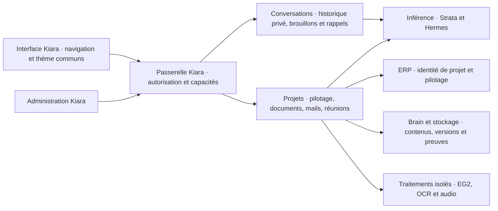

# Plan détaillé de finalisation de Kiara

15 novembre 2026 · Proposition d’architecture et de parcours à appliquer par lots

[Audit de la fusion](RAPPORT.md)

## État cible

Kiara a un dépôt de référence, une procédure de construction, une entrée d’exploitation et une interface utilisateur commune. Les clients manipulent le même catalogue de projets et chaque type de donnée a un propriétaire défini. Windows, le web privé, Android et Linux affichent les actions compatibles avec leurs capacités et leurs autorisations. L’administration du serveur partage le vocabulaire et les composants visuels de Kiara.

### Autorités et contrats

| Objet | Autorité cible | Règle de convergence |
| --- | --- | --- |
| Projet, client, équipe, CDC, planning, atelier, jalon, revue et livrable | ERP pour l’identité et le pilotage | Les nouveaux projets reçoivent un ID ERP stable. L’API renvoie archivage, liens et capacités effectives. Le rattachement ERP → Brain est résolu côté serveur. |
| Documents, notes, versions, pièces jointes, mails, transcriptions, comptes rendus et preuves d’un projet | Services documentaires et métier existants, avec Brain pour les sources et connaissances | Créer ou rattacher l’objet auprès de son propriétaire existant. Une citation référence original, version, locator et périmètre. EG2 indexe ce contenu et peut être reconstruit. |
| Historique privé, copie hors ligne, brouillons, mémoire personnelle et rappels | Workspace pour les données serveur, stockage protégé du client pour la copie et les brouillons | Conserver révisions, IDs de tour et synchronisation. L’utilisateur contrôle publication, archivage, export et suppression. Les sessions Hermes restent un état d’exécution. |
| Conversation publiée et mémoire de projet | Domaine du projet pour la publication et la mémoire partagée | Publier une révision idempotente issue d’un fil. Afficher « Publiée dans … » et permettre le retrait selon le rôle. Conserver le fil privé et le lien de publication. |
| Accès, portée et événements | Identité de l’appareil et politique Kiara, contrôle appliqué par l’autorité de l’objet | Rôles et projets gérés dans la même fiche. Réévaluer le droit lors du téléchargement, du streaming et de la reconnexion. L’activité se déduplique par identifiant d’événement et conserve les états de lecture. |
| Sauvegarde et restauration | Console Kiara et manifeste de sauvegarde versionné | Un point de reprise pour Workspace, ERP, Brain, fichiers, liens, accès, éléments de capture durables et métadonnées d’index. Le manifeste peut référencer plusieurs fichiers validés ensemble. |

Décision proposée pour l’interface. Utiliser le shell React métier comme point de départ du conteneur commun, puisqu’il pilote déjà les principaux écrans complexes et leurs liens directs. Reprendre pour ce conteneur le langage graphique actuel de Conversations. Porter l’écran Conversations par étapes, en réutilisant son rendu, ses modules de flux et ses contrats de synchronisation avant de déplacer leur cycle de vie. Une première étape peut appliquer le même shell visuel aux deux documents existants. La recette de fin exige un seul routeur, un seul thème et un seul état de navigation.

Décision proposée pour le serveur. Garder le lanceur Kiara comme superviseur et la passerelle comme seule exposition publique. Installer le service métier comme composant interne de Kiara. Les processus Python, Go, inférence, transcription et OCR gardent les isolations et dépendances qui leur sont nécessaires. Le découpage découle du domaine et des contraintes d’exécution.

## Navigation et interface

### Barre principale

| Entrée | Contenu et action fréquente |
| --- | --- |
| **Conversations** | Reprendre un fil ou écrire. Depuis le composeur, joindre un fichier, dicter, utiliser le mode vocal ou ouvrir le Correcteur. Accès direct clavier et liens existants pour ces outils. |
| **Projets** | Liste unique avec recherche, favoris et filtre Actifs / Archivés. « Nouveau projet » apparaît selon le droit. Ouvrir la fiche en un clic. |
| **Mails** | « À classer » puis « Classés » et « Rejetés ». Importer un message, vérifier sa destination ou préparer un brouillon. L’appairage Thunderbird se règle dans Connexions. |
| **Réunions** | Liste filtrable par projet. « Nouvelle réunion » ou « Reprendre l’enregistrement » quand une capture est active. Relire la transcription et publier le compte rendu depuis la séance. |
| **Activité** | Notifications et suivi des traitements dans une même vue, avec types et filtre « Non lues ». La ligne conduit à la ressource concernée. |
| **Réglages** | Entrée en bas de la barre. Quatre groupes proposés, « Apparence », « Connexions », « Mémoire et rappels », « Mises à jour ». L’administration du serveur s’ouvre depuis cette zone pour les personnes habilitées. |
| **Rechercher** | Une action dans l’en-tête et un raccourci Ctrl+K. Champ global filtrable par Conversations, Projets, Documents, Mails et Réunions, avec filtre du projet actif. Les résultats affichent leur type et leur contexte. |

### Fiche projet

Présenter le nom du projet, son client et son état dans le même en-tête. Afficher une action habituelle selon la section. Placer les opérations occasionnelles, dont l’archivage ou les exports, dans le menu d’actions de leur objet.

| Onglet | Vues actuelles à reprendre |
| --- | --- |
| **Vue d’ensemble** | Synthèse, échéance, état d’avancement, tâches prioritaires, identité, client et équipe. Donner accès aux consignes, aux conversations publiées et à « Poser une question ». |
| **Pilotage** | Exigences du cahier des charges, planning, atelier, jalons, validations et revues de lancement. Lier chaque vue à son URL et afficher un seul niveau de navigation locale, par exemple une liste de sections ou des filtres. Les référentiels et modèles s’ouvrent depuis les actions qui les utilisent. |
| **Documents** | Documents, notes, livrables, dossiers associés, versions et publications. Sources et informations deviennent des filtres ou des liens dans la vue. Une citation ouvre la version et le passage concernés. |
| **Réunions** | Séances du projet, enregistrements, transcriptions et comptes rendus. Même composant que dans la liste globale, avec le projet présélectionné. |

Une réunion reste accessible depuis Réunions et depuis sa fiche projet avec la même page de détail. Une recherche globale donne accès aux documents de plusieurs projets selon le périmètre de l’utilisateur. Les imports Sage éprouvés gardent leur place dans le parcours métier. Leur activation en exploitation suit leur qualification propre. Les imports EML, archives et dossiers rejoignent leurs destinations respectives.

### Règles de présentation

- Réutiliser les variables de `client-qwen/ui.css` comme référence de palette claire, sombre et système. Extraire des variables communes pour texte, accent, surfaces, état, bordure, focus, taille et espacement. Un réglage de lecture s’applique aux contenus qui en bénéficient.
- Garder la barre latérale, l’en-tête et les styles de sortie communs sur tous les écrans utilisateur. Fenêtres étroites avec un panneau de navigation, contrôles accessibles au clavier et focus rendu au bouton d’ouverture.
- Partager le comportement des boutons, champs, confirmations, tableaux, états vides, chargements, erreurs, succès et messages en cours de traitement. Les tableaux et plannings gardent leur densité, leur filtre et leur navigation au clavier.
- Retirer surtitres, descriptions qui répètent le titre, noms des moteurs en permanence et instructions de fonctionnement hors contexte. Conserver les consignes utiles, les autorisations, les états de capture, le périmètre d’envoi, les erreurs et les actions de récupération.
- Gérer thème, densité, police de lecture, favoris et préférences importantes dans un profil. Reprendre les anciennes préférences lorsqu’elles ont une correspondance. Les diagnostics, sauvegardes et commandes d’exploitation se trouvent dans la console.

### Charte graphique de référence

Les couleurs reprennent [Conversations](../../client-qwen/ui.css#L1). Les dimensions ci-dessous fixent la cible de départ pour les composants communs. Les tableaux et plannings gardent une présentation compacte pour faciliter la comparaison.

| Usage | Clair | Sombre |
| --- | --- | --- |
| Fond et barre latérale | `#FFFFFF` / `#F7F7F5` | `#202021` / `#19191A` |
| Surface et bordure décorative | `#FAFAF9` / `#E7E7E3` | `#262627` / `#383839` |
| Texte et texte secondaire | `#242423` / `#686862` | `#ECECEB` / `#999994` |
| Action principale, fond et texte | `#242423` / `#FFFFFF` | `#ECECEB` / `#202021` |
| Information positive, avertissement et erreur | `#327854` / `#8A5A10` / `#AD4038` | `#8FBA9E` / `#D7BA89` / `#E4A199` |

- **Typographie.** Segoe UI, puis la police système. Titre de page 24 px, titre de section 18 px, corps et contrôles 14 px, métadonnées 12 px. Les contenus de lecture conservent les préférences utilisateur existantes.
- **Dimensions.** Espacements de 4, 8, 12, 16, 24 et 32 px. Barre latérale de 238 px sur bureau et en panneau à partir de 850 px de largeur et en dessous. Rayon de 8 px pour les contrôles et de 12 px pour les panneaux. Icônes au trait de 18 px. Cibles tactiles de 44 px pour les actions essentielles.
- **Composants.** Un bouton principal par zone d’action, boutons secondaires sobres, action destructive confirmée dans son contexte. Afficher l’onglet courant par traitement visuel et état accessible. Les tableaux peuvent défiler dans leur conteneur. Sur téléphone, garder le nom de l’objet, son état et son action dans la vue principale, avec les autres champs dans le détail.
- **États.** Prévoir par composant repos, survol, focus, sélection, désactivation et traitement en cours. Associer un libellé à chaque état métier. Donner aux erreurs un message et une action de récupération. Mesurer les contrastes sur les surfaces réelles, notamment les bordures de contrôles et les indicateurs de focus. Exiger 4,5:1 pour le texte courant et 3:1 pour les indicateurs et limites de contrôles nécessaires à l’usage.
- **Préférences.** Une valeur clair, sombre ou système pour toutes les vues du client. Reprendre le réglage de Conversations s’il existe, puis celui de l’espace métier à défaut. Valider la persistance à la réouverture et la continuité lors du passage de Conversations à Projets.

### Découpage du lot interface

| Ordre | Livraison | Critère de fin |
| --- | --- | --- |
| 3.1 | Variables, composants de base et conteneur commun. Réaliser la liste Projets et une fiche de référence avec un projet fictif. | Captures à 1440, 768 et 390 px en clair et en sombre. Comparaison avec Conversations. Validation du clavier, des contrastes, du panneau mobile et du retour à la liste avant généralisation. |
| 3.2 | Fiche projet et liens historiques. Porter Vue d’ensemble, Pilotage, Documents et Réunions. | Les sept anciennes rubriques et leurs liens profonds mènent à une destination vérifiée. Le projet, le filtre et l’ancrage attendus sont conservés. |
| 3.3 | Mails, Réunions, Activité, Recherche, Réglages. | Un scénario complet et un état vide ou d’erreur par destination. Les actions d’administration sont accessibles selon les droits. |
| 3.4 | Conversations dans le conteneur commun et remplacement du panneau Assistant. | Reprise de fil et de brouillon, publication, refus d’outil, mode éphémère, voix et reprise après coupure validés avant de retirer l’ancien écran. |
| 3.5 | Adaptation Windows, web privé, Android et Linux, puis nettoyage des styles hérités. | Recette par capacité et par plateforme. Aucun retour à l’ancien thème au changement de vue, à la reconnexion ou au redémarrage. |

Les lots techniques 0 et 1 peuvent démarrer dès maintenant. Le travail 3.1 peut avancer sur données fictives pendant la préparation des migrations. La fiche projet de référence sert de validation visuelle avant de décliner la charte. La bascule des écritures dépend de la recette de migration et de restauration du lot 2.

### Parcours de référence

| Intention | Parcours attendu |
| --- | --- |
| Reprendre un projet | Projets → projet. Le retour rétablit recherche, filtre et position de la liste. |
| Demander une réponse fondée sur le projet | Projet → Poser une question → Conversations avec projet indiqué → citation → version et passage. Le mode éphémère est visible avant l’envoi et reste la valeur par défaut pour le parcours qui l’utilisait déjà. |
| Publier une discussion | Depuis le fil, « Publier dans le projet » précise les destinataires et la révision. Résultat visible et relançable sans créer de doublon. |
| Retrouver une réunion | Depuis le projet, la liste globale ou une notification, ouverture de la même séance. Reprise des fragments en attente et avertissement si l’arrêt ou l’envoi n’a pas abouti. |
| Classer et répondre à un mail | Mails → À classer → message et pièces jointes → projet → confirmation du classement → brouillon Thunderbird sur le poste associé. |
| Trouver un échec | Activité ou contexte d’origine → détail → Réessayer, reprendre ou exporter selon le traitement. Les décisions de sauvegarde et de récupération restent explicites. |

### Routes et accès à reprendre

Les routes ci-dessous forment le contrat de navigation proposé. Les adaptateurs traduisent aussi les liens profonds et les filtres diffusés avant la migration.

| Entrée actuelle | Destination Kiara | Donnée à transporter |
| --- | --- | --- |
| `/chat`, panneau Assistant ou notification de discussion | `/app/conversations` ou `/app/conversations/{id}` | ID de fil, projet présélectionné et mode éphémère selon le parcours |
| `/app` de l’espace métier et ancien écran Projets | `/app/projets` | Recherche, favoris, archives. Les éléments à traiter de l’ancien accueil rejoignent Activité. |
| `/app/projects/{id}/{onglet}` | `/app/projets/{id}/{section}` | ID, section et ancrage. `cdc`, `planification` et `atelier` pointent vers Pilotage, avec le bon sous-contexte. Les liens `reviews` mènent à la revue ou à la réunion demandée. |
| `/app/sources?source=…`, anciennes citations et liens documentaires | `/app/projets/{id}/documents` et lecteur de preuve | ID, révision, passage ou repère. En l’absence de projet dans le lien, résoudre la source sous le périmètre de l’utilisateur. |
| `/app/mail` et `/app/meetings?project=…` | `/app/mails` et `/app/reunions` | File de mails, projet, message ou séance. Une alerte de transcription conduit à la séance lorsqu’elle est connue. |
| Notifications et suivi des analyses | `/app/activite` | Type d’événement, état lu, traitement et identifiant de ressource |
| `/agent/` et anciens liens privés de téléchargement | Entrée web Kiara et téléchargement authentifié | Session et destination autorisée. Les requêtes d’écriture historiques gardent leur adaptateur de protocole. |

### Console serveur

Ramener la console à cinq destinations. **Vue d’ensemble** porte l’état du serveur, du modèle et des traitements. **Services** réunit calcul, modèle, fichiers, démarrage et surveillance. Les réglages serveur de mémoire, d’indexation et de recherche web y sont rattachés. **Clients & accès** regroupe appareils, projets autorisés, accès distant, réseau et API. Le stockage par client et les notifications par appareil se gèrent dans la fiche correspondante. **Mises à jour** regroupe les canaux et les livrables. **Sauvegardes** réunit création, vérification, NAS et restauration. Les journaux et informations avancées s’ouvrent depuis la vue d’état du service concerné et un lien Diagnostic stable. Aligner les formes et libellés avec le client Kiara et conserver la densité des données d’exploitation.

## Lots à exécuter

### 0. Établir un état reproductible

1. Capturer l’état Git et inventorier les fichiers suivis, non suivis et ignorés par fonction. Comparer le dépôt autonome au code déjà intégré. Pour les 100 divergences observées, identifier la version qui fait autorité ou réconcilier les évolutions utiles. Vérifier les quatre absences au regard du retrait de l’ancien multimodal. Rechercher les consommateurs restants dans les tâches, raccourcis, scripts de build, profils de lancement, documentation et procédures de secours. Exclure bases, archives, clés, index, fichiers clients, caches et binaires de recette des sources livrées. Établir une série de changements isolée, en préservant le travail local.
2. Vérifier le chemin des exécutables réellement utilisés, le manifeste de chaque canal, les versions du serveur, du relais, du frontend, de Tauri et du helper audio. Mettre à jour le périmètre de `maintenance/build_manifest.py` pour Tauri, Rust, dépendances et artefacts du relais. Rejouer le contrôle sur un répertoire de build propre.
3. Étendre `maintenance/verify_project.py` aux groupes métier Python, TypeScript, Tauri, paquet de distribution, recette transport et sauvegarde/restauration. Capturer les résultats par empreinte. Vérifier les chemins D:/E:, les environnements et les verrouillages de dépendances à partir des configurations effectives.
4. Faire une sauvegarde de référence complète et la restaurer sur une copie isolée. Relever le volume, les compteurs par domaine, les droits, l’intégrité SQLite, les fichiers, les empreintes de preuves et un échantillon de citations, d’audio et de mails. Identifier une version précédente reconstruisible et un point de retour.

**Sortie du lot** — Chaque artefact est relié à ses sources et à ses tests. Une restauration complète et la version précédente ont une preuve exploitable.

### 1. Fixer les contrats et les droits

1. Définir dans la passerelle une vue de projet avec `project_id`, état, capacités, lien documentaire résolu et provenance technique. Remplacer progressivement la détection par format UUID dans `lanceur/workspace.py`, `shared/kiara_shared/history_store.py` et `client-qwen/workspace.html`.
2. Unifier l’autorisation d’une action autour de l’identité Kiara, du rôle et de la ressource. Reprendre `agent_access.py`, `agent_gateway.py` et les filtres ERP/Brain. Tester lecteur, contributeur, propriétaire, accès suspendu ou révoqué, projet archivé et périmètre modifié en cours de flux.
3. Définir une route canonique par objet dans la façade Kiara. Cartographier les routes publiques et locales historiques, la page web, les liens dans les notifications, les pièces jointes, les téléchargements et les appels Tauri. Conserver les anciens contrats via adaptateurs tant que les clients ou liens nécessaires les utilisent. Tester la réécriture de chemin et du filtre, les IDs encodés et les variantes desktop, web et Android.
4. Séparer explicitement le protocole d’approbation et de reprise d’Hermes du protocole métier. Les routes historiques comprenant le même mot ont des usages différents. Aligner le vocabulaire visible, tout en gardant les invariants d’authentification, origine, cookies, URL locale, révocation, flux et ouverture de fichiers.

**Sortie du lot** — Le même projet a le même ID et les mêmes capacités sur les clients compatibles. Une opération refusée l’est à chaque entrée.

### 2. Préparer la convergence des données

1. Produire un inventaire par propriétaire des anciens projets Workspace, projets ERP, liens Brain et objets associés, y compris archivages, publications, mémoires, événements, documents, révisions et index. Distinguer les données actives, les doublons prouvés, les références manquantes et les projets privés. Un état vide du catalogue doit se distinguer d’un refus ou d’une panne.
2. Créer une table de correspondance versionnée `ancien ID → ID Kiara`, liée au propriétaire et aux preuves de rapprochement. Faire correspondre d’abord les identifiants et liens vérifiés. Soumettre les ambiguïtés au rapprochement manuel. Importer les projets privés avec une portée privée équivalente. Garder les codes usuels, favoris, liens profonds et anciens IDs consultables par alias.
3. Migrer en copie par domaine. Préserver révisions et dates, rattachements, fichiers d’origine, empreintes, citations, tours et reçus de commandes. Reprendre les archives de sauvegarde historiques dans un espace isolé avant conversion. Un journal de migration doit permettre reprise et vérification après interruption.
4. Comparer avant/après par ID, contrôle d’accès, compteur et empreinte. Ouvrir une preuve de chaque famille. Reconstituer les index dérivés en arrière-plan et montrer un état fiable de disponibilité. Au moment du changement d’autorité, diriger chaque écriture vers une destination unique. Neutraliser les projections cachées uniquement après vérification.

**Sortie du lot** — La migration à blanc se rejoue, y compris après interruption. Les écarts documentés sont résolus. Chaque projet reste identifiable, consultable et protégé selon ses droits.

### 3. Construire l’interface commune

1. Introduire le conteneur commun, les variables graphiques et le registre des routes. Migrer l’entête, la sidebar, les confirmations et le mécanisme de focus. Appliquer la nomenclature commune aux titres, messages, aide et réglages. Mettre en place les liens anciens dès cette étape.
2. Monter Projets et les quatre onglets de la fiche à partir des composants métier existants. Remplacer les accès « Ouvrir dans … » par la route directe. Migrer les retours de navigation et conserver les brouillons de notes, filtres, ancrages et sélections.
3. Intégrer Mails, Réunions, Activité, Réglages puis les outils de Conversations. Mettre les données de suivi au bon endroit. Brancher la recherche commune et le lecteur de preuve, y compris les anciennes citations. Déporter l’administration de projet, de connexion et de maintenance vers des écrans adaptés à leurs droits.
4. Intégrer le composeur et l’historique dans le même routeur. Utiliser un mode de sélection de projet explicite, préserver la reprise de tour et raccorder l’ancien panneau d’assistant à Conversations. Tester annulation, délai long, reconnexion, approbation, reprise, pièce jointe, voix, export et fermeture avec brouillon. Vérifier la réouverture de l’historique propre au panneau et la conservation du mode éphémère.
5. Définir les capacités communiquées au web et aux clients natifs. Vérifier les différences sur Android et Linux, en particulier l’accès aux projets, les citations, les notifications et la voix. Générer les assets Android à partir de leurs sources et tester le portage de l’interface sur WebView. Maintenir les fonctions Windows qui dépendent du relais, avec leur état et leurs autorisations.
6. Examiner le graphe des imports et les tests du bureau ancien, de ses préférences, de son menu et du dock. Après migration de leurs dernières fonctions utiles, retirer ces composants, CSS et dépendances. Scinder le chargement de CDC, planning, audio et formulaires lourds. Mesurer le temps d’ouverture et de navigation sur l’appareil de référence.

**Sortie du lot** — Ouvrir un projet, une citation ou une réunion garde la même navigation, le thème et la session. Les cinq destinations principales sont stables et les actions d’un objet sont accessibles dans son contexte.

### 4. Unifier l’exploitation et le nom

1. Donner au service un nom de domaine Kiara et une configuration commune, avec lecteurs de transition pour l’ancien fichier et les variables déjà déployées. Réunir l’état de santé et la supervision. Harmoniser les délais de redémarrage, les diagnostics et les budgets d’inférence.
2. Intégrer les habilitations à la fiche **Clients & accès**. Mettre « Sauvegardes » et « Restauration » dans une seule procédure Kiara. Vérifier que l’état « Vérifiée » couvre tous les fichiers, les empreintes de la copie NAS et la restauration de l’ensemble. L’assistant de restauration sait lire les anciens manifestes et affronter une pièce compagnon manquante, une panne NAS ou un manque d’espace.
3. Aligner nom de programme, titres, espace web, extension, installeur, captures, documentation d’exploitation et journaux courants. Valider les identifiants stables de mise à jour et d’appairage avant de changer un identifiant technique. Garder les termes anciens nécessaires à la lecture des sauvegardes et au diagnostic des migrations dans les guides d’historique et adaptateurs.
4. Publier un inventaire de références de compatibilité, avec propriétaire, contrat couvert, version minimale, test de retrait et date de revue. Retirer leur exposition au fil de la migration. Tester l’ouverture des liens publiés et l’import des archives utiles après tout retrait.

**Sortie du lot** — Les utilisateurs et administrateurs ne rencontrent qu’un seul produit nommé Kiara dans les écrans, messages, titres, téléchargements et documents courants.

### 5. Qualifier, basculer et retirer

1. Exécuter la matrice ci-dessous sur une copie réaliste. Bâtir un installateur signé selon la chaîne retenue, qualifier la migration depuis 3.5.63 et depuis la version Kiara 4 détectée sur les postes. Vérifier profil, réglages, signature, permissions et retour arrière.
2. Déployer d’abord la façade et les adaptateurs compatibles, puis activer l’interface commune sur un poste pilote. Suivre démarrage, reconnexion, erreurs d’accès, échecs de persistance et traitements interrompus. Valider les parcours prioritaires du poste pilote avant élargissement.
3. Pour la bascule des écritures, poser un point de reprise cohérent, arrêter ou mettre en file les écritures pendant la bascule, exécuter la migration idempotente, vérifier intégrité et droits, puis reprendre les traitements. Mesurer le volume d’écritures depuis le jalon de retour.
4. En cas de retour applicatif avec schéma compatible, réactiver les routes de l’interface précédente. En cas de restauration de données, reconstruire l’ensemble à partir du même point de reprise. Récupérer ou rejouer les écritures postérieures à partir du journal avant réouverture. Arrêter la bascule si l’intégrité, les droits ou la reprise des écritures ne peuvent pas être démontrés.
5. Retirer la navigation historique, le paquet autonome, les chemins d’exploitation doublons et les adaptateurs qui satisfont leur test de retrait. Archiver le dépôt autonome en lecture seule après réconciliation des sources et contrôle des derniers consommateurs. Réserver le dépôt Kiara aux constructions et évolutions futures. Vérifier les sources, le bundle, les chaînes visibles et la documentation courante après nettoyage.

## Matrice de recette finale

| Axe | Preuve attendue |
| --- | --- |
| **Projets et données** | Comparaison des IDs, révisions et champs, droits, archivage, migration rejouée deux fois et interrompue en cours. Projet historique privé, projet partagé et projet hors périmètre couverts. |
| **Conversations et mémoire** | Brouillon protégé, reprise en ligne et hors ligne, lecture de l’historique des deux interfaces, publication et retrait, aucun doublon de commande, mode éphémère et refus d’outil. |
| **Documents et recherche** | Import, note versionnée, preuve CDC, citation ancienne, original par empreinte, pièce jointe de mail, index reconstruit, erreur et reprise d’analyse OCR. Vérification croisée des périmètres. |
| **Mails et réunions** | Thunderbird appairé et révoqué, EML, classement et brouillon, capture native, coupure réseau et reprise des fragments, transcription, relecture, publication, PDF et lecture audio. |
| **Sauvegarde** | Création et seconde copie vérifiées, restauration complète isolée, anciens formats et projets historiques, accès restaurés, vérification d’un échec partiel et d’un retour avec écritures postérieures. |
| **Interface** | Desktop 1440×900, tablette 768×1024, mobile 390×844, zoom 200 %, clair et sombre. Clavier, focus, états vide/en cours/erreur/succès, retour et liens directs. Vérifications ciblées WCAG 2.2 AA. |
| **Droits et transports** | Windows Tauri installé, web privé HTTPS, WireGuard, Android WebView et client Linux. Au moins un scénario de révocation pendant une action longue, flux interrompu et fichier hors périmètre. |
| **Construction et distribution** | Sources et dépendances identifiables, artefacts et manifestes vérifiés, migration de profil, mise à jour signée et marche arrière sur les versions concernées. |
| **Nom et menus** | Aucune occurrence de l’ancien nom de produit dans les textes visibles ou la documentation courante. Les cinq destinations, Recherche et Réglages suffisent à rejoindre les fonctions inventoriées. Les anciennes routes encore nécessaires conservent leurs tests. |

## Démarrage des lots 0 et 1

- **Lot 0.** La [liste des sources à réconcilier](SOURCES-A-RECONCILIER.tsv) recense 100 fichiers divergents et quatre absents sur 431 comparés, hors tests. Le [manifeste Windows](../../maintenance/build_manifest.py) inclut les sources Tauri, le verrou Cargo et les hooks NSIS. Le contrôle de sélection a retenu 194 fichiers. La réconciliation fonctionnelle, la reconstruction et la restauration de référence restent à faire.
- **Lot 1.** Le catalogue Workspace expose `project_kind` (`private` ou `managed`). Pour un projet géré, `has_knowledge` indique si le projet est lié aux connaissances. La valeur `null` couvre le cas d’un serveur antérieur qui omet l’information. Le champ `id` et les contrôles existants restent compatibles. Les 28 tests ciblés d’accès, de passerelle et de transport passent. Le remplacement progressif du routage par forme d’identifiant et la cartographie des droits et des routes restent à poursuivre.
- **Aperçu.** La [liste et la fiche fictives](APERCU-PROJETS.html) permettent de vérifier recherche, filtres, navigation et thème. La fiche de la médiathèque sert de référence. Les autres lignes illustrent les états de la liste. Recette Chrome à 1440, 768 et 390 px, avec les deux thèmes sur la fiche.

## Préparation de l’intégration Projets

Le style accepté reste la référence dans [l’aperçu fictif](APERCU-PROJETS.html). Le premier raccordement est disponible dans le bundle de recette via `/app/projets?presentation=kiara`. Il utilise le portefeuille, les fiches, les droits et les données déjà fournis par Kiara. Le paramètre applique la palette de Conversations, Segoe UI, la barre de 238 px et le traitement des titres et tableaux aux deux écrans du pilote. La recette a ouvert la liste, la fiche et un lien direct vers Documents à 1440 et 390 px depuis le relais local avec un projet fictif. Les adresses actuelles gardent leur présentation en accès normal.

| Adresse de transition | Composant existant | Travail avant activation générale |
| --- | --- | --- |
| `/app/projets` | Portefeuille de `WorkspaceShell` | Reprendre la liste validée, ses filtres, ses favoris et le retour conservant la sélection. Brancher la création sur les capacités du catalogue. |
| `/app/projets/{id}/vue-ensemble` | Vue d’ensemble de `ProjectPanel` | Composer « À traiter », « Situation », le dernier document et la prochaine réunion à partir des données existantes. |
| `/app/projets/{id}/pilotage` | Planning du projet | Regrouper CDC, planning, atelier et revues sans rendre leurs anciens liens inaccessibles. |
| `/app/projets/{id}/documents` | Documents du projet | Raccorder le lecteur de preuve et confirmer les liens qui portent déjà un identifiant de source ou de version. |
| `/app/projets/{id}/reunions` | Revues et réunions du projet | Raccorder la séance et sa transcription au même détail que la liste globale. Tester un lien de notification. |

### État des lots

- **Lot 0.** Le dépôt intégré est la référence retenue pour les nouvelles constructions. Les 100 écarts avec le dépôt historique sont recensés. L’examen des 13 écarts à suppression dominante retrouve surtout l’ancien index multimodal et des contrôles documentaires consolidés. Les quatre sources multimodales absentes restent retirées. La qualification fonctionnelle de tous les écarts et le contrôle exhaustif des consommateurs historiques restent ouverts. Le paquet serveur est reconstruit depuis un bundle Vite neuf et son manifeste empreinte les fichiers réellement empaquetés. Les contrôles TypeScript, Vitest (1 041 tests), Tauri (3) et contrats de livraison (2) passent. Le paquet Windows final et son parcours de mise à jour restent à reconstruire et qualifier.
- **Restauration de référence.** La paire locale du 15 novembre a été vérifiée. La copie isolée du domaine métier a restauré 11 projets, 39 038 passages EG2 et 3 032 fichiers, avec intégrité SQLite et empreinte de l’original CDC vérifiées. Les 17 tests de restauration métier et les 12 tests de restauration du lanceur passent. Le chemin NAS annoncé par le catalogue est introuvable depuis le lanceur et dans la session courante. La recette de l’ensemble sur copie NAS reste ouverte.
- **Lot 1.** Le client partagé utilise le type explicite pour les entrées présentes dans le catalogue. Anciens catalogues et historiques continuent à être lus. Les assets Android ont été régénérés et vérifiés. Le routeur accepte les liens Projets en français et conserve les chemins historiques. Les 49 tests ciblés du lanceur, des accès et des clients et les six contrôles des nouveaux liens passent. La politique d’autorisation reste portée par l’identité d’appareil, le rôle et le périmètre de projet. La convergence complète des chemins d’accès et la recette réelle Android/Linux restent ouvertes.

La recette ciblée complémentaire couvre 81 cas de périmètre, d’archivage et de préparation de publications. Le contrôle de livraison lit les empreintes du frontend dans le ZIP serveur et compare les sources à l’arbre courant. Il a vérifié 760 entrées sur le ZIP de recette. La suite Python métier complète est en cours et ne vaut pas encore preuve de validation globale.

## Intégration de la liste et de la fiche

La liste **Projets** est raccordée au portefeuille Kiara. Le client Windows passe directement de Conversations à cette liste quand son serveur annonce l’interface. La fiche présente **Vue d’ensemble, Pilotage, Documents et Réunions**. Les anciens liens de fiche restent lisibles, y compris CDC, Atelier, Informations et l’identifiant de réunion. Pilotage ouvre les vues de travail correspondantes. Les recherches et filtres du portefeuille sont retrouvés au retour de la fiche.

La présentation reprend Segoe UI, la barre de 238 px et les neutres clair/sombre de Conversations. Les titres, la rangée d’onglets et la grille de synthèse reprennent l’aperçu accepté. Les actions métier d’édition, de sauvegarde et le suivi détaillé restent accessibles. Le serveur conserve l’autorité sur les droits. Le client masque la création en lecture seule ou lorsque le rôle est limité à une liste de projets.

- [Liste intégrée](captures/integree-liste.png) et [fiche intégrée](captures/integree-fiche-1440.png), sur projet fictif. [Fiche en fenêtre étroite](captures/integree-fiche-390.png).
- Chrome à 1440, 768 et 390 px. Ouverture depuis Conversations, quatre onglets, ancien lien CDC et conservation du filtre au retour. Recette native de la même entrée et du retour avec le nouvel exécutable Kiara et WebView2.
- Le paquet serveur a été reconstruit avec le frontend livré. Le relais Windows a passé son autotest, le module audio a été reconstruit, et l’installateur NSIS contient les trois exécutables. Le paquet de recette est conservé dans `E:\Kiara-Integration\Build\fusion-kiara\windows-recette`. Les deux binaires précédents ont été préservés et remis en place dans l’ancien dossier de build après vérification des empreintes. L’installateur de recette est non signé. Aucun certificat actif de signature de code avec clé privée n’a été trouvé dans le magasin utilisateur.
- Le contrôle des sources et des sept verrous de runtime est vert. Le runtime de construction vocale Windows pointait encore vers l’ancien profil local et a été rattaché à Python 3.12.14, avec vérification des versions installées.
- Le partage `\\DS218\home\Sauvegarde\Serveur IA` reste inaccessible. La restauration locale documentée reste la preuve de référence. Aucune recette de mise à jour sur un poste Windows installé, de nouvelle fiche sous Android ou de client Linux réel n’a été effectuée. Le paquet Android partagé est vérifié et sa recette navigateur passe. La fusion du routage métier complète au-delà des liens Projets reste à valider avec ces clients.

## Migration à blanc et navigation commune

La recette a ouvert en lecture seule les trois bases du serveur et réalisé des instantanés SQLite dans un dossier temporaire privé. Les contrôles d’intégrité et de clés étrangères passent. La base des espaces privés contient **zéro ancien projet**. Les quatre archives locales du 9 au 15 novembre dont le catalogue indique une vérification contiennent également zéro projet, document et conversation publiée dans ce périmètre. Les deux historiques personnels en base ont été examinés pour leurs rattachements, avec zéro référence de projet à remapper. Le portefeuille métier compte **11 projets et 11 liens vers Brain**, tous résolus avec les identifiants existants.

La [commande de répétition](../../maintenance/rehearse_project_migration.py) crée un catalogue de recette. La conception retient chaque projet privé et ses objets dans son stockage propriétaire. Le futur catalogue peut les référencer par ID et owner en préservant la portée personnelle. La recette n’étend donc aucun accès ERP à un dossier privé. Aucun regroupement par titre n’est autorisé. La répétition donne les mêmes identifiants et les mêmes compteurs. Le [test d’interruption et de périmètre](../../maintenance/tests/test_project_migration_rehearsal.py) couvre deux projets homonymes avec propriétaires distincts, l’archivage, un document et sa citation, une conversation, une mémoire, l’annulation transactionnelle et le refus d’une collision d’identifiants. Aucune écriture sur les bases en service.

La navigation de recette présente **Conversations, Projets, Mails, Réunions et Activité**, avec Recherche dans l’en-tête et Réglages en bas. La palette clair/sombre et la barre de 238 px viennent de Conversations. Le relais ouvre Mails, Réunions et Activité lorsque le serveur annonce la capacité. La page Activité réunit les actions à traiter et le suivi des analyses, avec accès à la boîte de notifications locale depuis Kiara Windows. Les anciens liens Mails, Réunions et Suivi des analyses restent reconnus. Les outils du client restent accessibles pendant la transition.

- **Validation.** Parcours de navigation authentifié en recette Chrome à 1440, 768 et 390 px, dont le passage de Conversations en sombre vers un écran métier et l’ouverture des notifications depuis Activité. [Activité en clair](captures/navigation-activite-1440.png) · [Activité en sombre](captures/navigation-activite-390.png)
- **Suites.** La suite métier de référence s’est achevée avec 3 006 réussites et 13 tests ignorés. Les 28 tests du transport, le test de répétition et les contrôles frontend ciblés sont rejoués pour la navigation. La génération Android et les parcours de récupération du client partagé sont vérifiés sur données fictives.
- **Encore à qualifier.** Les tests natifs Android et Linux, la signature Windows, la copie NAS et la bascule générale restent ouverts.

## Conversations et assistant de projet

Depuis **Conversations**, le bouton **Assistant de projet** réutilise le composeur, les bulles et la palette de Kiara. Depuis le menu métier, il ouvre le même écran et présélectionne le projet courant s’il est relié aux connaissances. L’historique de projet permet de relire et de reprendre les échanges enregistrés dans le périmètre autorisé. [Capture de recette](captures/conversations-assistant-projet.png)

Le brouillon personnel est restauré au retour. Les brouillons des échanges enregistrés passent par le stockage protégé du client. Un nouvel échange de projet est éphémère par défaut. Le brouillon et les messages éphémères restent en mémoire pendant la session et sont exclus des écritures d’historique. Les rattachements et les fils existants conservent leurs identifiants et leurs contrôles d’accès.

La recette Chrome à 1440 et 390 px utilise un projet, des sources et des réponses fictifs. Elle vérifie le brouillon, les écritures d’historique, les citations et la reprise d’un échange enregistré. Le mode projet traite les questions textuelles et les sources indexées. Les pièces jointes et la voix restent disponibles dans les conversations personnelles sur les clients qui les prennent en charge.

Le **web privé** ouvre Conversations après connexion et conserve un accès aux fiches métier. Le navigateur utilise la session HTTPS pour les échanges de projet et l’historique personnel du serveur. Les brouillons enregistrés sont conservés dans le navigateur par accès. La recette couvre les deux configurations du portail, avec ou sans préfixe, les écritures autorisées et le refus d’une révision obsolète. [Capture du web privé à 390 px](captures/conversations-web-prive-390.png)

**Android** embarque le même module. Le bouton **Discuter du projet** dans un projet géré ouvre le composeur avec ce projet présélectionné. Les brouillons enregistrés restent dans le stockage protégé de l’application. Les extraits de sources sont lisibles dans les réponses.

L’APK de recette a été installé sur l’émulateur téléphone Android API 36. Le WebView a chargé le catalogue et l’historique de projet, puis reçu deux réponses en flux par WireGuard UDP avec un serveur fictif. Le serveur a reçu une seule écriture de fil avec la révision attendue, pour l’échange enregistré. Après arrêt forcé et relance, le brouillon personnel, le brouillon de projet et le fil prolongé ont été retrouvés. L’échange éphémère avait disparu. [Capture WireGuard après relance](captures/conversations-android-wireguard.png)

Le même parcours est validé en HTTPS natif sur l’émulateur API 36 avec une copie de l’APK pointant vers un serveur fictif. La copie vérifie le certificat délivré par l’autorité de recette. Le serveur a constaté TLS 1.3, deux demandes de réponse et une seule écriture d’historique de projet. Les brouillons et le fil enregistré reviennent après relance. L’essai sur téléphone physique et le chemin HTTPS de production via Cloudflare restent à qualifier. [Capture HTTPS après relance](captures/conversations-android-https.png)

Le sélecteur d’historique garde le fil ouvert sélectionné si plusieurs chargements se chevauchent. Le portail privé, la passerelle et le lanceur affichent le nom Kiara dans leurs messages de connexion, d’accès aux projets et de disponibilité. Les liens publiés et l’identification de session restent compatibles. Aucun déploiement effectué.

Le portail et le relais récent ouvrent l’assistant de projet depuis un lien direct vers Conversations. Le composeur commun récupère le filtre des sources à confirmer et signale les réponses fondées sur une recherche partielle. Sur Android, une citation ouvre le lecteur de source avec l’extrait cité et le texte indexé accessible à l’utilisateur. Le téléchargement natif écrit l’original dans le cache privé, contrôle sa longueur et son empreinte lorsque le serveur les fournit, puis ouvre le sélecteur Android. Ce parcours lève la limite de 16 Mo de l’export par la WebView. Sur l’émulateur Android API 36 via WireGuard, le fichier relu dans Téléchargements correspond octet pour octet à l’original fictif de 17 825 808 octets. Son SHA-256 est `6a49a14600ab76f1d945c107f58eff747306135dad14abc09ff97537cccee210`.

La [procédure de bascule et de retour arrière](BASCULE.md) détaille les actions du pilote, les motifs d’arrêt et la restauration avec récupération des écritures. Le composant métier et le portail ont passé la répétition sur bases isolées. Le pilote Windows a validé la conservation des brouillons et du fil quand le relais précédent revient sous le même hôte Tauri. La qualification par installateur signé et la restauration à partir d’une paire d’archives du serveur réel restent ouvertes.

Conversations prend en charge le rattachement explicite des sources d’un projet, les projets de connaissance sans fiche portefeuille, l’arrêt avec conservation de la question et la relecture de la version enregistrée après un conflit. Les scénarios de recette Windows et Android vérifient le rattachement sans écriture implicite et la reprise du fil. Le portail candidat a retiré l’ancien volet de l’espace de travail. Le raccourci de secours du Studio Réunions ouvre Conversations sur le projet courant sans quitter la séance.
