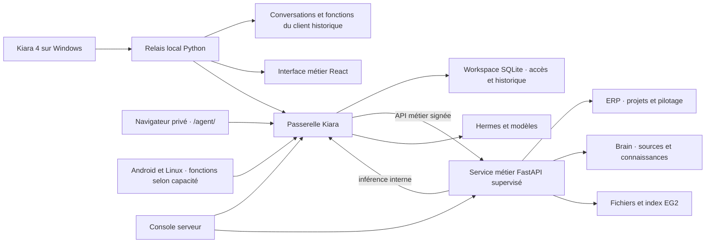

# Audit de la fusion Kiara

15 novembre 2026

Kiara a déjà une identité d’accès commune et peut présenter le même portefeuille dans Conversations et dans l’espace métier. La fusion reste incomplète à trois endroits. Le bureau change de document et de navigation pour passer aux fonctions métier. Deux implémentations savent gérer des projets, des documents et des conversations liées à un projet. La chaîne de livraison décrit imparfaitement la composition de Kiara 4. La priorité est donc de stabiliser ce qui fait autorité pour chaque donnée, puis de réunir les parcours dans une seule interface Kiara.

[Plan détaillé de finalisation](PLAN.md)

## Périmètre et état de référence

- Dépôt local `D:\Serveur IA`, branche `main`, commit de référence `97e15e7`. Le travail local est plus récent que ce commit. Au début de l’audit, 72 fichiers suivis étaient modifiés et le dossier `agent/` représentait 884 fichiers non suivis et non ignorés. Des sources Tauri et des modules de passerelle étaient également non suivis. L’inventaire de livraison doit isoler les sources de toute donnée locale avant leur intégration à Git.
- Le dépôt Git autonome `E:\Agent` existe encore, sur `main` à `0c2e08a`. La comparaison avec l’intégration Kiara porte sur 431 fichiers source suivis de `app`, `backend`, `web/src` et `extensions`, hors tests, fins de ligne normalisées. **327 sont identiques, 100 divergent et 4 anciens fichiers multimodaux sont absents de Kiara.** Le port historique 8001 n’était pas en écoute et la tâche d’ouverture de session Kiara observée ne référence pas ce dépôt. Les dépendances de tous les raccourcis et procédures de reconstruction restent à vérifier avant archivage. Le runtime Python et les données sur E: ont leurs propres emplacements et doivent être inventoriés séparément.
- Console locale sur 8765 joignable. Son API de distribution annonce **serveur 3.5.63** et **client Windows 4.0.5**, avec vérification positive du manifeste. Le fichier `D:\Kiara\Kiara\Kiara.exe` porte la version **4.0.4** dans ses métadonnées. La version annoncée et ce fichier précis décrivent deux états distincts. Le chemin de l’application utilisée par Fred reste à établir.
- La passerelle 8766 demande une authentification pour `/v1/status`. Le moteur local sur 8080 est chargé et annonce une capacité de 524 288 tokens. Les anciens chiffres et chemins de la [documentation d’architecture](../../ARCHITECTURE-ACTUELLE.md) doivent être rapprochés de l’inventaire d’exploitation.
- La [recette de sauvegarde du 15 novembre](<D:/Kiara/integration-agent/verification-kiara/recette-sauvegarde-automatique.log>) consigne une paire locale et NAS vérifiée, 11 projets ERP, 39 038 passages EG2 et 3 032 fichiers restaurés. Ces chiffres constituent le jalon de cette recette. La comparaison avant migration se fera sur une nouvelle copie datée.
- `agent/app/services/backup.py` et `agent/tests/test_project_note_backup.py` sont présents et exempts d’octets nuls au contrôle de ce jour. Leur comportement doit être couvert dans la recette de référence.

## Architecture actuelle

| Domaine | Implémentation et dépendances | Conséquence pour la fusion |
| --- | --- | --- |
| Démarrage | La console construit la passerelle et supervise un processus FastAPI local. Ce dernier vérifie les deux bases, son stockage et les racines de documents. Les workers et runtimes spécialisés ont leur propre cycle de vie. [Lanceur](../../lanceur/app.py#L61) · [Supervision](../../lanceur/agent_service.py#L334) · [Démarrage FastAPI](../../agent/app/main.py#L71) | Une seule entrée d’exploitation peut conserver des processus isolés. Harmoniser santé, configuration, diagnostic et redémarrage autour de Kiara. |
| Identité | Le code Kiara identifie l’appareil. Une habilitation stockée dans Workspace ajoute rôle, projets, personne et éventuel ancien opérateur. La passerelle signe le contexte transmis au service, qui applique ensuite le périmètre ERP/Brain. Le web privé utilise un cookie sécurisé. [Habilitations](../../lanceur/agent_access.py#L37) · [Passerelle](../../lanceur/agent_gateway.py#L132) · [Périmètre](../../agent/app/services/project_access.py#L170) · [Web privé](../../lanceur/agent_web.py#L66) | Unifier l’écran de gestion des accès. Conserver la vérification du périmètre dans chaque opération et pendant les flux longs. |
| Projets | Workspace peut lister ses projets privés, ou projeter le catalogue ERP lorsqu’il est configuré. La création, l’archivage et certaines opérations se redirigent vers l’ERP. Le client et le serveur déduisent une partie du routage de la forme UUID. [Projection](../../lanceur/workspace.py#L302) · [Routage](../../lanceur/workspace.py#L555) · [Détection côté client](../../client-qwen/workspace.html#L52) | Déclarer un identifiant et des capacités explicites. Recenser les projets historiques invisibles en mode catalogue, et traiter leur rattachement avant de retirer l’écriture historique. |
| Pilotage métier | ERP porte le portefeuille, les identités métier, les exigences CDC, le planning, l’atelier, les jalons, les revues et les livrables. Plusieurs routes déclarées dans FastAPI viennent de `backend/app`. [Montage des routes](../../agent/app/main.py#L190) | Conserver la sémantique métier et les IDs ERP. Traiter chaque ancien onglet comme une vue contextuelle à reclasser, avec un lien direct conservé. |
| Documents et recherche | Workspace gère ses documents privés, révisions, index et sources. Le service métier gère notes, versions, dépôts, publications, pièces jointes, originaux, mails et transcriptions. Brain et EG2 fournissent recherche et preuves. La passerelle sait déjà rechercher dans un projet métier depuis Conversations. [Contexte](../../lanceur/workspace.py#L439) · [Recherche unifiée métier](../../agent/app/services/unified_search.py) · [Lecteur de preuves](../../agent/web/src/components/WorkspaceViews.tsx#L131) | Rassembler l’accès et le modèle de citation. Préserver original, version, empreinte, locator, périmètre et historique, y compris pour les citations déjà diffusées. |
| Conversations | Kiara gère copie locale, brouillon, historique serveur, annulation et reprise de tour. Le panneau Assistant de l’interface métier utilise son propre flux et son propre historique avec mode éphémère activé par défaut. Les publications liées aux projets ERP passent par une route dédiée. [Conversation Kiara](../../client-qwen/chat.html#L210) · [Assistant projet](../../agent/web/src/components/AssistantPanel.tsx#L72) · [Données métier exposées à Kiara](../../agent/app/routers/kiara_admin.py) | Définir un modèle de fil privé, éphémère ou publié, avec portées explicites. Rapprocher les parcours sans changer silencieusement la confidentialité. |
| Mémoire et événements | Mémoire personnelle et rappels sont côté Workspace. Certaines mémoires projet et publications sont déléguées. Les événements de transcription sont projetés dans les notifications Kiara, avec contrôle du périmètre et invalidation côté client. [Commandes](../../lanceur/assistant_commands.py) · [Mémoire et publication par projet](../../lanceur/workspace.py#L567) · [Notifications](../../lanceur/notifications.py#L257) | Garder états de lecture, déduplication, préférences et liens directs. Faire converger le catalogue des actions et des événements, avec une seule règle pour chaque écriture. |
| Inférence et traitements | Strata/Hermes répondent aux conversations. Le service métier appelle la passerelle par une identité interne et possède son propre routage et ses files pour les tâches métier. Les traitements incluent extraction, recherche vectorielle, OCR et transcription. [Identité interne](../../lanceur/remote.py#L494) · [Configuration du service](../../lanceur/agent_service.py#L369) · [Routage](../../agent/app/services/ai_routing.py) | Publier une santé commune et aligner les budgets par charge. Garder files durables, consentement de repli et isolation des différents moteurs. |
| Mails et réunions | Le relais embarque la liaison Thunderbird appairée à un poste et la capture WASAPI. Le navigateur privé et le client natif n’exposent pas les mêmes capacités. La capture conserve les fragments pour reprise et assure l’envoi avec reçus. [Transport et capture](../../client-qwen/client.py#L525) · [Règles Thunderbird](../../lanceur/agent_gateway.py#L150) · [Recette Windows](../../client-tauri/README.md) | Montrer une seule vue Mails et une seule vue Réunions. Afficher les actions selon l’autorisation et les capacités réelles du poste. |
| Sauvegarde | La sauvegarde Kiara référence une archive compagnon chiffrée par taille et SHA-256. La copie NAS traite les deux fichiers. La console expose une restauration métier isolée et Workspace peut refuser une sauvegarde de projets historiques en mode catalogue. [Sauvegarde](../../lanceur/backups.py#L348) · [Restauration métier](../../lanceur/app.py#L500) · [Validation Workspace](../../lanceur/workspace.py#L814) | Une seule opération de sauvegarde et un seul état vérifié sur la totalité. Maintenir un lecteur des anciens formats et un retour arrière qui couvre les deux autorités. |
| Interfaces et livraison | Tauri encadre le relais local. Android génère son interface à partir des sources du client classique, puis applique ses adaptateurs. L’interface React est construite et livrée avec le serveur, et ses assets sont relayés au bureau et au web. [Tauri](../../client-tauri/src/main.rs) · [Générateur Android](../../client-android/scripts/Prepare-Assets.py#L67) · [Paquet serveur](../../maintenance/package_server.py) | Définir la matrice versions du serveur, du bundle métier, du relais, du client et des enveloppes. Qualifier explicitement les fonctions par plateforme. |

## Constats à traiter

| Priorité | Constat | Correctif à préparer |
| --- | --- | --- |
| P0 avant bascule | L’absence de table de correspondance peut rendre orphelins documents, conversations, mémoires, notifications et liens de projets historiques. La restauration Workspace refuse certains anciens projets quand le catalogue est activé. | Produire une migration à blanc, énumérer les écarts, effectuer une restauration intégrale sur copie et valider les correspondances avant toute bascule. |
| P0 avant livraison | Des sources de l’intégration existent uniquement dans l’état local observé. `build_manifest.py` inclut des fichiers non suivis autorisés et le frontend métier dans le composant serveur. Son périmètre Windows ne cite pas `client-tauri` et son filtre général n’inclut pas `.rs`. | Réconcilier Git, sources, dépendances, build et manifestes. Examiner les divergences du dépôt autonome avant de le placer en archive. Relier le paquet serveur, le frontend, l’installateur Windows, le relais, le pont et le helper de capture à un état de source reconstruisible et associer la preuve à chaque empreinte. [Périmètre du manifeste](../../maintenance/build_manifest.py#L12) |
| P1 | L’ancienne rubrique ouvre un autre document après sauvegarde de l’historique et fin de la voix. Le retour porte le nom « Conversations » dans la deuxième barre latérale, et les deux onglets Projets exposent des actions différentes. | Navigation et détails projet communs, garde unique des changements en cours, lien direct vers la bonne section sans écran intermédiaire. [Changement de document](../../client-qwen/ui.js#L14) · [Barre métier](../../agent/web/src/components/WorkspaceShell.tsx#L246) |
| P1 | Trois surfaces affichent l’aide et la configuration selon des déplacements différents. Les sources, les informations et les analyses métier sont accessibles dans Réglages, tandis que Réunions a aussi un écran global, des revues dans le projet et une section de préparation dans Autres réglages. | Mettre l’action à l’endroit où elle est utilisée. Réserver Réglages aux préférences et connexions. [Menu et réglages](../../agent/web/src/components/WorkspaceShell.tsx#L31) · [Vues projet](../../agent/web/src/lib/workspaceNavigation.ts#L2) |
| P1 | Les deux recherches et les deux historiques de discussion rendent le périmètre et le devenir d’un échange difficiles à prévoir. | Un point d’entrée Conversations et une recherche qui indique clairement son périmètre. Les recherches dans l’historique restent filtrables et les preuves restent consultables. |
| P1 | Android masque les actions qui ouvrent l’interface métier dans son WebView. Les notifications de transcription suivent un chemin spécifique selon la plateforme. | Vérifier les actions et liens réellement disponibles, publier la matrice, prévoir l’ouverture autorisée ou proposer une action équivalente. [Détail projet](../../client-qwen/workspace.html#L66) · [Notifications](../../client-qwen/workspace.html#L360) |
| P1 | Le point d’entrée `verify_project.py` couvre le lanceur et les clients historiques, sans groupe explicite pour le backend métier, son frontend et le client Tauri. | Faire remonter ces suites, les sauvegardes restaurées, les contrôles d’accès et les parcours de l’installeur dans le même rapport. [Groupes actuels](../../maintenance/verify_project.py#L35) |
| P2 | Les styles divergent au passage de Conversations à Projets. Conversations utilise une barre gris clair, un bouton principal foncé et des réglages de lecture propres. Les écrans métier utilisent une barre latérale blanche en clair, un fond bleuté, un accent vert et des contrôles plus denses et des variables de thème distinctes. Le style clair de la console est déjà proche de Conversations, avec ses propres variables. | Reprendre le langage visuel de Conversations. Partager les variables, le chrome et les composants d’action. Garder la densité des tableaux et des plannings. [Style client](../../client-qwen/ui.css#L1) · [Style métier](../../agent/web/src/workspace-shell.css#L2) · [Console](../../lanceur/web/interface.css#L2) |
| P2 | `App` monte directement `WorkspaceShell`, alors que le même fichier contient aussi l’ancien bureau, le dock, le menu et les préférences associées. Le bundle métier reconstruit pèse environ 1,11 Mo de JS minifié et 304 ko de CSS. | Prouver les usages à partir du graphe d’imports et des recettes, retirer les surfaces abandonnées et charger les gros modules à la demande. [Point de montage](../../agent/web/src/App.tsx#L96) · [Ancien menu](../../agent/web/src/App.tsx#L3011) |
| P2 | Le nom d’origine est encore présent dans les titres, la connexion web, les erreurs, l’action de retour, les téléchargements, l’aide et la documentation. Il couvre aussi des protocoles et des formats historiques. | Éliminer le nom du produit et de ses textes actifs, puis traiter les anciens contrats par adaptateurs et lectures compatibles. Établir les preuves de retrait au dernier lot. |

Les P0 ci-dessus sont des conditions de migration et de livraison. Aucun incident de perte de données n’a été reproduit lors de cet audit.

## Revue des textes et de la navigation

| Emplacement | Texte ou contrôle | Décision proposée |
| --- | --- | --- |
| [En-tête client](../../client-qwen/chat.html#L3) | « Accès serveur Kiara » et « Votre espace de travail » | Afficher « Kiara » dans le bandeau commun. Réserver l’état d’accès à Connexion. |
| [Conversation vide](../../client-qwen/chat.html#L12) | « VOTRE ESPACE POUR AVANCER », titre, paragraphe et suggestions | Supprimer le surtitre et le paragraphe. Rendre le champ de message accessible immédiatement. Garder une suggestion contextuelle quand elle aide à démarrer. |
| [Rubrique homonyme](../../client-qwen/ui.js#L13) · [Projet](../../client-qwen/workspace.html#L7) | « Agent », « Ouvrir dans Agent », « Ouvrir la source dans Agent » | Supprimer l’entrée parallèle. Ouvrir le détail depuis Projets et utiliser « Voir la source » dans les résultats et citations. |
| [Barre métier](../../agent/web/src/components/WorkspaceShell.tsx#L241) | « Espace de travail », sélection de projet, favoris, fil d’Ariane et en-tête de projet | Garder un retour à Projets et le nom du projet affiché. Le sélecteur et les favoris rejoignent la liste Projets. |
| [Réglages métier](../../agent/web/src/components/WorkspaceShell.tsx#L271) | Huit onglets, puis six choix « Autres réglages » | Regrouper les préférences par action. Déplacer Sources vers Documents, Suivi des analyses vers Activité et Maintenance vers Administration. |
| [Assistant](../../agent/web/src/components/AssistantPanel.tsx#L189) | « Nouvelle discussion » dans un panneau métier et « Nouvelle conversation » côté client | Utiliser « Nouvelle conversation ». Depuis un projet, proposer « Poser une question » avec le projet prérenseigné et un indicateur « Éphémère » quand applicable. |
| [Console](../../lanceur/web/index.html#L60) | « Accès à Agent » et « Configurer Agent » | Mettre « Projets autorisés » et le rôle dans la fiche de l’appareil. Garder la révocation, les personnes associées et la confirmation. |
| [Page de connexion privée](../../lanceur/agent_web.py#L95) | « Agent · Kiara » et « Ouvrir Agent » | « Kiara » et « Se connecter ». Le téléchargement vit dans une action distincte, avec son avertissement de signature tant qu’il s’applique. |
| [Erreurs de projet et sauvegarde](../../lanceur/workspace.py#L439) · [Console](../../lanceur/app.py#L500) | Nom interne du service dans le message et état technique brut | « Projets indisponibles », « Réessayer », ou message précis de restauration. Consigner le composant, l’empreinte et le diagnostic dans la console. |
| [Approbations](../../client-qwen/chat.html#L188) · [Récupération](../../client-qwen/chat.html#L195) | Accord nécessaire, historique plein, export et durée de récupération | Conserver la décision explicite, le refus, l’action de récupération et la durée. Alléger la présentation autour de ces informations. |

### Parcours et captures

| Parcours | Observation | Captures de recette |
| --- | --- | --- |
| Conversations → espace métier → Conversations, 1440×900 | Deux documents, deux barres et deux identités visuelles. Le retour aboutit à `/chat`. | [Conversations](captures/01-conversations.png) · [Accueil métier](captures/02-accueil-projets.png) |
| Projets et dossier fictif, 1440×900 | Les sept rubriques de la fiche ont été ouvertes. Le projet se répète dans le fil d’Ariane, la liste locale et son en-tête. | [Navigation du projet](captures/03-projet.png) |
| Mails, Réunions et Assistant | La navigation vers Mails a été ouverte. Réunions affiche un état vide et un panneau de conversation distinct. La panne simulée du portefeuille affiche un message d’erreur et « Réessayer ». | [Réunions et assistant](captures/05-assistant.png) |
| Réglages et console | Réglages mène à Sources, Informations, Suivi des analyses et Connexions & imports, puis ouvre six choix supplémentaires. La console affiche l’habilitation dans un panneau indépendant, avec quinze destinations dans sa barre après initialisation. | [Réglages métier](captures/06-reglages.png) · [Habilitations de la console](captures/07-acces-console.png) |
| Thème sombre, 1440×900 | Choisir Sombre dans Conversations puis ouvrir l’espace métier laisse ce dernier en clair. Un deuxième réglage y applique le sombre. | [Conversations en sombre](captures/08-conversations-sombre.png) · [Écran ouvert ensuite](captures/09a-projets-apres-bascule.png) |
| Fenêtres de 768×1024 et 390×844 | Les vues Conversations et Projet vérifiées tiennent dans la largeur de la page. Dans les deux vues, Échap ferme le panneau et rend le focus à son bouton. | [Conversation étroite](captures/conversation-390.png) · [Projet étroit](captures/projet-390.png) |

## Validation effectuée

- Chrome headless avec Playwright en dehors du profil de Fred. Passerelle, service métier, relais et console sur ports locaux temporaires, WireGuard de recette, moteur simulé, bases neuves, un projet fictif, workers métier désactivés. Les noms et routes des interfaces proviennent de leurs sources et du bundle affiché. Les empreintes SHA-256 du CSS et du JS d’entrée reconstruits avec Vite correspondent au bundle testé.
- Recettes automatisées locales **28 tests Python ciblés** sur les accès, la passerelle, le web privé et le transport du relais, **17 tests Python de sauvegarde et restauration des notes**, **1 035 tests frontend réussis** dans 99 fichiers et compilation Vite réussie. TypeScript sans émission, contrôle des assets Android et recette UI de l’habilitation (périmètre, rattachement, révocation) réussis.
- L’inventaire de code couvre Windows, web privé, console, Android, Linux, voix, stockage, sauvegarde et livraison. Les contrôles de navigateur couvrent l’interface avec données fictives. Les installateurs, appareils physiques, traitements audio et conversions de production restent dans la matrice de recette du plan.
