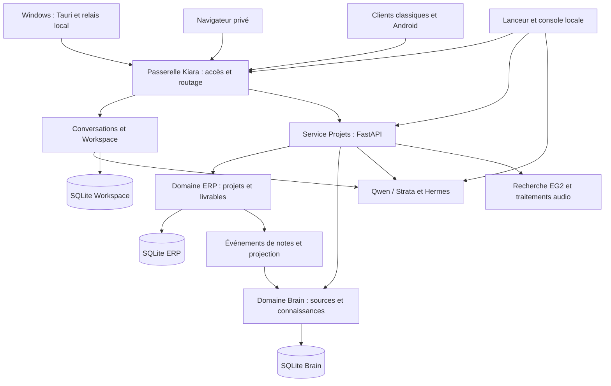

# Audit Kiara — architecture, interface et rationalisation

16 novembre 2026 · Dépôt `D:\Serveur IA` · Référence `0bf3b3e8234188f020ddb0530ee705437f702146` (Kiara 4.0.8).

**Conclusion.** Conserver le monolithe modulaire et les moteurs séparés. La priorité est de réduire le travail effectué par les écrans invisibles, de clarifier les responsabilités entre domaines et de rendre les contrôles transversaux réellement communs. La fusion est aboutie sur plusieurs parcours, mais trois familles d’interface et plusieurs autorités de données restent coordonnées par des modules très chargés. Une évolution par petits lots est adaptée.

**Périmètre et limites.** Lecture de l’architecture, du lanceur, de la passerelle, des deux domaines métier Python, du portail React, de l’enveloppe Tauri, des contrôles de qualité et de la distribution. Inspection approfondie d’un échantillon ; ce rapport ne certifie pas l’ensemble du dépôt. Les mesures et captures utilisent un bundle construit depuis les sources courantes, servi sur une adresse de boucle locale à port dynamique, avec des réponses HTTP fictives. Aucune modification du code applicatif, de la production, des bases, des accès ou des services. Aucun commit.

Les écrans effectivement parcourus sont Projets, Recherche et Accès rapide. États de portefeuille normal, vide, filtre sans résultat, indisponibilité et reprise ; thèmes clair/sombre ; fenêtres de 1440×900, 768×1024 et 390×844. Les fiches de projet utilisent une indisponibilité simulée pour mesurer leur activité après navigation. Les écrans métier détaillés, Conversations, Mails, Réunions et la console font l’objet d’une lecture de sources ou de tests ciblés, sans validation visuelle exhaustive. Aucun microphone, téléphone physique, import Sage, sauvegarde réelle, restauration, inférence ou réseau distant testé.

Playwright MCP n’est pas exposé dans cette session ; son inspection CLI a échoué par refus d’accès à l’exécutable Codex. La recette emploie la bibliothèque Playwright déjà installée dans le projet. Les premiers ajustements des réponses fictives et du scénario ne constituent pas des défauts de production ; seuls les résultats de la dernière exécution sont conservés dans `interface.json`.

## Architecture observée

Le schéma résume les responsabilités ; il ne représente pas chaque transport ni chaque base auxiliaire. Sources : [service Projets](<D:/Serveur IA/agent/app/main.py>), [passerelle](<D:/Serveur IA/lanceur/remote.py>), [Tauri](<D:/Serveur IA/client-tauri/src/main.rs>), [Workspace](<D:/Serveur IA/lanceur/workspace.py>).

Les bases distinctes ont des fonctions légitimes. ERP porte la gestion des projets ; Brain les sources et connaissances ; Workspace les accès, historiques et espaces privés. La simplification utile consiste à définir une autorité unique par objet et des interfaces explicites entre domaines. Fusionner physiquement les bases n’est pas un préalable.

**Points solides à préserver :** paquet `kiara_shared`, contrôles de révision, identifiants de commandes, migrations avec sauvegarde préalable, séparation des moteurs, activation des workers par groupe et traitement récupérable des notes entre ERP et Brain. Le mécanisme [outbox des notes](<D:/Serveur IA/agent/backend/app/services/note_evidence_outbox.py>) et son [consommateur](<D:/Serveur IA/agent/app/services/note_evidence_bridge.py>) constituent une bonne base pour les échanges asynchrones. Le client IA possède déjà un ordonnanceur : il faut l’instrumenter et le rendre lisible, pas introduire une deuxième file concurrente.

**Taille indicative.** 7 086 fichiers suivis et 207 fichiers suivis à la racine. Les sept périmètres de sources examinés représentent 94 019 lignes physiques, hors tests selon le filtre documenté par la recette. Ce chiffre comprend CSS, HTML et commentaires ; il ne mesure pas la complexité à lui seul. Détails dans [metrics.json](<D:/Serveur IA/audits/2026-11-16-architecture-interface/metrics.json>).

| Fichier | Taille | Indice de concentration |
|---|---:|---|
| `agent/web/src/App.tsx` | 1 715 lignes, 87 Ko | 107 occurrences de `useState` réparties entre les composants du fichier |
| `WorkspaceShell.tsx` | 348 lignes, 39 Ko | 25 états et 20 effets ; beaucoup de JSX compacté |
| `MeetingStudio.tsx` | 871 lignes, 80 Ko | 41 états et 13 effets |
| `lanceur/remote.py` | 1 169 lignes, 77 Ko | accès, distribution et transport dans le même module |
| `lanceur/workspace.py` | 877 lignes, 65 Ko | stockage central et orchestration malgré des extractions existantes |

## Constats et propositions

Priorités : **P1** à traiter dans le prochain lot de fiabilisation ; **P2** amélioration structurante ou ergonomique ; **P3** entretien. Aucun P0 établi dans le périmètre vérifié. Les priorités représentent une décision d’audit, pas une mesure de panne en production.

### A01 — P1 : les projets quittés continuent leurs interrogations réseau

**Confirmé par code et navigateur.** `WorkspaceShell` conserve toutes les vues visitées dans `visited` et masque les anciennes par `hidden`. `ProjectWindow` n’a pas de propriété `active` et monte toujours `useCdcJobs`. Ce hook interroge le serveur toutes les deux secondes, sans consulter la visibilité, même quand la liste de travaux est vide.

Preuves : [WorkspaceShell.tsx:145](<D:/Serveur IA/agent/web/src/components/WorkspaceShell.tsx:145>), [WorkspaceShell.tsx:310](<D:/Serveur IA/agent/web/src/components/WorkspaceShell.tsx:310>), [App.tsx:1657](<D:/Serveur IA/agent/web/src/App.tsx:1657>), [useCdcJobs.ts:26](<D:/Serveur IA/agent/web/src/hooks/useCdcJobs.ts:26>), [trace navigateur](<D:/Serveur IA/audits/2026-11-16-architecture-interface/interface.json>).

Après ouverture puis fermeture par navigation de deux fiches, **quatre requêtes CDC en 4,709 secondes**, les deux vues restant montées. Les fiches étaient volontairement indisponibles dans la simulation et les listes de jobs vides. Le code explique également le comportement lorsque la fiche est disponible. À intervalle constant, 11 projets visités représenteraient environ 330 requêtes/minute pour ce seul hook : projection arithmétique, pas mesure de production.

**Correction proposée.** Transmettre `active` aux fiches et aux hooks, suspendre les lectures quand la vue ou le document est caché, ralentir quand aucun travail n’est actif et borner les vues conservées. Conserver explicitement les brouillons et les captures audio actives avant toute éviction. Une notification globale peut suivre les traitements côté serveur sans maintenir chaque écran.

**Acceptation.** Aucun appel périodique propre à une fiche inactive ; une actualisation au retour ; travail en cours toujours visible dans Activité ; brouillon intact après 20 navigations ; aucun arrêt de capture provoqué par le changement d’écran.

### A02 — P1 : les contrôles UX des interfaces suivent deux circuits

**Confirmé par code.** Le contrôle racine couvre le client classique, Android et la console, mais pas `agent/web/src`. Le portail possède un analyseur TypeScript séparé. `verify_project.py` inclut TypeScript, Vitest et Vite dans `business-web`, mais n’appelle pas cet analyseur UX React. Il existe donc une couverture web réelle, avec une lacune précise dans l’agrégation des contrôles UX.

Preuves : [ux-check.json:2](<D:/Serveur IA/maintenance/ux-ui/ux-check.json:2>), [verify_project.py:50](<D:/Serveur IA/maintenance/verify_project.py:50>), [analyseur React](<D:/Serveur IA/agent/scripts/ux-quality-check.mjs>), [résultat](<D:/Serveur IA/audits/2026-11-16-architecture-interface/ux-react.json>).

L’analyseur React produit **50 avertissements**. Ce sont des candidats à examiner, pas 50 défauts confirmés. Exemple vérifié : les champs « Nouvelle action » et « Pilote » utilisent uniquement des placeholders, sans label explicite ([App.tsx:1446](<D:/Serveur IA/agent/web/src/App.tsx:1446>)).

**Correction proposée.** Ajouter les contrôles React et leurs tests au point d’entrée commun, avec un résultat par plateforme. Conserver les avertissements heuristiques consultatifs ; réserver les échecs bloquants aux règles déterministes et aux parcours réellement cassés.

**Acceptation.** Une commande produit un bilan lisible serveur / portail / Windows / Android ; le rapport indique explicitement ce qui n’a pas été exécuté.

### A03 — P2 : le portefeuille mobile perd des informations utiles

**Confirmé visuellement et par CSS.** À 390 px, le titre reste lisible mais l’état se trouve partiellement hors de la zone affichée. Le tableau conserve une largeur minimale ; sous 520 px, les colonnes Avancement et Prochaine étape sont masquées. La prochaine étape ne devient donc pas accessible par simple défilement horizontal. Il n’y a pas de débordement horizontal de la page entière dans la recette.

Preuves : [capture téléphone](<D:/Serveur IA/audits/2026-11-16-architecture-interface/projets-mobile.png>), [tablette](<D:/Serveur IA/audits/2026-11-16-architecture-interface/projets-tablet.png>), [workspace-shell.css:113](<D:/Serveur IA/agent/web/src/workspace-shell.css:113>), [project-kiara-preview.css:117](<D:/Serveur IA/agent/web/src/project-kiara-preview.css:117>).

**Correction proposée.** Sur petit écran, conserver une ligne compacte par projet : titre, client, état, prochaine échéance ; mettre les chiffres secondaires dans le détail. Garder le tableau dense sur ordinateur. Une ligne cliquable avec un vrai lien permettrait aussi l’ouverture dans un nouvel onglet ; actuellement l’ouverture du projet se fait par bouton.

**Acceptation.** À 390 px et en zoom 200 %, identifier un projet, son état et sa prochaine échéance sans défilement latéral. Tous les détails restent disponibles dans la fiche.

### A04 — P2 : une seule unité de chargement pour tout le portail

**Mesuré sur une compilation neuve.** Le bundle produit un seul JavaScript de **1 098 886 octets**, soit environ **307 Ko gzip**, et **270 Ko de CSS**, environ **48 Ko gzip**. Vite signale un chunk supérieur à 500 Ko. Cela n’établit pas à lui seul une lenteur ressentie : aucun test de réseau mobile ou profil CPU utilisateur n’a été réalisé.

`App.tsx` importe directement de nombreux panneaux métier. Le dépôt compte 28 feuilles CSS dans le périmètre React. Preuve : [App.tsx:1](<D:/Serveur IA/agent/web/src/App.tsx:1>) et compilation de la recette.

**Correction proposée.** Charger à la demande Réunions, CDC, documents complexes et réglages ; garder la navigation et le portefeuille dans le socle initial. Extraire les composants de `App.tsx` avant le découpage pour éviter des imports circulaires. Vérifier aussi les imports de barres globales depuis les gros modules métier.

**Acceptation.** Relevé avant/après des ressources chargées pour Projets, puis première ouverture de Réunions ; aucune régression de brouillon ou de capture ; budget initial déterminé à partir du premier découpage, sans objectif arbitraire de score.

### A05 — P2 : orchestration et état métier trop concentrés

**Confirmé par lecture et métriques.** Le nombre de lignes sous-estime la taille de certains fichiers, dont de longues lignes JSX portent plusieurs responsabilités. `App.tsx` regroupe portefeuille, fiche, mails, imports et sous-vues ; le shell gère route, cache, thèmes, recherche, captures et préférences.

**Correction proposée.** Organiser progressivement le frontend par fonctionnalités : `projects`, `mail`, `meetings`, `search`, `settings`, avec composants et hooks proches. Limiter le shell à navigation, disposition et état global. Pour `MeetingStudio`, extraire un contrôleur de séance à transitions explicites (préparation, capture, pause, conservation, transcription, publication), en réutilisant les états serveur existants.

Côté serveur, poursuivre les extractions de handlers de `remote.py` vers des modules de routes, en conservant les contrôles communs d’accès, de bornes et de quota. Garder Workspace responsable des transactions plutôt que répartir une même transaction entre plusieurs dépôts.

**Acceptation.** Chaque extraction conserve les mêmes contrats ; tests de révision, annulation, reprise et permissions passent ; pas de gros déplacement simultané de l’ensemble des fichiers.

### A06 — P2 : frontières ERP / Brain à rendre explicites

**Constat d’architecture, pas preuve de corruption.** `agent/app/main.py` assemble `app` et `backend.app`. Les deux domaines utilisent leurs bases et modèles. Des services importent directement les sessions ou modèles de l’autre domaine ; le pont de notes en fournit un exemple explicite.

**Correction proposée.** Documenter, pour chaque objet, identifiant canonique, propriétaire, révision, projection et politique de suppression. Introduire des interfaces ciblées entre domaines et généraliser, quand une synchronisation fiable le demande, le mécanisme récupérable déjà utilisé pour les notes. Ne pas multiplier les représentations persistantes d’un même objet sans règle de reconstruction.

**Acceptation.** Un tableau d’autorité des données ; essais d’interruption et rejeu pour les échanges modifiés ; aucune décision de fusion des bases avant d’avoir mesuré les coûts et répété une migration réversible.

### A07 — P2 : deux expériences de recherche au vocabulaire presque identique

**Confirmé par parcours.** Le champ principal et Ctrl+K ouvrent une page Recherche. Le bouton « Accès rapide aux rubriques » ouvre une modale titrée « Rechercher dans Kiara », mélangeant rubriques, projets et résultats métier. La page Recherche utilise des filtres et une recherche de sources ; la modale utilise `api.search`. Les deux approches ont une utilité, mais leur intitulé ne rend pas la différence claire.

Preuves : [page Recherche](<D:/Serveur IA/audits/2026-11-16-architecture-interface/recherche.png>), [accès rapide](<D:/Serveur IA/audits/2026-11-16-architecture-interface/acces-rapide.png>), [WorkspaceShell.tsx:232](<D:/Serveur IA/agent/web/src/components/WorkspaceShell.tsx:232>), [SearchView.tsx](<D:/Serveur IA/agent/web/src/components/SearchView.tsx>).

**Correction proposée.** Nommer la modale « Aller à… » et la limiter d’abord à navigation et projets ; réserver « Rechercher » aux contenus, sources et preuves. Autre option à arbitrer : une palette unique avec catégories explicites. Conserver un raccourci stable, des liens profonds et un seul vocabulaire pour Sources / Documents / Informations.

**Acceptation.** Une personne comprend avant de saisir si elle cherche une rubrique ou un contenu ; aucun résultat n’apparaît hors du périmètre autorisé.

### A08 — P2 : les activités métier sont partiellement rangées dans Réglages

**Confirmé par code.** Sources, Informations et Suivi des analyses figurent dans `settingsPages`. La navigation principale reste courte — Projets, Mails, Réunions, Activité — ce qui est positif ; mais le classement de contenus consultables avec des paramètres complique leur découverte.

Preuve : [WorkspaceShell.tsx:44](<D:/Serveur IA/agent/web/src/components/WorkspaceShell.tsx:44>).

**Correction proposée.** Maintenir les quatre entrées principales. Dans un projet, conserver Vue d’ensemble / Pilotage / Documents / Réunions. Rendre les sources et informations accessibles depuis Documents et la recherche ; regrouper files de travaux, erreurs et relances dans Activité. Réserver Réglages aux préférences, connexions et modèles. Garder l’administration technique dans la console.

**Acceptation.** Trouver une source, une analyse en échec ou le document d’une réunion ne nécessite plus de connaître l’organisation interne. Les anciens liens restent redirigés.

### A09 — P2 : renforcer les limites d’erreur et les noms des champs

**Confirmé par code ; validation assistive complète non réalisée.** `main.tsx` entoure l’application d’une seule ErrorBoundary. Une exception de rendu dans un panneau remplace toute l’application par un écran de rechargement. Des frontières par rubrique permettraient de conserver navigation et état des autres espaces. Les réponses invalides de la première fixture ont illustré cette portée globale ; elles ne démontrent pas qu’un serveur réel envoie de telles réponses.

Les champs de création d’action cités dans A02 méritent des labels visibles. La liste CDC expose `listbox/option`, sans focus standard sur les options ; des raccourcis j/k et de validation existent déjà. Il serait incorrect d’affirmer que la fonction n’a aucun accès clavier. Améliorer la sémantique, la navigation par flèches et la visibilité des raccourcis, après recette clavier et lecteur d’écran.

Preuves : [main.tsx:8](<D:/Serveur IA/agent/web/src/main.tsx:8>), [ErrorBoundary.tsx](<D:/Serveur IA/agent/web/src/components/ErrorBoundary.tsx>), [CdcReviewPanel.tsx:183](<D:/Serveur IA/agent/web/src/components/CdcReviewPanel.tsx:183>), [CdcReviewPanel.tsx:322](<D:/Serveur IA/agent/web/src/components/CdcReviewPanel.tsx:322>).

**Acceptation.** Une erreur de panneau n’empêche pas de naviguer ; les champs restent identifiables après saisie ; la liste de revue fonctionne au clavier avec focus explicite. Aucun engagement de conformité WCAG complète sans campagne dédiée.

### A10 — P2 : documentation « actuelle » encore mêlée à des profils historiques

**Confirmé.** Le document d’architecture daté du 16 novembre indique encore, dans la section Environnements, que Qwen conserve la RTX 4080 et les deux P100. L’inventaire Windows de cet audit ne présente que RTX 4080 et Quadro P2200. D’autres passages identifient correctement les profils anciens comme historiques. Ce mélange rend le document moins fiable pour une reconstruction.

Preuves : [ARCHITECTURE-ACTUELLE.md:81](<D:/Serveur IA/ARCHITECTURE-ACTUELLE.md:81>), [validation.json](<D:/Serveur IA/audits/2026-11-16-architecture-interface/validation.json>). L’inventaire matériel n’est pas un contrôle des modèles effectivement chargés.

**Correction proposée.** Séparer état installé, architecture cible et historique. Générer l’inventaire versions / chemins / GPU depuis les manifestes et contrôles en lecture seule, puis ajouter uniquement les décisions humaines. Réduire `CONTEXTE-PROJET.md` à une courte reprise avec liens vers les archives datées.

**Acceptation.** Une source de référence par information courante ; date de vérification visible ; aucune ancienne configuration présentée comme active.

### A11 — P2 : donner une lecture commune des sauvegardes

**Constat d’interface et proposition à qualifier.** Le portail Projets affiche un état de sauvegarde globale et une procédure hors ligne ; la console propose création et restauration de sauvegardes chiffrées. Ces mécanismes ont des périmètres distincts : leur coexistence n’est pas une preuve de sauvegardes défectueuses.

Preuves : [OperationsPanel.tsx:18](<D:/Serveur IA/agent/web/src/components/OperationsPanel.tsx:18>), [console](<D:/Serveur IA/lanceur/web/index.html>), [backups.py](<D:/Serveur IA/lanceur/backups.py>).

**Correction proposée.** Présenter un état commun : périmètre couvert, date de dernière réussite, copie secondaire, date de dernière restauration vérifiée et action nécessaire. Les exports projet et sauvegardes de migration restent identifiés séparément. Conserver les outils existants derrière cette présentation.

**Acceptation.** Pouvoir répondre sans ouvrir plusieurs pages : « quelles données sont couvertes, jusqu’à quand et où est la preuve de restauration ? ». La vérification réelle d’une paire d’archives fera l’objet d’une recette isolée distincte ; elle n’a pas été réalisée ici.

### A12 — P3 : clarifier le dépôt et la durée des compatibilités

**Confirmé par inventaire et documentation.** La racine contient 207 fichiers suivis, dont de nombreux essais anciens. La distribution conserve un client de transition et plusieurs plateformes ; les préfixes `/agent/` et `/kiara/` et configurations historiques restent acceptés.

**Correction proposée.** Établir une matrice de compatibilité avec propriétaire, utilisateurs restants, preuve de migration et condition de retrait. Ranger les essais historiques au fil des interventions, après vérification des références de scripts. Laisser les données, archives et clés hors des déplacements de code. Les noms internes `agent` et `minipilot` peuvent attendre : les renommer partout apporte moins de valeur que clarifier leurs contrats.

**Acceptation.** Démarrage et construction passent depuis la documentation ; aucun retrait avant migration des clients concernés ; aucune dépendance cachée à un ancien chemin.

## Plan proposé

Estimations indicatives en jours de travail effectif, à recalibrer après le premier lot. Elles incluent une validation ciblée, sans qualification matérielle complète ni attente de déploiement.

| Lot | Contenu | Effort indicatif | Critère de sortie |
|---|---|---:|---|
| 1 — Fiabilité observable | A01, A02, mise à jour ciblée A10 | 2–4 jours | Vues inactives silencieuses ; contrôles communs ; état courant cohérent |
| 2 — Parcours quotidiens | A03, A07, A08, labels et erreurs A09 | 4–7 jours | Portefeuille mobile utile ; recherche compréhensible ; Activité centralise les reprises |
| 3 — Maintenance durable | A04, A05, contrats A06, cadrage A11/A12 | 8–15 jours | Chargement par rubrique ; extractions limitées ; autorités documentées ; plan de retrait mesurable |

Le troisième lot doit être fractionné. Commencer par Projets, puis Réunions ; maintenir en parallèle les contrats du client classique et d’Android jusqu’à leur qualification. Une unification visuelle peut d’abord partager tokens, libellés et composants de base ; le remplacement complet du chat historique nécessite une décision distincte sur le hors-ligne, la voix et les mises à jour.

## Vérifications et preuves

| Vérification effectuée | Résultat | Limite |
|---|---|---|
| 5 fichiers Vitest : shell, navigation projet, connexion, persistance documents, portefeuille | 58 tests réussis | Mocks et jsdom ; pas une recette de production |
| TypeScript `--noEmit --incremental false` | Réussi | Contrôle statique |
| Vite, sources courantes, sortie isolée | Réussi, alerte de taille de chunk | Aucun benchmark de latence utilisateur |
| Contrôle des sources | 1 080 Python, 101 JavaScript, 103 PowerShell vérifiés dans chacun des deux shells | Syntaxe, pas couverture fonctionnelle |
| Analyse UX React | 50 avertissements à examiner | Heuristique ; seuls quelques cas recoupés |
| Navigateur, Projets / Recherche / Accès rapide | Réussi ; zéro `pageerror` sur la recette finale | Réponses API synthétiques |
| Menu mobile puis Échap | Focus rendu à « Ouvrir le menu » | Pas un audit complet du piège de focus |
| Modale Accès rapide puis Échap | Focus rendu à son bouton | Pas de lecteur d’écran |
| Ctrl+K | Ouvre Recherche | Recherche de données réelles non testée |
| Portefeuille en erreur puis Réessayer | Récupération confirmée | Indisponibilité simulée |
| Fenêtres 1440, 768 et 390 px | Aucun débordement global de page | Tableau mobile avec zone débordante et colonnes masquées |

La confiance Git a été fournie uniquement au processus des contrôles, sans modification de configuration globale. Le contrôle des sources a d’abord été bloqué par la propriété Windows héritée du dépôt, puis a réussi avec cette configuration temporaire.

Les critères d’interface ont été recoupés avec les [Web Interface Guidelines de Vercel](https://raw.githubusercontent.com/vercel-labs/web-interface-guidelines/main/command.md), adaptées aux règles françaises et métier du dépôt. Ils servent de guide ; une suspicion automatique n’est pas une preuve de non-conformité.

Preuves locales : [mesures et environnement](<D:/Serveur IA/audits/2026-11-16-architecture-interface/validation.json>), [requêtes et interactions](<D:/Serveur IA/audits/2026-11-16-architecture-interface/interface.json>), [métriques](<D:/Serveur IA/audits/2026-11-16-architecture-interface/metrics.json>), [syntaxe](<D:/Serveur IA/audits/2026-11-16-architecture-interface/sources.txt>), [avertissements React](<D:/Serveur IA/audits/2026-11-16-architecture-interface/ux-react.json>), [script de recette](<D:/Serveur IA/audits/2026-11-16-architecture-interface/audit-ui.cjs>).

Captures examinées : [ordinateur](<D:/Serveur IA/audits/2026-11-16-architecture-interface/projets-desktop.png>), [tablette](<D:/Serveur IA/audits/2026-11-16-architecture-interface/projets-tablet.png>), [téléphone](<D:/Serveur IA/audits/2026-11-16-architecture-interface/projets-mobile.png>), [sombre](<D:/Serveur IA/audits/2026-11-16-architecture-interface/projets-sombre.png>), [recherche](<D:/Serveur IA/audits/2026-11-16-architecture-interface/recherche.png>), [accès rapide](<D:/Serveur IA/audits/2026-11-16-architecture-interface/acces-rapide.png>), [erreur récupérable](<D:/Serveur IA/audits/2026-11-16-architecture-interface/projets-erreur.png>). Les captures ne contiennent que des données fictives.
