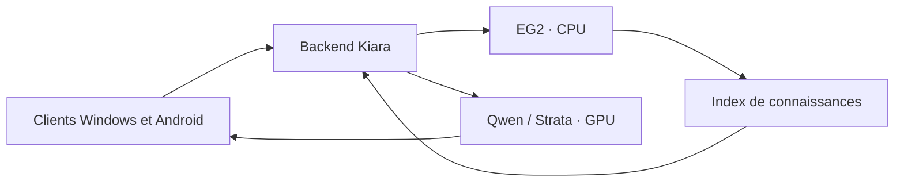

# Mémoire et connaissances — EmbeddingGemma 2

Intégration du 11 octobre 2026. Le backend Kiara pilote deux moteurs indépendants : Qwen via Strata pour les réponses, EmbeddingGemma 2 via Sentence Transformers/PyTorch pour retrouver les passages utiles. EG2 est installé dans son propre environnement Python et fonctionne sur CPU, avec deux threads. Son activation ou sa désactivation conserve Qwen chargé.



## Espaces de connaissances

Chaque accès personnel conserve ses propres données. Une question dans un projet recherche uniquement ses documents, souvenirs et conversations. Une question hors projet recherche uniquement les conversations hors projet et les souvenirs personnels de cet accès. Les projets archivés et discussions archivées, supprimées ou déplacées ne sont pas rappelés dans leur ancien espace. Une conversation liée à un projet inexistant ne devient pas une conversation personnelle.

Les conversations déjà synchronisées sont indexées automatiquement. Les pièces
jointes binaires, réflexions internes et réponses interrompues sont exclues.
Une ancienne réponse de l’assistant reste un échange passé, sans devenir un
souvenir confirmé. Depuis serveur/Windows 3.5.52 et Android 1.0.23/code 24,
les souvenirs se gèrent explicitement en conversation écrite ou orale et dans
**Mémoire et rappels**, dans l’espace Personnel ou un projet. La console conserve
ses outils d’administration. Voir le [guide commun](../GUIDE-ASSISTANT-KIARA.md).

Une préférence personnelle explicitement choisie pour tous les projets peut
s’appliquer dans leurs réponses ; elle ne donne pas accès aux autres conversations
ou documents personnels. Après correction ou oubli, les anciens passages
correspondants sont filtrés dans le contexte et la recherche. Les discussions
sources et archives conservées ne sont pas supprimées et toute paraphrase n’est
pas nécessairement masquée. Kiara porte la mémoire de référence ; la mémoire
native Hermes automatique est désactivée.

La séparation suit l’identité d’accès actuelle de Kiara. Deux accès distincts, même sur des appareils appartenant à la même personne, ont deux espaces distincts. Une copie du même profil partage son identité et son espace.

## Utilisation

Ouvrir la [console Mémoire et connaissances](http://127.0.0.1:8765/#knowledge). Elle affiche le moteur, la progression et les limites d’indexation. **Activer EG2** et **Désactiver EG2** pilotent uniquement le moteur mémoire. **Reconstruire l’index** efface le cache et le recalcule depuis les données originales.

Choisir un accès pour ajouter, modifier ou supprimer un souvenir personnel. Le formulaire de recherche permet de comparer les passages retrouvés hors projet ou dans un projet sélectionné. Les autres clients conservent leur contrat de chat actuel : le serveur ajoute automatiquement les passages pertinents au contexte envoyé à Qwen et retourne les sources consultables.

La recherche combine mots-clés et proximité sémantique, avec filtrage par accès et projet avant le classement. Le serveur revérifie chaque passage dans les données originales avant de l’utiliser. Une source supprimée ou modifiée est donc refusée immédiatement, même avant la prochaine indexation. Si EG2 est arrêté, occupé ou indisponible, la recherche par mots-clés reste disponible et Qwen continue de répondre.

## Installation et exploitation

Sur cette installation, les poids sont déjà téléchargés et le moteur activé. Pour réinstaller les composants locaux :

```powershell
.\Install-EG2.ps1
```

Le script crée `toolchain/eg2-python` sans modifier les dépendances Strata, puis télécharge `google/embeddinggemma-2`, révision `914f7f89142e33e77833254d9c9b90c3cef7303b`, dans `toolchain/eg2-model`. Le chargement et les calculs suivants sont hors ligne. Le service écoute seulement sur une adresse locale et exige un jeton interne éphémère ; les clients distants passent par les droits existants du backend.

Configuration : texte uniquement, float32, 768 dimensions normalisées, deux threads CPU, 2 048 jetons au plus par passage. Quatre passages sont indexés par lot ; les questions interactives ont priorité. Le processus s’arrête avec son parent et possède un garde-fou de RAM à 4 Gio. Après trois échecs de redémarrage, l’administrateur peut relancer depuis la console.

L’index est limité à 16 000 passages au total, 4 000 par accès et un budget logique de cache de 64 Mio. Le dépassement est affiché dans la console. L’indexation priorise les souvenirs, les documents actuels, puis les discussions. Les quotas de stockage des données originales restent applicables ; les souvenirs personnels sont limités à 50 par accès et 2 000 caractères chacun.

## Sauvegarde et mesures

La base originale `lanceur/espaces-prives/espaces.sqlite3` conserve les conversations, documents et souvenirs, y compris personnels, ainsi que le réglage d’activation EG2. Elle entre dans les sauvegardes chiffrées existantes. `connaissances-cache.sqlite3` est un cache privé reconstructible, exclu des archives ; il est vidé après restauration. Le moteur et ses poids se réinstallent séparément.

Sur les fixtures françaises : chargement d’environ 14 secondes, RAM du véritable processus autour de 1,63 Gio, huit courts passages indexés en 0,75 seconde. Les six questions reformulées retrouvent chacune la source attendue en premier. Les passages longs demandent davantage de temps ; ces mesures ne garantissent pas un débit sur tous les documents. L’impact pendant une génération Qwen simultanée n’a pas été mesuré.

Les preuves, contrôles d’isolation, parcours de console, sauvegardes avant/après et état réel du serveur sont dans [le rapport de validation](../preuves/eg2-20261011/VALIDATION.md).
